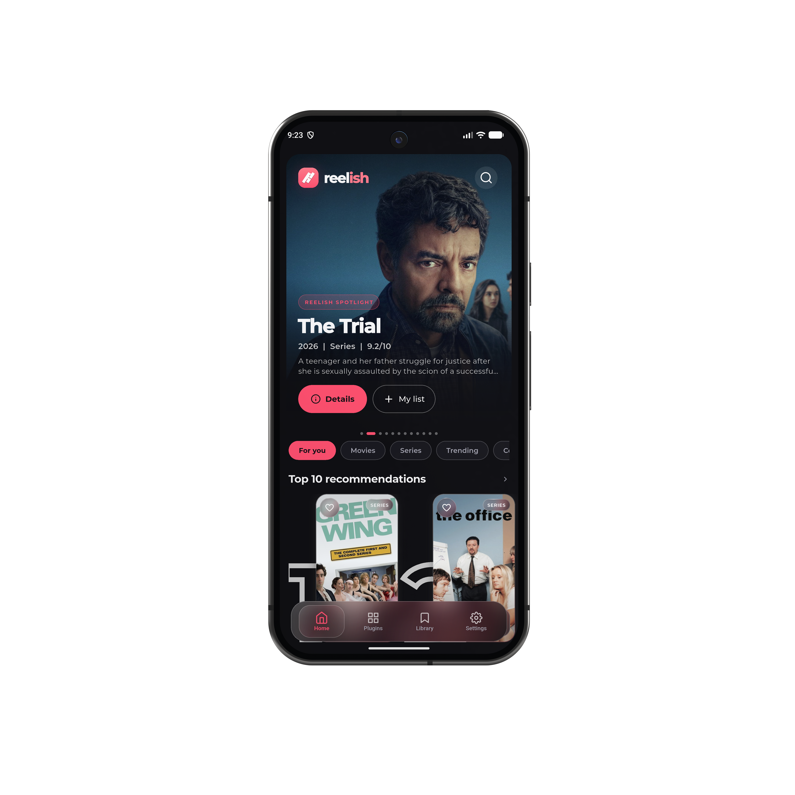
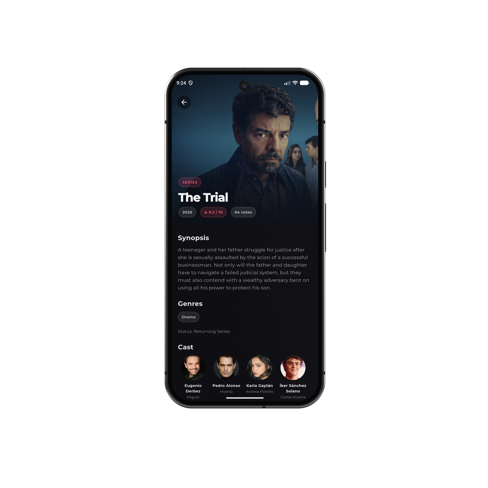
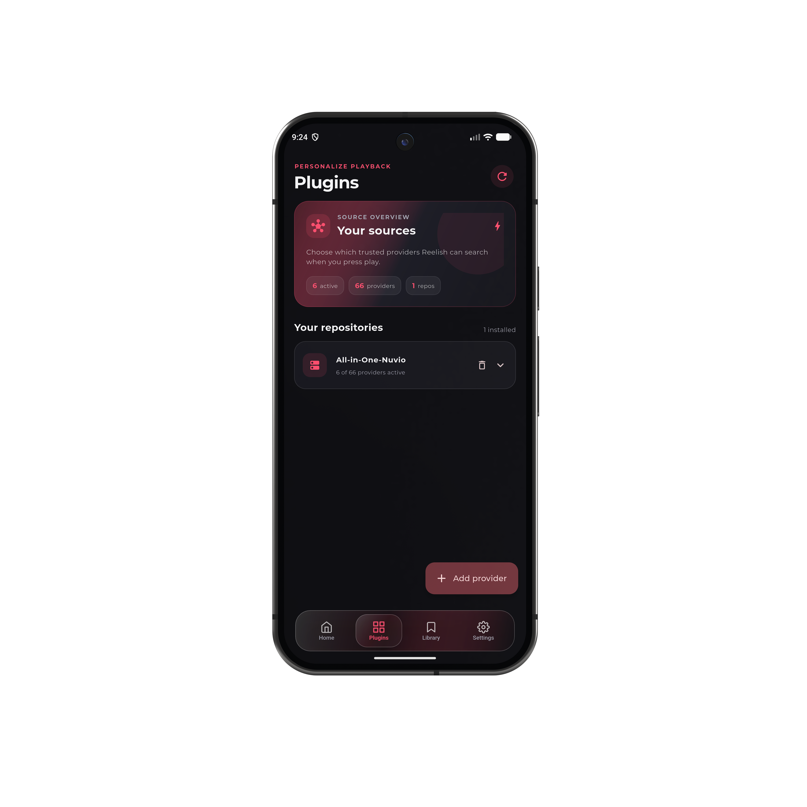
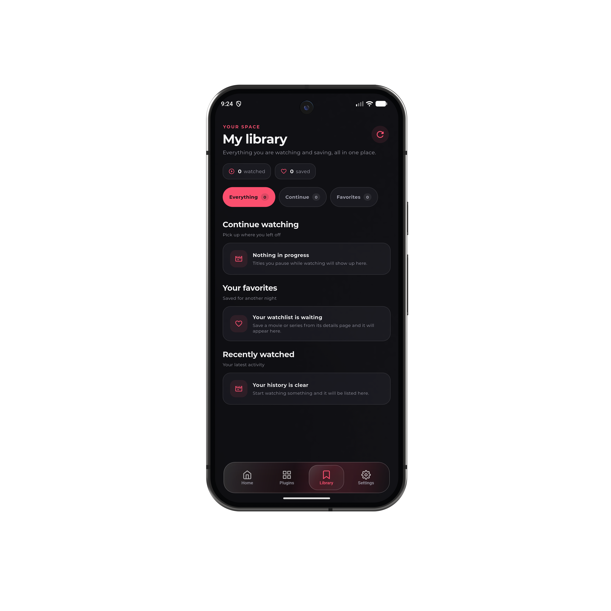
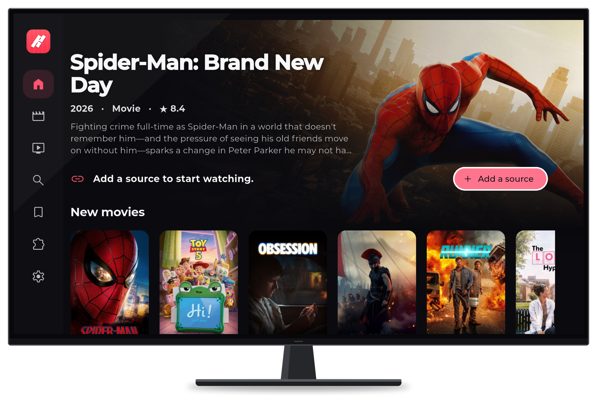

# Reelish

[](https://github.com/frnzeeey/reelish)

Reelish is an open-source Flutter app for discovering movies and TV series and watching them with providers you choose. Browse TMDB-powered catalogs, find a title, search enabled providers for streams, and play a source in the built-in player. Reelish was previously named Onfeed in parts of the codebase.

**Developers:** the technical documentation starts at [docs/README.md](docs/README.md). See also [For developers](#for-developers) below and [CONTRIBUTING.md](CONTRIBUTING.md).

## Features

- Browse popular and trending movies and series, search titles, and view recommendations, new releases, and title details.
- Keep a local library of favorites, recently watched titles, and playback progress so you can continue where you left off.
- Browse a built-in library of community provider repositories, search and filter it by language or content type, and install a repository from its details page.
- Install provider repositories from a manifest URL, enable the providers you want, and choose which providers can be used for playback.
- Play supported direct streams, with source selection, resume progress, playback controls, and configurable subtitles.
- On Android, allow compatible providers to return torrent sources for P2P playback.
- Use Reelish on Android TV and Google TV with an interface built for the remote, from the same APK as phones and tablets.
- Run Reelish on Windows 10 and 11 as a desktop app with its own desktop interface, mouse and keyboard controls, and fullscreen playback.
- Choose an accent color and customize playback, subtitle appearance, language preferences, and gestures.
- Read the privacy policy, terms of use, and third-party credits in the app.

## Images

| Home | Title details |
|:---:|:---:|
|  |  |

| Provider plugins | Personal library |
|:---:|:---:|
|  |  |

## Providers

Open **Plugins** and choose **Browse the library** to find a provider repository, or paste a provider manifest URL (or a supported GitHub repository/file link) with the link button. Review the repository's providers, then enable the ones you want. Provider repositories and enabled-provider choices are saved on the device. Reelish runs provider scripts in a constrained JavaScript runtime and requests streams when you open a title; providers do not populate the catalog.

Providers are third-party code and services. Install repositories only from publishers you trust. Reelish does not supply or host streams. Provider availability and compatibility depend on each provider and its sources.

### Plugin library

The library lists repositories from a community-maintained catalog curated by wolf knight. Listings are not verified or endorsed by Reelish; repository names, descriptions, and manifests belong to their authors.

The app downloads the catalog from [`assets/data/plugins.json`](assets/data/plugins.json) on this repository's `main` branch, checks for a newer copy at most every six hours (or when you pull to refresh), and keeps the last copy on the device. The same file is bundled with each release as an offline fallback. To update the catalog without an app release, regenerate the file and commit it:

```sh
dart run tool/generate_plugin_catalog.dart
```

Reelish is an independent project. It is not affiliated with, endorsed by, or sponsored by Stremio, CloudStream, or OpenSubtitles; their names are used only to describe compatible formats and services.

## Playback and subtitles

Choose a source from the title's stream list to start playback. Reelish supports direct HTTP(S) streams accepted by the platform player. Android also supports compatible torrent/P2P sources returned by providers; this depends on the provider and torrent source. Other platforms do not offer Reelish's torrent playback.

The player supports external SRT and WebVTT subtitles, with language selection and display settings. Reelish can search OpenSubtitles for subtitles. Stream and subtitle availability, formats, and behavior vary by source and platform.

## Android TV and Google TV

<p align="center">
  
</p>

The same APK runs on phones, tablets, Android TV, and Google TV. Reelish checks at startup whether it's on a TV and, if so, shows an interface built for the remote:

- A side menu for Home, Movies, Series, Search, My library, Plugins, and Settings.
- A large preview of the focused title above rows of posters; each row remembers where you left off.
- Details pages with seasons and episodes you can browse with the remote, and search with the TV's keyboard.
- Remote playback controls: play/pause, fast forward, rewind, next episode, captions, and D-pad seeking. Back while watching shows the controls first instead of leaving.

Phones and tablets keep the touch interface.

### Installing on a TV

Android TV has no browser for downloads, so install the APK once by sideloading it. The easiest way is the **Downloader** app from the Play Store: enter the link below, install, and allow installs from Downloader when Android asks.

```
https://github.com/frnzeeey/reelish/releases/latest/download/reelish.apk
```

From a computer, enable **USB debugging** (or **Network debugging**) in the TV's Developer options, then run `adb connect <tv-ip>:5555` and `adb install reelish.apk`.

After the first install, Reelish updates itself like on a phone. The first time you update, allow **Install unknown apps** for Reelish in the TV's settings.

Details on TV detection, remote navigation, and known limitations are in [docs/android_tv.md](docs/android_tv.md).

## Windows

Download `Reelish-Windows-x64.zip` from the [latest release](https://github.com/frnzeeey/reelish/releases/latest), extract it, and run `Reelish\Reelish.exe`. Windows has its own desktop interface with a collapsible side menu and mouse and keyboard controls: click or use the keyboard, Ctrl+F to search, Escape or Backspace to go back, F11 for fullscreen, and Space, Left/Right, Up/Down (volume), M and F in the player. P2P playback is Android-only. **Settings > About > Check for updates** downloads and verifies a new ZIP and shows it in File Explorer; the app is not code-signed yet, so SmartScreen may ask before the first launch.

Details, building from source, and the release workflow are in [docs/windows.md](docs/windows.md).

## TMDB configuration

Reelish uses [The Movie Database (TMDB)](https://www.themoviedb.org/) for catalog data, search, artwork, and title details. A TMDB API key is required to run the app. Create the ignored local file `lib/tmdb_config.local.dart` with:

```dart
const tmdbApiKey = 'YOUR_TMDB_API_KEY';
```

The key is included in client builds, so treat it as a public API key and apply appropriate restrictions in your TMDB account. This product uses the TMDB API but is not endorsed or certified by TMDB. Credits and third-party notices are available in Reelish under **Settings > Credits**.

## Run from source

Install Flutter for your target platform, configure the TMDB key as described above, then run:

```sh
flutter pub get
flutter run
```

To try the TV interface on a phone or a regular emulator, use `flutter run --dart-define=REELISH_FORCE_TV=true` (arrow keys and Enter act as the remote). On an Android TV emulator, see the testing notes in [docs/android_tv.md](docs/android_tv.md).

## Android releases

Release builds are published on [GitHub Releases](https://github.com/frnzeeey/reelish/releases). One `reelish.apk` covers phones, tablets, and TVs. Android can check for a newer stable release and offer to download its APK; installation is confirmed through Android's package installer. See [docs/releasing.md](docs/releasing.md) for how releases are made.

## Privacy and terms

On first launch, read and accept the privacy policy and terms of use shown in the app. Favorites, playback history, settings, and provider choices are stored locally. TMDB, provider publishers, stream hosts, and subtitle services receive requests needed for the features you use. The plugin library downloads its catalog from GitHub and loads provider logos from their listed hosts, and Android and Windows may contact GitHub for update checks. See the in-app **Privacy policy** and **Terms of use** for details.

## For developers

**Supported platforms:** Android phones and tablets, Android TV and Google TV (one APK), and Windows 10 and 11. The `ios/`, `linux/`, `macos/` and `web/` folders are generated by Flutter and are not shipped.

**Technology:** Flutter and Dart; TMDB for metadata; provider scripts run in QuickJS (vendored `flutter_js`) on background isolates; playback through `package:video_player` with Media3 on Android and libmpv (media_kit) on Android and Windows; a Go torrent streamer on Android; local storage in SharedPreferences.

**Repository layout:**

| Path | Contents |
|---|---|
| `lib/` | The app: `main.dart`, then `src/` with services, models, view models, the phone (`screens/`, `widgets/`), TV (`screens/tv/`, `widgets/tv/`) and Windows (`desktop/`) interfaces, and the shared player (`widgets/player/`) |
| `test/`, `integration_test/` | Unit and widget tests; tests on devices and Windows |
| `android/`, `windows/` | Native projects (Android activity; Windows runner and installer) |
| `packages/`, `third_party/` | Vendored native packages (libmpv bridge, torrent streamer, QuickJS) |
| `tool/` | Plugin catalog generator, Windows QuickJS build script, documentation tool |
| `docs/` | Technical documentation |

**Build and test:** configure the TMDB key as described above, then:

```sh
flutter pub get
flutter analyze lib test integration_test test_driver
flutter test
flutter build apk --profile        # Android
flutter build windows --release    # Windows
```

**Documentation:** [docs/README.md](docs/README.md) is the index: architecture, a feature-to-code map, playback and provider internals, platform guides, and A–Z references to every file, class and function. Start with [onboarding](docs/development/onboarding.md).

**Contributing:** read [CONTRIBUTING.md](CONTRIBUTING.md) and [CLAUDE.md](CLAUDE.md).
