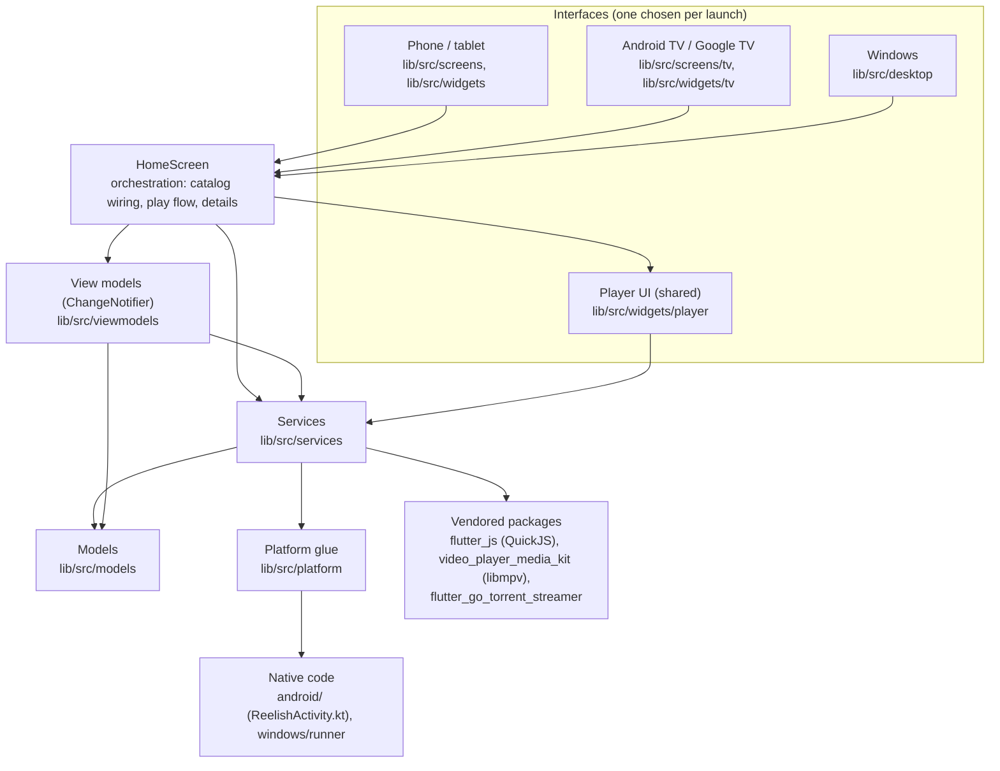
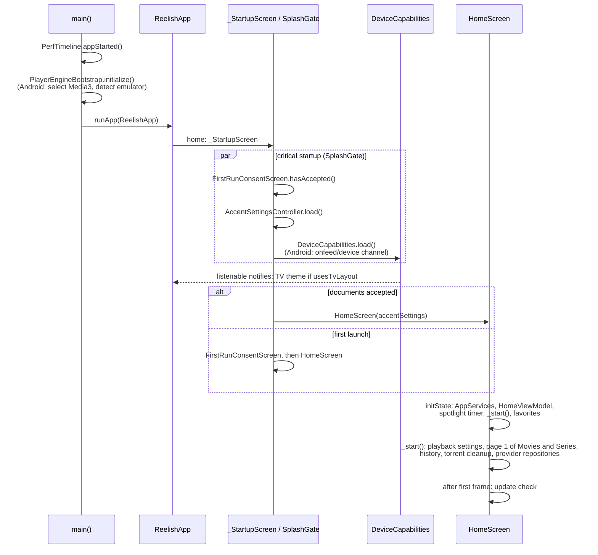
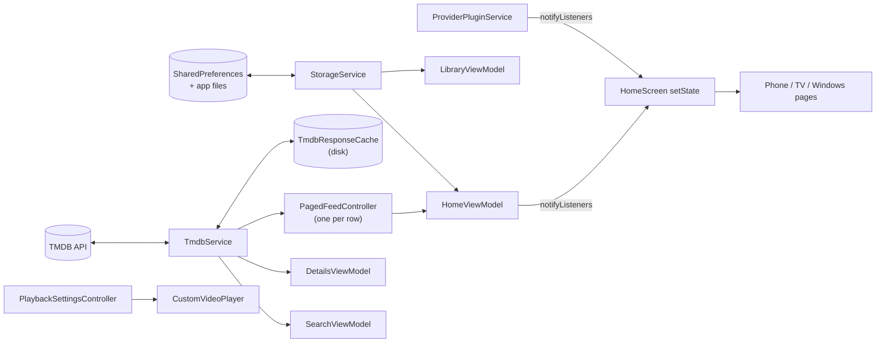

# Architecture overview

Reelish is a single Flutter app (Dart package `onfeed`) with three
interfaces built over one shared core:

- **Phone and tablet** (Android): touch, bottom dock.
- **Android TV and Google TV**: remote and D-pad focus, side rail. Same APK
  as phones.
- **Windows**: mouse, keyboard and game controller, side rail.

Catalog data comes from TMDB. Streams come from third-party *provider*
scripts that the viewer installs and that Reelish runs in a QuickJS sandbox.
Playback uses Media3 on Android (libmpv as fallback) and libmpv alone on
Windows. Everything the viewer saves stays on the device.

This page explains how those pieces fit. For exact names and paths, use the
[codebase index](../codebase/codebase-index.md) and the generated
[file](../codebase/file-reference.md), [class](../codebase/class-reference.md)
and [function](../codebase/function-reference.md) references.

## Layers

| Layer | Where | What it holds |
|---|---|---|
| Entry | [`lib/main.dart`](../../lib/main.dart) | `main`, `ReelishApp`, the startup gate |
| Services container | [`lib/src/app/app_services.dart`](../../lib/src/app/app_services.dart) | `AppServices`: `TmdbService`, `StorageService`, `ProviderPluginService`, `PluginLibraryRepository`, `PlaybackSettingsController` |
| Orchestration | [`lib/src/screens/home_screen.dart`](../../lib/src/screens/home_screen.dart) | `HomeScreen`: builds the phone tabs or the TV/Windows shell, owns the play flow and details navigation |
| View models | [`lib/src/viewmodels/`](../../lib/src/viewmodels) | `HomeViewModel`, `DetailsViewModel`, `LibraryViewModel`, `SearchViewModel`; `TvCatalog` hands Home's data to TV and Windows pages |
| Services | [`lib/src/services/`](../../lib/src/services) | TMDB, storage, providers, playback pipeline, subtitles, updates, settings |
| Models | [`lib/src/models/`](../../lib/src/models) | `MediaItem`, `StreamSource`, `PlayableSource`, `EpisodeProgress`, `ProviderPlugin`, … |
| Phone UI | [`lib/src/screens/`](../../lib/src/screens), [`lib/src/widgets/`](../../lib/src/widgets) | Tabs, details, library, plugins, settings, dock |
| TV UI | [`lib/src/screens/tv/`](../../lib/src/screens/tv), [`lib/src/widgets/tv/`](../../lib/src/widgets/tv) | `TvHomeShell`, TV pages, `TvFocusable` |
| Windows UI | [`lib/src/desktop/`](../../lib/src/desktop) | `DesktopShell`, `DesktopHero`, desktop pages, details, settings, plugins |
| Player UI | [`lib/src/widgets/player/`](../../lib/src/widgets/player) | `CustomVideoPlayer` and its controls, sheets and overlays, on every platform |
| Platform glue | [`lib/src/platform/`](../../lib/src/platform) | `DeviceCapabilities`, window/fullscreen, shortcuts, gamepad, Windows installation |
| Theme | [`lib/src/theme/glass_theme.dart`](../../lib/src/theme/glass_theme.dart) | Colours, accent palettes, Material themes |

The dependency direction is checked by the generated
[dependency map](../codebase/dependency-map.md): models and services do not
import UI folders.

## Startup

What happens where:

1. [`main`](../../lib/main.dart) records the start time, initialises the
   player engines (`PlayerEngineBootstrap` in
   [`player_engine.dart`](../../lib/src/services/player_engine.dart)) and runs
   `ReelishApp`.
2. `ReelishApp` rebuilds when the accent or the detected device changes. It
   picks `GlassTheme.tv` for TV and Windows and `GlassTheme.dark` otherwise,
   adds `TvPopupFocusObserver` on TV, and wraps Windows in `DesktopGamepad`
   and `DesktopShortcuts`.
3. `_StartupScreen` runs only local work inside `SplashGate`
   ([`splash_screen.dart`](../../lib/src/screens/splash_screen.dart)): the
   consent flag, the accent, and `DeviceCapabilities.load()`. Network work
   waits for Home.
4. `HomeScreen` creates `AppServices` and `HomeViewModel`, then starts the
   first catalog pages, the watch history and the provider repositories, and
   checks for updates after its first frame.

## Choosing the interface

[`DeviceCapabilities`](../../lib/src/platform/device_capabilities.dart) is
read once per launch:

| Flag | True on | Use it for |
|---|---|---|
| `DeviceCapabilities.isTv` | Android TV / Google TV hardware (or `REELISH_FORCE_TV`) | Remote-only behaviour: overscan margins, D-pad focus, Back to reveal controls |
| `DeviceCapabilities.isDesktop` | Windows | Mouse, keyboard and gamepad behaviour, desktop pages |
| `DeviceCapabilities.usesTvLayout` | TV **and** Windows | Choosing the rail-based layouts over the phone tabs |
| `DeviceCapabilities.isDesktopPlatform` | Windows target platform | Before `load()` completes (e.g. in `main.dart`) |

`HomeScreen.build` returns `_buildDesktop` on Windows, `_buildTv` on TV,
and the phone tabs otherwise. More in
[platform architecture](platform-architecture.md).

## Navigation

There is no router package. Navigation is plain `Navigator`:

- **Top level.** Phone: a tab index in `HomeScreen` with `SoftGlassDock`.
  TV and Windows: a `TvDestination` value
  ([`app_destination.dart`](../../lib/src/navigation/app_destination.dart))
  that `TvHomeShell` or `DesktopShell` shows; visited pages stay alive and
  keep their scroll positions.
- **Pushed pages.** Details, the player, settings sub-pages and the plugin
  library are pushed with `AppPageRoute`
  ([`app_transitions.dart`](../../lib/src/navigation/app_transitions.dart)).
  `HomeScreen._showDetails` chooses `DesktopDetailsScreen`,
  `TvMediaDetailsScreen` or `MediaDetailsScreen`.
- **Back on Windows.** `DesktopShortcuts` (Escape/Backspace) and
  `DesktopGamepad` (B) pop the root navigator through the `navigatorKey`
  set in `ReelishApp`.

## State

State lives in a few deliberate places; see
[design patterns](design-patterns.md) for the patterns themselves.

- **View models** are `ChangeNotifier`s that read services and notify the
  screen. They have no UI types and are shared by all three interfaces.
- **Services** own I/O and caching. `StorageService` serialises writes
  through one static queue so concurrent saves cannot interleave.
- **`HomeScreen`** still owns orchestration: it listens to the view model,
  feeds and plugin service, and owns the play flow (`_openItem`). It is the
  largest file in the app; see [technical debt](../maintenance/technical-debt.md).
- **Widget state** holds UI-only state (focus, hover, scroll, the player
  session).

## Where to go next

- [Data flow](data-flow.md): catalog, library and details, step by step.
- [Playback architecture](../playback/playback-architecture.md): from Play to
  pixels.
- [Provider integration](../playback/provider-integration.md): repositories,
  scripts and the sandbox.
- [Platform architecture](platform-architecture.md): what is shared and what
  is per platform.
