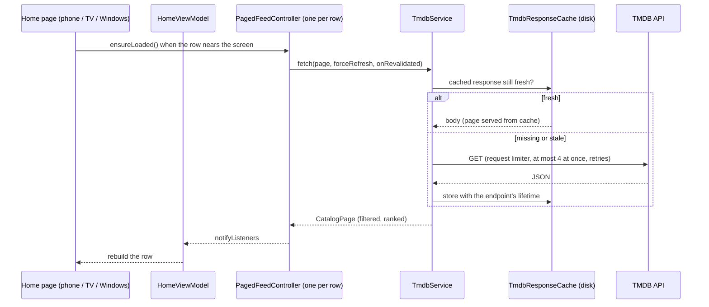
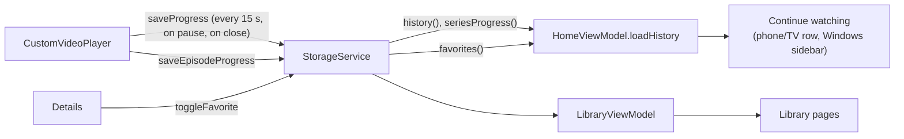

# Data flow

How data moves through Reelish for browsing, the library and details.
Playback has its own pages:
[playback architecture](../playback/playback-architecture.md) and
[provider integration](../playback/provider-integration.md).

## Browsing: TMDB → rows

- **Rows.** `HomeViewModel`
  ([`home_view_model.dart`](../../lib/src/viewmodels/home_view_model.dart))
  owns one `PagedFeedController` per row: New movies, Series worth the
  queue, New releases and Top 10. Loading, failing or paging one row never
  touches another.
- **Load order.** Page 1 of Movies and Series starts with Home (the
  Spotlight and the Top 10 seeds come from them). Other rows load only as
  they approach the screen, and Top 10 and New releases wait until
  `catalogSettled` (Movies and Series page 1 have loaded).
- **Guards.** Each controller
  ([`paged_feed_controller.dart`](../../lib/src/services/paged_feed_controller.dart))
  runs every operation under a generation number, so a slow page 2 cannot
  land on a refreshed page 1. Rows that filter titles out fetch a bounded
  number of extra pages, and Top 10 stops at ten titles.
- **Freshness.** `TmdbResponseCache`
  ([`tmdb_response_cache.dart`](../../lib/src/services/tmdb_response_cache.dart))
  keeps responses on disk with per-endpoint lifetimes in `TmdbCacheTtl`:
  catalog, new releases and recommendations 20 min, search 3 min,
  metadata 24 h, identifiers 7 days, fallback 15 min. A row past its
  lifetime is renewed quietly by `revalidateIfStale` when Home is shown
  again.
- **Rules.** Which titles a row keeps, and in what order, comes from
  [`media_catalog_rules.dart`](../../lib/src/services/media_catalog_rules.dart)
  (media type, suitability, dates) and
  [`media_discovery_ranking.dart`](../../lib/src/services/media_discovery_ranking.dart)
  (vote-weighted quality, recency, Top 10 seeds and the Spotlight).
- **TV and Windows.** Their pages receive Home's data as a `TvCatalog`
  ([`home_catalog.dart`](../../lib/src/viewmodels/home_catalog.dart)): the
  same controllers, so no platform adds its own requests (except Trending,
  which the TV and Windows Home load from the same cached endpoint).

## Library: storage → Continue watching, My list, history

- **Store.** `StorageService`
  ([`storage_service.dart`](../../lib/src/services/storage_service.dart))
  keeps everything in SharedPreferences, except provider manifests and the
  last-used streams, which are JSON files in the app's files folder. All
  writes run one at a time through a static queue (`_serialized`), so two
  saves cannot overwrite each other.
- **Watch history.** `saveProgress` puts the title first in the history
  (at most 50 entries) with its position and length. A series also gets
  per-episode progress through `saveEpisodeProgress` (the 100 most recent
  series), and the episode watched last is remembered, so a series resumes
  in the right episode.
- **Continue watching.** `HomeViewModel.loadHistory` takes the history
  entries with a resume position and each series' episode progress.
  `ResumeSummary`
  ([`resume_summary.dart`](../../lib/src/models/resume_summary.dart)) turns
  that into the card text ("S2 E1 · 27 min left") and never estimates:
  unknown progress shows nothing. On Windows the list is shown in the
  sidebar (`DesktopResumeShelf` in
  [`desktop_shell.dart`](../../lib/src/desktop/desktop_shell.dart)).
- **When it refreshes.** After the player closes (`_openItem` reloads the
  history), when the library opens, and when a title is removed from the
  history. Reads that finish after a newer one are dropped, so a slow read
  cannot bring back a removed title.

The full list of keys is in the
[configuration reference](../reference/configuration-reference.md#stored-data).

## Details

`DetailsViewModel`
([`details_view_model.dart`](../../lib/src/viewmodels/details_view_model.dart))
loads TMDB details, the seasons and the selected season's episodes for all
three details screens. `MediaDetailsScreen` (phone),
`TvMediaDetailsScreen` and `DesktopDetailsScreen` draw it differently and
call back into `HomeScreen` to play.

## Search

The phone Home searches inline (`HomeScreen._loadSearch`). TV and Windows
use `SearchViewModel`
([`search_view_model.dart`](../../lib/src/viewmodels/search_view_model.dart)):
it debounces typing, loads page 1 then more on demand, and drops a stale
answer for an older query.

## Providers and the plugin library

- Installed repositories, their enabled providers and approved script
  hashes are stored by `StorageService` and managed by
  `ProviderPluginService`
  ([`provider_plugin_service.dart`](../../lib/src/services/provider_plugin_service.dart)).
  See [provider integration](../playback/provider-integration.md).
- The community catalog shown in the Plugin Library comes from
  `PluginLibraryService`
  ([`plugin_library_service.dart`](../../lib/src/services/plugin_library_service.dart)):
  the network copy of `assets/data/plugins.json` on GitHub, a cached copy on
  the device, or the copy bundled with the app.

## Settings

`PlaybackSettingsController` and `AccentSettingsController` load their
values once, notify listeners on change and save through
`StorageService.saveSetting`. The player listens to the playback settings
while it plays.
