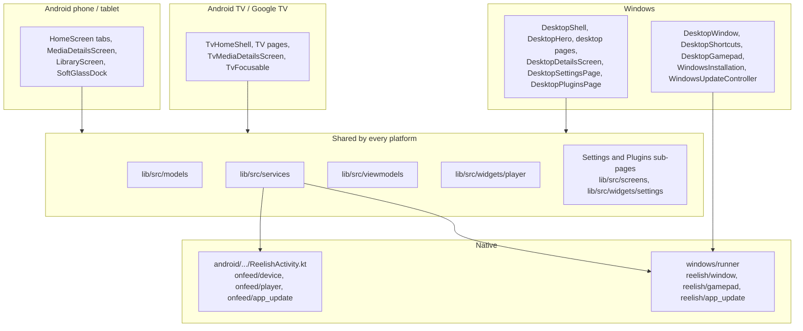

# Platform architecture

What is shared between the three interfaces and what each platform owns.
Per-platform detail: [Android](../platforms/android.md),
[Android TV](../platforms/android-tv.md),
[Google TV](../platforms/google-tv.md), [Windows](../platforms/windows.md).

## Matrix

| Concern | Phone / tablet | Android TV / Google TV | Windows |
|---|---|---|---|
| Selected by | default | `DeviceCapabilities.isTv` (from `onfeed/device`) | `DeviceCapabilities.isDesktop` (target platform) |
| `usesTvLayout` | false | true | true |
| Theme | `GlassTheme.dark` | `GlassTheme.tv` | `GlassTheme.tv` plus `DesktopSurfaces` |
| Navigation | Dock tabs (`SoftGlassDock`) | `TvHomeShell` rail, D-pad | `DesktopShell` hover rail; mouse, keyboard, controller |
| Details | `MediaDetailsScreen` | `TvMediaDetailsScreen` | `DesktopDetailsScreen` |
| Library | `LibraryScreen` | `TvLibraryPage` | `DesktopLibraryPage`, plus Continue watching in the sidebar |
| Search | inline on Home | `TvSearchPage` | `DesktopSearchPage` (Ctrl+F) |
| Plugins | `PluginsScreen` | `PluginsScreen` | `DesktopPluginsPage` |
| Settings | `SettingsScreen` | `SettingsScreen` | `DesktopSettingsPage` (reuses the sub-pages) |
| Player engine | Media3, libmpv fallback | Media3, libmpv fallback | libmpv only |
| Player input | Touch gestures (`GestureTouchLayer`) | Remote keys (`_onRemoteKey`) | Mouse, keys, controller |
| Torrents | 64-bit processes only (`TorrentSupport`) | Same; many TV devices are 32-bit | Not supported |
| Updates | `GitHubUpdateService` APK → package installer (`onfeed/app_update`) | Same | `WindowsUpdateController`: installer or ZIP, verified, via `reelish/app_update` |
| Glass quality | `LiquidGlass` balanced/high | Capped to low | Desktop surfaces, one blur per panel |
| Picture-in-picture, brightness, rotation | Yes (`onfeed/player`) | Not offered | No |

## Shared code that branches

Some shared files check the platform. The generated
[file reference](../codebase/file-reference.md) lists each file's checks
under **Branches on**. The main ones:

- [`home_screen.dart`](../../lib/src/screens/home_screen.dart): chooses the
  phone, TV or Windows build and details screen; the resolving overlay.
- [`custom_video_player.dart`](../../lib/src/widgets/player/custom_video_player.dart):
  touch gestures, TV remote focus and desktop pointer and keyboard paths
  are kept separate.
- [`player_engine.dart`](../../lib/src/services/player_engine.dart): the
  engine for each platform and scheme.
- [`torrent_source_preparer.dart`](../../lib/src/services/torrent_source_preparer.dart):
  `TorrentSupport`, which also gates torrent requests in
  `ProviderPluginService`.
- [`github_update_service.dart`](../../lib/src/services/github_update_service.dart)
  and [`app_update_flow.dart`](../../lib/src/widgets/app_update_flow.dart):
  APK versus Windows installer handling.

Rule of thumb: prefer a platform-specific widget over a branch in a shared
one. If a shared file must change, make the change inert on the other
platforms and say so in the change. See
[coding standards](../development/coding-standards.md).

## Native channels

| Channel | Side | Methods | Used by |
|---|---|---|---|
| `onfeed/device` | Android (`ReelishActivity.kt`) | `capabilities` | `DeviceCapabilities.load` |
| `onfeed/app_icon` | Android (`ReelishActivity.kt`, `AppIconSwitcher.kt`) | `current`, `select` (launcher icon presets: activity aliases; the old entry is disabled once the app is in the background) | `AppIconService` |
| `onfeed/player` | Android | `setBrightness`, `resetBrightness`, `keepScreenOn`, `isEmulator`, `enterPip` | Player, `PlayerEngineBootstrap` |
| `onfeed/app_update` | Android | `canRequestPackageInstalls`, `openInstallPermissionSettings`, `inspectApk`, `installApk` | `GitHubUpdateService`, update dialogs |
| `reelish/window` | Windows runner (`flutter_window.cpp`) | `setFullscreen`, `isFullscreen` | `DesktopWindow` |
| `reelish/gamepad` | Windows runner (`gamepad_channel.cpp`) | `state`, sent from the runner to Dart with XInput buttons and stick | `DesktopGamepad` |
| `reelish/app_update` | Windows runner (`app_update_channel.cpp`) | `inspectInstaller`, `freeDiskSpace`, `launchInstaller` | `WindowsInstallation`, used by `WindowsUpdateController` |

Android code: [`ReelishActivity.kt`](../../android/app/src/main/kotlin/com/example/onfeed/ReelishActivity.kt).
Windows runner: [`windows/runner/`](../../windows/runner).
