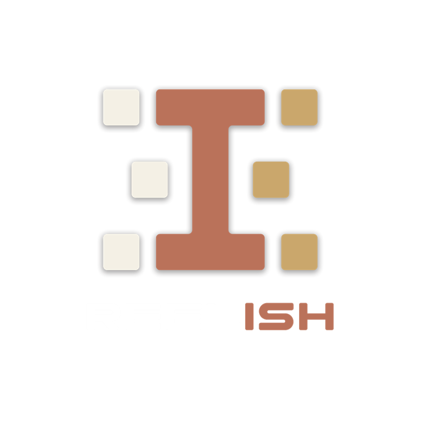
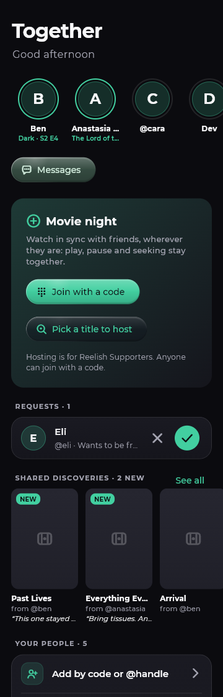
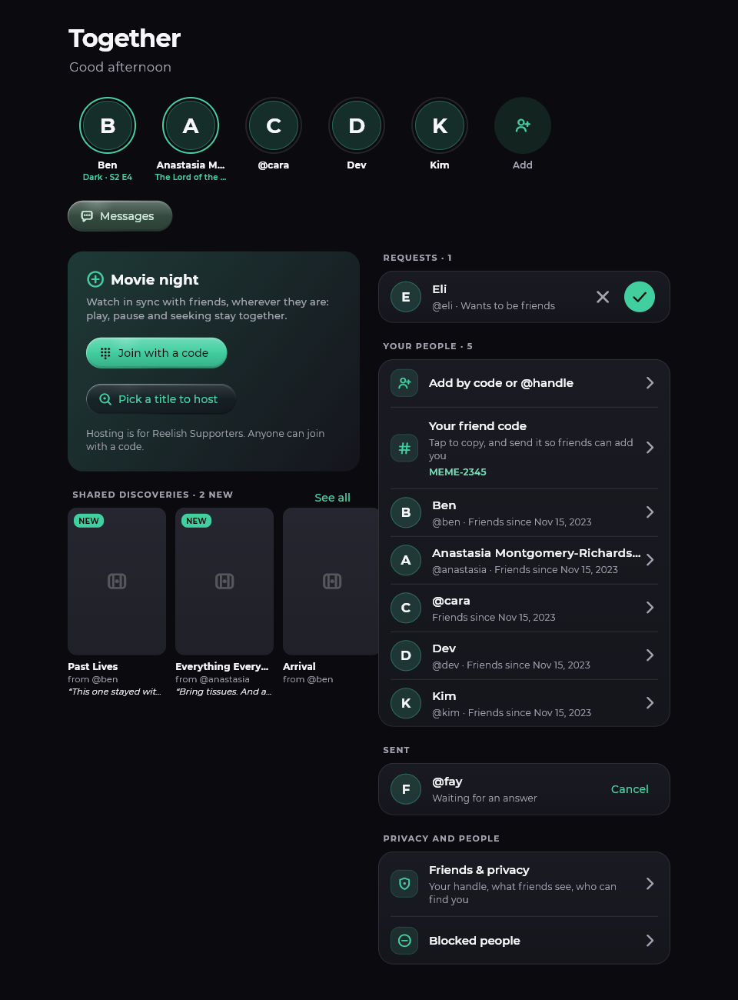

# Reelish — Brand Identity & Brand Guidelines

Version 1.0 · 20 November 2026 · Audited against Reelish v1.39.0

> **Entertainment is better together.** Your digital living room.

This document is Reelish's brand reference for product, design, development and marketing. It combines the brand direction defined before this audit with what the app, its assets and its website actually show today, and it says plainly which is which.

**How to read the labels.** Every significant statement carries one:

| Label | Meaning |
|---|---|
| [Established] | Brand direction defined before this audit (the November 2026 brand strategy and the founder's brief). |
| [Observed] | Verified in the Reelish source code, assets, website or running app during this audit. |
| [Recommended] | This document's professional recommendation, with its reasoning. |
| [Exploratory] | A direction worth pursuing that still needs validation. |
| [Pending Decision] | Needs the founder's approval before it becomes a standard. |

**What was audited.** The Flutter app (v1.39.0, all three interfaces: phone and tablet, Android TV and Google TV, Windows), its theme, icon and font code, every brand asset in the repository and the brand files on the founder's desktop, the generated launcher icons, the Reelish website source, and the November 2026 brand strategy document. Contrast ratios were calculated with the WCAG 2.2 formula. Interface pictures in this document were rendered by the app's own code during testing, with sample data.

**Limits of the audit.** No user research, analytics or market data were available; audience statements are hypotheses. The source file of the wordmark's lettering was not found, only exported images. No logo drawing with circles or a sofa silhouette was found (section 05). The app could not be used signed in on a phone during the audit, so phone and TV observations come from code, tests and renders.

<!-- pagebreak -->

## 01. Brand Overview

### Introduction to Reelish

Reelish is a free, ad-free app for discovering movies and series and watching them, alone or together, on Android phones and tablets, Android TV and Google TV, and Windows. [Observed]

People sign in with Trakt, browse catalogues built from TMDB, keep a library and continue watching across devices, add friends, send each other messages and recommendations, and watch in sync in a Watch Party. Playback comes from third-party provider plugins that each person installs; Reelish itself does not host, store, license or distribute any movie or series. [Observed]

### Brand philosophy

A cinema gives you something to watch. A living room gives you somewhere to belong. Reelish should give people both: entertainment, and a reason to come together. [Established]

### Core idea

Think of Reelish as a friend's living room: a familiar, comfortable place where people discover something worth watching, share recommendations, talk, and watch together, even when they are apart. The living room is an emotional reference, not a literal visual instruction. [Established]

### Brand essence

**Entertainment is better together.** [Established]

<!-- pagebreak -->

## 02. Brand Strategy

| Element | Definition | Status |
|---|---|---|
| Purpose | Bring people closer through entertainment. | [Established] |
| Promise | Make entertainment more enjoyable by making it more social. | [Established] |
| Positioning | A social entertainment platform for friends and family. | [Established] |
| Essence | Entertainment is better together. | [Established] |

### Brand values

| Value | What it means | How the product shows it today |
|---|---|---|
| Connection | Entertainment creates reasons to talk and share. | Friends, Messages, recommendations with a note, Watching now, Watch Party chat and reactions. [Observed] |
| Belonging | Everyone is welcome, free accounts included. | Anyone can join a Watch Party with a code; every accent colour stays free. [Observed] |
| Simplicity | Watching and connecting take as few steps as possible. | One Trakt sign-in, Continue watching across devices, "Join with a code". [Observed] |
| Freedom | People choose how and where they discover and watch. | Free, ad-free, no subscription; people choose their own sources and themes. [Observed] |
| Shared experiences | Watching together is the high point. | Watch Party keeps play, pause, seek and episode changes in sync. [Observed] |

### Brand personality

Approachable, playful, modern, relaxed, premium. [Established]

| Trait | Is | Is not |
|---|---|---|
| Approachable | Warm, plain-spoken, welcoming to newcomers | Insider jargon, gatekeeping |
| Playful | Light humour, small delights, spontaneous moments | Childish visuals, noisy effects |
| Modern | Current, fast, quietly capable | Cold tech, "AI-powered" hype |
| Relaxed | Calm pacing, comfortable spacing, no pressure | Urgency, countdowns, guilt |
| Premium | Crafted details, considered motion, quality materials | Exclusivity, status games |

The balance: friendly without being childish, premium without being exclusive, modern without being cold. [Established]

### Brand archetypes

| Archetype | Role | In the visual identity | In communication | In the product | In marketing |
|---|---|---|---|---|---|
| The Everyman | Primary | Warm neutrals, familiar shapes, nothing intimidating | Plain words, "you" and "your people" | Belonging first: anyone can join, free features stay whole | Real friends and families, not stars |
| The Jester | Secondary | Small moments of colour and motion (reactions, the Spotlight, Wrapped) | A light touch of humour in empty states and celebrations | Reactions, Wrapped, playful profile cards | Shareable moments, never mocking anyone |

[Established] archetypes; mapping [Recommended].

**Observed tension.** The Supporter and Founder perks speak a luxury register (Sovereign Edition, Velvet Cinema, Obsidian Gold, Rosé Noir, Premiere 2026). That reads as the Ruler archetype, not the Everyman. It is legitimate as a thank-you, but it must stay inside the perks and never set the tone of the core product. [Observed] [Recommended]

<!-- pagebreak -->

## 03. Product Identity

### What Reelish is

- A social entertainment platform: discovery, friends, messages and shared viewing in one app. [Established]
- A player for streams from sources each person chooses and installs. [Observed]
- Three interfaces designed for their devices: touch on phones, a remote on TV, mouse, keyboard and gamepad on Windows. [Observed]
- Free, ad-free and open source, funded by voluntary supporters. [Observed]

### What Reelish is not

- Not a streaming service. Reelish owns, hosts, licenses and sells no content, and must never imply that it does. [Established] [Observed]
- Not a cinema. Cinema is a feature of the experience (the player, artwork, the Spotlight), not the brand's personality. [Established]
- Not a generic social network or a short-video feed. People and entertainment stay at the centre. [Established]
- Not a status product. Supporter perks are thank-yous, not walls. [Observed]

### The digital living room in practical design

| Living-room quality | Design translation | Where it applies |
|---|---|---|
| Welcoming | Greet people by name; warm surfaces; never an empty, cold screen | Together's greeting, empty states, onboarding |
| Human-centred | People shown as faces before lists; who sent what, with their note | Together's friends strip, Shared discoveries |
| Social presence | Show who is around and what they are watching, only when they share it | Watching now, Watch Party |
| Shared experiences | Watching together is one step from any title | "Watch together" on every title page; Movie night |
| Comfortable navigation | Few top-level places; the same names on every device | Dock, TV rail and Windows sidebar share Home, Library, Together, Settings |
| Personalisation | Themes, avatars, frames and profile cards that make the room yours | Appearance, Profile |
| Familiarity | Continue where you left off, on any device | Continue watching, My list sync |

[Recommended], built on [Observed] features.

### Product philosophy

**Reelish should feel like a place people want to spend time in, not only an app they open to watch something.** [Established]

### Feature ecosystem

| Experience | Brand role | Status |
|---|---|---|
| Movies & Series | Entertainment | [Observed] TMDB catalogues, title pages, search, recommendations |
| Reelish Spotlight | Discovery showcase | [Observed] phone and Windows, six animation styles |
| Top 10 Picks | Discovery | [Observed] Home row with large numerals |
| Friends & Messages | Connection | [Observed] friend codes and handles, private messages, nicknames, mute, unsend |
| Watch Party | Togetherness | [Observed] synced viewing with chat and reactions; hosting is a Supporter perk, joining is free |
| Together | The social home | [Observed] friends, Movie night, Messages, Shared discoveries, privacy |
| Reelish Wrapped | Reflection | [Observed] yearly recap with share cards |
| Reelish Clips | Discovery | Not implemented. [Exploratory] |
| Reelish Moments | Expression | Not implemented. [Exploratory] |

<!-- pagebreak -->

## 04. Audience and Positioning

No user research was available. The profiles below are hypotheses drawn from the product's features and the established strategy, to be checked against the app's opt-in analytics and a short survey. [Exploratory]

| Audience | Who | Needs | What Reelish offers today |
|---|---|---|---|
| Social Watchers (primary) | Friends, couples and families who watch together, often apart | Start a shared session quickly; stay in sync; talk while watching | Watch Party with codes, chat and reactions; Together; Messages [Observed] |
| Living-room Viewers | People who watch mainly on a TV | A calm interface made for the remote | A dedicated Android TV and Google TV interface [Observed] |
| Entertainment Explorers | People who love finding the next thing | Good recommendations, trusted friends' picks | Recommended for you, Because you watched, Shared discoveries, Top 10 [Observed] |
| Comfort Watchers | People who unwind with favourites | No friction; pick up where they left off | Continue watching across devices, My list [Observed] |
| Trackers | Trakt users | Their history and watchlist in sync | Trakt sign-in and My list sync [Observed] |

### Positioning statement

For friends and families who love movies and series, Reelish is the social entertainment platform that turns watching into time spent together: one warm place on the phone, the TV and the PC to discover what to watch, share it, and watch it in sync. Unlike streaming services, Reelish sells no content; it brings your people and your chosen sources together. [Recommended]

### Unique value proposition

**Your friends, your picks and your movie nights, together in one place on every screen.** [Recommended]

### Differentiators

| Differentiator | Proof in the product | Status |
|---|---|---|
| Social at the core, not bolted on | Together is a top-level destination on every interface | [Observed] |
| Watch together across devices | Watch Party works between phone, TV and Windows | [Observed] |
| Real TV and desktop interfaces | Separate remote-first and desktop interfaces, not a stretched phone app | [Observed] |
| Free and fair | No ads, no subscription; perks are cosmetic and social; joining is free | [Observed] |
| Yours | Themes, avatars, frames, profile cards, app icons, Wrapped | [Observed] |

### Competitive positioning

| Category | What they are | How Reelish differs |
|---|---|---|
| Streaming services | Content owners selling a catalogue | Reelish sells no content; it is where you and your people watch |
| Media centres and add-on players | Capable but solitary and technical | Social first; simple Trakt sign-in |
| Watch-together tools | Browser add-ons tied to one service | Cross-device parties, each person on their own source |
| Social networks | Feeds and followers | Small circles of friends around entertainment |

The comparison reflects public knowledge of these categories, not a market study. [Recommended]

### Reasons to choose Reelish

- Watching with friends takes a code, not a plan.
- Your friends' picks, with their notes, are a tap away.
- It feels the same, and right, on your phone, your TV and your PC.
- It is free, without ads, and nothing important is locked.

<!-- pagebreak -->

## 05. Visual Identity

### Logo concept

The current Reelish mark is the **emblem**: a terracotta I-shaped form, wide at top and bottom, between two columns of three rounded squares: cream on the left, gold on the right. [Observed] It appears on every launcher icon, the splash screen, the app header, the Windows sidebar and the TV banner. [Observed]

 

 

### Logo symbolism

The established concept describes an abstract sofa built from two capital E forms and three circles representing friends, with negative space and squares forming the backrest. [Established] Compared with the actual artwork: [Observed]

| Established element | In the current emblem | Finding |
|---|---|---|
| Two capital E forms | Read as two E's facing away from each other, sharing one stem: the top and bottom bars are the outer arms, the middle squares the middle arms. The founder's "R ▪ LISH" logotype uses the emblem in place of "EE". | Supported |
| Three circles (friends) | Six rounded squares, three a side, in two colours | Not present as drawn: squares, not circles |
| Sofa silhouette | No sofa reading is evident; at small sizes the mark reads as an "I" or a film strip with sprocket holes | Not evident |
| Avoid film symbols | The squares beside a central frame resemble film sprocket holes | Tension with the established principle |

**Recommendation.** Tell the story the artwork supports: two E's, the two halves of "Reelish's" double E, facing outward around one shared centre, with friends gathered on both sides. If the sofa and circles remain the intended idea, the mark needs a redraw, which is a founder decision. [Recommended] [Pending Decision]

### Logo variations

| Variation | Asset | Use | Status |
|---|---|---|---|
| Emblem | assets/icons/reelish_app_emblem.png | App icon, avatar, favicon, small spaces | [Observed] |
| White emblem | assets/icons/reelish_emblem_white.png | On coloured app icons | [Observed] |
| Primary lockup (emblem over wordmark) | assets/icons/reelish_primary_logo.png | Splash, store graphics | [Observed] dark backgrounds only |
| Wordmark, "ISH" in terracotta | assets/icons/reelish_wordmark.png | Wide headers, Windows sidebar | [Observed] dark backgrounds only |
| Horizontal wordmark (emblem + REELISH) | Founder's files | Website header, documents | [Observed] not in the app |
| "R ▪ LISH" logotype | Founder's files | Campaigns, merchandise | [Observed] not in the app; [Exploratory] |
| Sovereign Crest | Founder's icon only | Founder's edition | [Observed] not a brand mark |

**Gap: light backgrounds.** Every wordmark asset draws its letters in cream, so on white or cream only "ISH" (or nothing) remains. A light-background version with ink letters is needed. [Observed] [Recommended]

### Colour identity: the journey so far

| Stage | Palette | Status |
|---|---|---|
| Original identity | Coral pink (#FF4169 on the website; Coral #FF4D6D in the app) | Being retired [Established]; still on the live website [Observed] |
| Forest Haven (strategy, November 2026) | Deep Evergreen #263A30, Sage Green #879B83, Warm Cream #E8E0D5, Forest Haven #34483D | Proposed [Established]; not in the app [Observed] |
| Living Room (shipped in v1.39.0) | Terracotta #BA725A, Gold #CAA76C, Cream #F4F0E5 on #14110E | The default theme today [Observed] |
| Brief palette | Terracotta #D17B5B, Dark Espresso #39302B, Warm Apricot #E8B98A, Soft Cream #F4E9D8, Muted Sage #829078 | Proposed [Exploratory] |

### Colour assessment

Contrast ratios, WCAG 2.2 (4.5 : 1 is the minimum for normal text, 3 : 1 for large text and interface parts):

| Pair | Ratio | Verdict |
|---|---|---|
| Terracotta #D17B5B on base #14110E | 6.00 | Passes; better than today's #BA725A (5.05) |
| Terracotta #D17B5B on Espresso #39302B | 4.10 | Fails for text: Espresso cannot be the page |
| White on Terracotta #D17B5B | 3.14 | Fails for button text |
| Base #14110E on Terracotta #D17B5B | 6.00 | Passes: dark text on accent fills |
| Soft Cream #F4E9D8 on #14110E | 15.67 | Excellent body text |
| Warm Apricot #E8B98A on #14110E | 10.52 | Excellent accent |
| Muted Sage #829078 on #14110E | 5.56 | Passes as an accent |
| Muted Sage #829078 vs Terracotta #D17B5B | 1.08 | Same lightness: never the only difference between two states |
| Terracotta #D17B5B on Soft Cream #F4E9D8 | 2.61 | Fails: light mode needs a deeper terracotta |
| Terracotta on Deep Evergreen #263A30 | 3.87 | Fails: Forest Haven backgrounds weaken the accents |
| Cream squares on the sage app icon | 2.82 | Weak at small icon sizes |

**Conclusions.** [Recommended]

1. Adopt the brief's terracotta **#D17B5B** as the primary accent: it is warmer, livelier and more legible on dark backgrounds than today's #BA725A.
2. Keep dark backgrounds near-black and warm (#14110E). Espresso and evergreen backgrounds turn muddy and pull every accent below the contrast minimum; neutral dark also keeps posters' own colours true.
3. Keep Forest Haven's heritage through **Muted Sage** as a supporting accent, not as backgrounds.
4. Text on accent fills is dark, never white.
5. Light mode uses deeper versions: terracotta text **#9C5238** (4.76 on cream) and sage text **#5E6B56** (4.71).

<!-- pagebreak -->

### Official brand palette

[Recommended] [Pending Decision] — adopting it means updating the Living Room theme and the emblem's colours together (section 10).

| Swatch | Colour | HEX | Role |
|---|---|---|---|
| swatch:#D17B5B | Terracotta | #D17B5B | Primary brand accent: the emblem's frame, calls to action, focus |
| swatch:#E8B98A | Warm Apricot | #E8B98A | Secondary accent: highlights, the emblem's right squares, supporter touches |
| swatch:#F4E9D8 | Soft Cream | #F4E9D8 | Light neutral: text on dark, light backgrounds, the emblem's left squares |
| swatch:#39302B | Dark Espresso | #39302B | Deep brand neutral: marketing panels, raised surfaces, text on light |
| swatch:#829078 | Muted Sage | #829078 | Supporting accent: presence ("watching now"), success, calm moments |

### Interface tokens

Brand colours and the theme system are related but separate: themes recolour the interface; the brand palette stays fixed outside the app.

**Dark (default)** [Recommended], built on the [Observed] Living Room values

| Swatch | Token | HEX | Contrast |
|---|---|---|---|
| swatch:#14110E | Base (page) | #14110E | — |
| swatch:#1F1A16 | Surface (cards) | #1F1A16 | 1.09 against base |
| swatch:#29221D | Raised (sheets, menus) | #29221D | 1.20 against base |
| swatch:#39302B | Elevated (dialogs, brand panels) | #39302B | 1.46 against base |
| swatch:#F4E9D8 | Text | #F4E9D8 | 15.67 on base |
| swatch:#B4AA9C | Text, secondary | #B4AA9C | 8.22 on base; 5.62 on Elevated |
| swatch:#D17B5B | Accent | #D17B5B | 6.00 on base |

**Light** [Recommended] — Ivory Studio is the only light theme today [Observed]

| Swatch | Token | HEX | Contrast |
|---|---|---|---|
| swatch:#FBF6EE | Base (page) | #FBF6EE | — |
| swatch:#F4E9D8 | Surface | #F4E9D8 | — |
| swatch:#39302B | Text | #39302B | 11.96 on base |
| swatch:#6E625A | Text, secondary | #6E625A | 5.49 on base; 4.92 on surface |
| swatch:#9C5238 | Accent text and icons | #9C5238 | 5.31 on base; 4.76 on surface |
| swatch:#5E6B56 | Sage text | #5E6B56 | 5.26 on base |

**Status colours** (dark)

| Swatch | Meaning | HEX | Contrast on base | Status |
|---|---|---|---|---|
| swatch:#FF5252 | Error | #FF5252 | 5.90 | [Observed] keep |
| swatch:#8FBF8A | Success | #8FBF8A | 8.95 | [Recommended] |
| swatch:#E8B98A | Warning | #E8B98A | 10.52 | [Recommended] |

Status is always shown with an icon or words as well as colour.

### Typography

| Role | Typeface | Status | Assessment |
|---|---|---|---|
| Interface, headlines, body | Montserrat (Regular, Medium, SemiBold, Bold) | [Observed] on every interface | Geometric, friendly, very readable; keep |
| Display numerals (Top 10) | Bebas Neue | [Observed] phone only | Strong cinematic accent; keep for numerals only |
| Wordmark | Custom rounded, extended lettering | [Observed] as images; source font not found | Distinctive; slightly technical; keep as artwork |
| Icons | ReelishIcons, the app's own icon font | [Observed] | Keep |

**Recommendation.** Keep Montserrat. It is already shipped, legible at TV distance and on small phones, and its geometric shapes sit well with the emblem. A rounded display face for marketing headlines is worth testing, but not inside the app, where one family keeps the interface calm. Recover or recreate the wordmark's source file so the lettering can be set in new sizes and colours. [Recommended] [Exploratory]

### Shapes and geometry

- **The rounded square is the brand shape.** It comes from the emblem's squares and repeats in app icons, cards, buttons and avatars. [Observed] [Recommended]
- Corners are soft, never sharp; spacing is generous. [Established]
- Depth is subtle: soft warm shadows, no hard outlines. [Recommended]
- Glass effects stay light and purposeful. The app's surfaces and phone header use glass; the strategy warns against excessive glassmorphism. [Observed] [Established]

### Iconography

ReelishIcons only: the app's own font, regular and filled forms; filled shows a selected state. No other icon sets. [Observed]

### Imagery and illustration

- Film and series artwork comes from TMDB and always sits under a warm dark scrim so text stays readable and pages keep their warmth. [Observed]
- Marketing imagery shows people and moments: a Watch Party on a TV, friends' faces in Together, a Wrapped card. Never a wall of posters presented as "what you get". [Recommended]
- Illustrated avatars are the existing illustration style; new illustration follows their soft, friendly character. [Observed] [Recommended]

 

<!-- pagebreak -->

## 06. Brand Voice and Messaging

### Voice and tone

Reelish sounds like a friend inviting you over: conversational, warm, confident, a little playful, and always honest. [Established]

| Principle | Write | Avoid |
|---|---|---|
| Conversational | "Pick up where you left off" | "Resume your viewing session" |
| Warm | "Bring your people in" | "No entities found" |
| Honest | "You sign in on Trakt. Reelish never sees your password." | Claims about content, quality or speed it cannot keep |
| Inclusive | "Hosting is for Reelish Supporters. Anyone can join with a code." | Wording that makes free users feel lesser |
| Calm | "The stream host refused access (HTTP 403)." | Alarm, blame, exclamation marks |
| Playful, lightly | "Moments that made your year." | Jokes in errors or at anyone's expense |

The examples on the left are real Reelish copy. [Observed]

**Never say:** "free movies", "every movie", "stream anything", or name current releases as available. Reelish plays streams from sources people choose. [Established] [Recommended]

### Tagline

| Line | Assessment |
|---|---|
| Entertainment is better together. | The brand essence: clear, says the category and the benefit [Established] |
| Because everything's better when shared. | Conversational and warm; already the website's subtitle [Observed]; the strategy's primary line [Established] |
| The best moments are the ones we share. | Emotional; fits Wrapped and future Moments [Established] |
| Good stories are better together. | The website's current headline [Observed]; close to the essence |
| Movie night, together. | Proposed in an earlier audit; best as a Watch Party line |

**Recommendation.** [Recommended] [Pending Decision]

- **Primary tagline: "Because everything's better when shared."** It is established, conversational, already public, and it makes the essence personal.
- **Brand essence, used as a headline statement: "Entertainment is better together."** It replaces "Good stories are better together" on the website, so essence and headline say the same thing.
- **Campaign lines:** "The best moments are the ones we share." (Wrapped, Moments); "Movie night, together." (Watch Party).

### Messaging framework

| Pillar | Message | Proof |
|---|---|---|
| Together | Watching is better with your people | Watch Party, Together, Messages |
| Everywhere | One account on every screen | Phone, TV and Windows interfaces; Trakt sync |
| Yours | Your sources, your look, your year | Plugins, themes, avatars, Wrapped |
| Fair | Free, ad-free, nothing important locked | Supporters fund it; joining is free |

### Communication examples

[Recommended]

| Where | Example |
|---|---|
| Website homepage | **Entertainment is better together.** Discover what to watch, share it with your people and watch together in sync, on your phone, TV or PC. Because everything's better when shared. |
| Onboarding | "What do you love watching? Pick a few, and we'll make Home feel like yours." |
| Empty state (no friends yet) | "Bring your people in. Add a friend with their code, or share yours." |
| Watch Party invitation | "Movie night at mine? Join with code 4821 7730. Bring snacks." |
| Friend interaction | "Ana sent you *Past Lives*: "This one stayed with me for days."" |
| Social media | "Same movie, three cities, one couch. #MovieNight on Reelish" |
| Campaign | "Your living room, wherever your people are." |
| Product announcement | "New in Reelish: Together. Your friends, what they're watching and your next movie night, in one place." |
| Community | "Thank you, Supporters. You keep Reelish free and ad-free for everyone." |

<!-- pagebreak -->

## 07. Brand Experience

### Experience principles

[Recommended]

| Principle | In practice |
|---|---|
| People before platforms | Show faces, names and notes before catalogues on social screens. |
| Togetherness before transactions | Joining is always free; perks never block being together. |
| Entertainment before complexity | Play is one step from any title; technical details stay out of the way. |
| Comfort without sacrificing quality | Calm motion, generous spacing, legible text; still crafted. |
| Personalisation without fragmentation | Themes recolour, they never re-arrange; the emblem stays itself. |
| Social without becoming a generic network | Small circles of friends; no public feeds, follower counts or virality loops. |
| Honest by default | Never imply Reelish provides content; explain failures plainly. |

### UX philosophy

Reelish is a room, not a funnel. Screens should invite people to stay, browse and talk, and never push them toward a purchase. Every interface keeps the same places (Home, Library, Together, Settings) so the room feels familiar wherever you are. [Recommended], based on [Observed] navigation.

### Cross-platform experience

| | Phone and tablet | Android TV / Google TV | Windows |
|---|---|---|---|
| Feeling | Personal, quick, social | Immersive, calm, shared | Spacious, polished, discovery-focused |
| Input | Touch | Remote (D-pad) | Mouse, keyboard, gamepad |
| Navigation | Dock: Home, Library, Together, Settings | Side rail | Sidebar |
| Density | Compact, one column | Large type, two columns, overscan-safe | Wide, two columns, side-by-side messages |
| Must stay the same | Brand palette and emblem, voice, place names, Watch Party behaviour | | |
| Adapts | Layout, density, input, focus styles, Spotlight (none on TV) | | |

[Observed]; feelings [Established].

### Social experience

Friends, messages, recommendations and Watch Party make up one social layer, and Together is its home on every interface. [Observed] Social features stay off until a person turns them on, and sharing what you watch is opt-in. [Observed] Keep both: they are what make the room trustworthy. [Recommended]

### Entertainment experience

Discovery leads with the Spotlight and Top 10 Picks and becomes personal with rows like Recommended for you and Because you watched. The player keeps a dark, cinematic chrome in every theme so the picture comes first. [Observed]

<!-- pagebreak -->

## 08. Brand Ecosystem

| Experience | Role | Status | Brand guidance |
|---|---|---|---|
| Movies and series | Entertainment | [Observed] | Artwork leads; brand stays in the frame (scrims, type, accent) |
| Reelish Spotlight | Discovery showcase | [Observed] | The brand's most cinematic moment; motion stays smooth and calm |
| Top 10 Picks | Discovery | [Observed] | Bebas Neue numerals are the one display exception |
| Friends and messages | Connection | [Observed] | Faces first; warm, plain wording |
| Watch Party | Togetherness | [Observed] | The brand's signature moment: "inviting friends over" |
| Together | Social home | [Observed] | Greets people by name; Movie night is lit with the accent |
| Wrapped | Reflection, sharing | [Observed] | Share cards always carry the emblem and palette |
| Reelish Clips | Discovery | [Exploratory] | Entertainment-led, shared between friends; never an endless public feed |
| Reelish Moments | Expression | [Exploratory] | Personal memories around watching; private by default |

### Accounts and personalisation

| Element | Free | Supporter | Founder (Sovereign) | Observed |
|---|---|---|---|---|
| App themes | Living Room, Classic (any accent) | + Velvet Cinema, Aurora, Obsidian Gold, Ember, Arctic, Rosé Noir, Ivory Studio | + Sovereign Edition | Yes |
| App icons | Default, Coral, Slate | + seven Signature and nine colour icons | + Sovereign Crest | Yes |
| Avatar frames | — | Elegant (Aurora, Celestial, Royal, Rose Gold), Cinematic (Eclipse, Nebula, Prism, Obsidian), Special (Supporter, Premiere 2026) | + Sovereign | Yes |
| Profile card | Standard styles | Cinematic backgrounds, gentle effects, any colour | Sovereign card | Yes |
| Spotlight animation | Cinematic Depth, Minimal Motion | + four more | — | Yes |
| Watch Party | Join | Host | Host | Yes |

       

**Guidance.** [Recommended]

- Supporter and Sovereign experiences keep their names, looks and benefits. They are the brand's premium register and may be richer and more luxurious than the core product.
- One foundation runs through all of them: the emblem's shape, Montserrat, the ReelishIcons, rounded geometry and the voice. Themes change colour and finish, never these.
- Outside the app (store, website, social media, share cards), the emblem always appears in its own brand colours, whatever theme a person uses.
- The free Coral app icon keeps the retired pink alive; review whether it still belongs. [Pending Decision]

<!-- pagebreak -->

## 09. Brand Guidelines

### Logo standards

| Standard | Rule | Status |
|---|---|---|
| Clear space | At least the width of one emblem square on every side | [Recommended] |
| Minimum size | Emblem 24 px on screen (16 px favicon, flat, no shadow); wordmark 80 px wide | [Recommended] |
| Backgrounds | Dark versions on Base or Espresso; light version (to be made) on cream or white | [Recommended] |
| App icon | Emblem centred on a rounded square at about 55 % of its width; white emblem on saturated colours | [Observed] |
| Monochrome | One-colour emblem in cream on dark or Espresso on light; squares and frame keep their spacing | [Recommended] |

**Incorrect use.** Do not recolour the emblem's parts outside the brand palette; rotate, outline, stretch or add effects; place the cream wordmark on light backgrounds; set "REELISH" in another typeface to imitate the wordmark; crowd the clear space; or put the emblem on busy artwork without a scrim. [Recommended]

### Colour standards

- Brand palette as specified in section 05; interface tokens per theme.
- Proportions in dark interfaces: about 70 % base and surfaces, 20 % cream text, 8 % terracotta, 2 % apricot and sage.
- One terracotta call to action per screen area.
- Accent fills carry dark text (#14110E or Espresso), never white.
- Never rely on colour alone, and never on sage against terracotta.

[Recommended]

### Typography standards

The app's type scale, in logical pixels, from AppTextSize in lib/src/theme/design_tokens.dart [Observed]:

| Token | Size | Use |
|---|---|---|
| display | 32 | Hero and page titles on large screens |
| headline | 24 | Page and section headers |
| titleLarge | 20 | Large titles, dialogs |
| title | 18 | Card and row titles |
| bodyLarge | 16 | Emphasised body text |
| body | 14 | Body text |
| bodySmall | 13 | Secondary text |
| label | 12 | Labels, section headings in capitals |
| caption | 11 | Captions, metadata |
| micro | 10 | Badges |

Montserrat Bold for display and headlines, SemiBold for titles, Regular for body, Medium for labels. On TV, text follows the same scale with the platform's larger reading distance in mind. The token file stays the source of truth. [Recommended]

### Visual standards

- Rounded corners from the app's AppRadius scale; no sharp corners on interactive elements.
- Soft, warm shadows (AppShadow), never black hard shadows.
- Motion runs through AppMotion so reduced motion is respected.
- Artwork always under a scrim when text sits on it.

[Observed] tokens; [Recommended] rules.

### Application guidelines

| Application | Guidance |
|---|---|
| App icon | Emblem on the brand terracotta-and-espresso gradient by default; theme icons stay optional |
| Website | Same palette and emblem as the app; the live site still shows the retired "R" mark and pink and must be updated |
| Social media | Dark warm backgrounds, people-first imagery, one accent; the emblem in a corner, not over faces |
| Share cards (Wrapped, invitations) | Always the emblem and palette; generous margins |
| Store listings | Screenshots of real screens in the Living Room theme; never posters as the promise |

[Recommended]; website state [Observed].

### Accessibility

- Text contrast at least 4.5 : 1; large text and interface parts at least 3 : 1 (see the contrast tables in section 05).
- Every control is reachable by remote and keyboard, with a visible focus ring.
- Screen readers get names and values for every control, including sliders.
- Reduced motion is honoured everywhere.
- Never colour alone for meaning.

The app already meets several of these: D-pad focus on TV, named sliders and reduced-motion support. [Observed] [Recommended]

<!-- pagebreak -->

## 10. Brand Evolution Roadmap

### Existing strengths

[Observed]

- A clear, warm philosophy that the product already supports: Together, Watch Party, Messages, Shared discoveries.
- A distinctive emblem that works from launcher icon to splash.
- One type family and one icon set across three interfaces.
- An honest, warm voice already present in the app.
- A fair model: free, ad-free, perks that never block togetherness.

### Areas requiring refinement

| Gap | Evidence | Priority |
|---|---|---|
| Logo story and artwork disagree | No circles or sofa in the emblem; it reads as a film strip | High [Pending Decision] |
| No light-background wordmark | All wordmarks are cream | High |
| Live website still uses the retired "R" mark and pink | Website source; an updated version waits unpublished | High |
| Palette not final | Living Room (#BA725A) vs brief (#D17B5B) | High [Pending Decision] |
| App icon background | Default brown in the app; sage on the founder's desktop; cream squares weak on sage (2.82 : 1) | Medium [Pending Decision] |
| Public metadata | Android launcher label "reelish" in lowercase; package description is a placeholder | Medium |
| Wordmark source file | Only images exist | Medium |
| Luxury register leaking | Supporter and Founder naming tone | Low |

### Recommended improvements, in order

[Recommended]

1. Decide the logo story (two E's, or a redraw for the sofa) and the brand palette.
2. Apply the palette: update the Living Room theme to #D17B5B, #E8B98A and #F4E9D8, and recolour the emblem assets together, through the scripts in tool/branding.
3. Draw the light-background wordmark and lockup; recover the wordmark source.
4. Publish the updated website with the new emblem, palette and tagline.
5. Fix public metadata: the launcher label "Reelish" and a real package description.
6. Retake store and website screenshots in the Living Room theme.

### Future brand opportunities

[Exploratory]

- **Reelish Clips:** short, friend-shared discovery, kept small and social.
- **Reelish Moments:** private memories around watching together, building on Wrapped.
- Watch Party invitation cards that carry the brand when shared outside the app.
- A light default theme built from the light tokens above.
- Seasonal, people-first campaigns ("Movie night, together").

<!-- pagebreak -->

## 11. Consolidated Brand Framework

| Element | Definition |
|---|---|
| Brand essence | Entertainment is better together. |
| Purpose | Bring people closer through entertainment. |
| Promise | Make entertainment more enjoyable by making it more social. |
| Positioning | A social entertainment platform for friends and family. |
| Personality | Approachable, playful, modern, relaxed, premium. |
| Archetypes | The Everyman (primary), the Jester (secondary). |
| Values | Connection, Belonging, Simplicity, Freedom, Shared Experiences. |
| Primary tagline | Because everything's better when shared. (recommended, pending decision) |
| Primary palette | Terracotta #D17B5B, Warm Apricot #E8B98A, Soft Cream #F4E9D8, Dark Espresso #39302B, Muted Sage #829078 (recommended, pending decision) |
| Visual direction | The emblem; rounded squares; warm near-black interfaces; Montserrat; soft depth; people-first imagery |
| Voice | A friend inviting you over: warm, plain, honest, lightly playful |
| Core product philosophy | A place people want to spend time in, not just an app they open to watch something. Your digital living room. |

## 12. Final Brand Assessment

| Status | Items |
|---|---|
| Already established | Essence, purpose, promise, positioning, values, personality, archetypes, the living-room philosophy, the move away from coral pink, free and ad-free |
| Validated by the audit | The product supports the social positioning (Together, Watch Party, Messages, Shared discoveries); one type family and icon set; the emblem shipped everywhere in the app; the voice; terracotta #D17B5B passes on dark (6.00 : 1) |
| Exploratory | Reelish Clips and Moments; the "R ▪ LISH" logotype; a rounded display face for marketing; a light default theme; audience profiles |
| Founder decisions | 1. Logo story or redraw. 2. Brand palette (#D17B5B family). 3. Default app icon background. 4. Primary tagline. 5. The free Coral icon. 6. Whether "Reelish" is the permanent name, listed as open in the November strategy. |
| Implement next | Light-background wordmark; publish the website update; palette and emblem update after decision; launcher label and package description; new screenshots |

What should remain unchanged: the philosophy, the social core, the voice, the emblem's recognisable shape, the free model and the supporter benefits. What should evolve: the palette's final values, the logo story, light-background assets, the website and the public metadata.
