# Dependency map

<!-- Generated by tool/docs/docs_tool.dart from the source. Do not edit by hand: run `dart run tool/docs/docs_tool.dart generate`. -->

How the folders of `lib/` import each other, which files the most code depends on, and where each third-party package is used. Counts are import statements between files, from the source.

## Folder dependencies

An arrow `A --> B` means files in A import files in B; the label is how many imports. Read it to see which layers know about which: for example, nothing in `models` or `services` should import a UI folder.

```mermaid
graph LR
  lib_icon_gallery_dart["lib/icon_gallery.dart"] -->|2| theme["theme"]
  lib_icon_gallery_dart["lib/icon_gallery.dart"] -->|1| widgets["widgets"]
  lib_main_dart["lib/main.dart"] -->|7| account["account"]
  lib_main_dart["lib/main.dart"] -->|1| diagnostics["diagnostics"]
  lib_main_dart["lib/main.dart"] -->|1| notifications["notifications"]
  lib_main_dart["lib/main.dart"] -->|4| platform["platform"]
  lib_main_dart["lib/main.dart"] -->|4| screens["screens"]
  lib_main_dart["lib/main.dart"] -->|3| services["services"]
  lib_main_dart["lib/main.dart"] -->|1| social["social"]
  lib_main_dart["lib/main.dart"] -->|1| theme["theme"]
  lib_main_dart["lib/main.dart"] -->|1| widgets_tv["widgets/tv"]
  account["account"] -->|3| collections["collections"]
  account["account"] -->|2| discovery["discovery"]
  account["account"] -->|3| models["models"]
  account["account"] -->|1| platform["platform"]
  account["account"] -->|5| services["services"]
  account["account"] -->|1| theme["theme"]
  analytics["analytics"] -->|1| diagnostics["diagnostics"]
  app["app"] -->|5| services["services"]
  collections["collections"] -->|5| models["models"]
  collections["collections"] -->|1| services["services"]
  desktop["desktop"] -->|1| account["account"]
  desktop["desktop"] -->|3| collections["collections"]
  desktop["desktop"] -->|2| discovery["discovery"]
  desktop["desktop"] -->|12| models["models"]
  desktop["desktop"] -->|2| navigation["navigation"]
  desktop["desktop"] -->|8| screens["screens"]
  desktop["desktop"] -->|1| screens_social["screens/social"]
  desktop["desktop"] -->|1| screens_watch_party["screens/watch_party"]
  desktop["desktop"] -->|14| services["services"]
  desktop["desktop"] -->|2| spotlight["spotlight"]
  desktop["desktop"] -->|29| theme["theme"]
  desktop["desktop"] -->|5| viewmodels["viewmodels"]
  desktop["desktop"] -->|1| watch_party["watch_party"]
  desktop["desktop"] -->|19| widgets["widgets"]
  desktop["desktop"] -->|2| widgets_collections["widgets/collections"]
  desktop["desktop"] -->|1| widgets_plugin_manager["widgets/plugin_manager"]
  desktop["desktop"] -->|4| widgets_settings["widgets/settings"]
  diagnostics["diagnostics"] -->|1| analytics["analytics"]
  diagnostics["diagnostics"] -->|1| services["services"]
  discovery["discovery"] -->|5| models["models"]
  discovery["discovery"] -->|4| services["services"]
  messaging["messaging"] -->|3| account["account"]
  messaging["messaging"] -->|1| diagnostics["diagnostics"]
  messaging["messaging"] -->|4| social["social"]
  models["models"] -->|1| discovery["discovery"]
  models["models"] -->|1| intro_skip["intro_skip"]
  navigation["navigation"] -->|1| theme["theme"]
  notifications["notifications"] -->|4| account["account"]
  notifications["notifications"] -->|2| analytics["analytics"]
  notifications["notifications"] -->|1| models["models"]
  notifications["notifications"] -->|1| platform["platform"]
  notifications["notifications"] -->|2| services["services"]
  platform["platform"] -->|3| account["account"]
  platform["platform"] -->|2| analytics["analytics"]
  platform["platform"] -->|1| widgets["widgets"]
  screens["screens"] -->|31| account["account"]
  screens["screens"] -->|3| analytics["analytics"]
  screens["screens"] -->|1| app["app"]
  screens["screens"] -->|1| collections["collections"]
  screens["screens"] -->|7| desktop["desktop"]
  screens["screens"] -->|3| diagnostics["diagnostics"]
  screens["screens"] -->|8| discovery["discovery"]
  screens["screens"] -->|1| intro_skip["intro_skip"]
  screens["screens"] -->|1| messaging["messaging"]
  screens["screens"] -->|29| models["models"]
  screens["screens"] -->|12| navigation["navigation"]
  screens["screens"] -->|4| notifications["notifications"]
  screens["screens"] -->|21| platform["platform"]
  screens["screens"] -->|1| screens_collections["screens/collections"]
  screens["screens"] -->|3| screens_search["screens/search"]
  screens["screens"] -->|3| screens_social["screens/social"]
  screens["screens"] -->|3| screens_tv["screens/tv"]
  screens["screens"] -->|3| screens_watch_party["screens/watch_party"]
  screens["screens"] -->|3| search["search"]
  screens["screens"] -->|46| services["services"]
  screens["screens"] -->|3| social["social"]
  screens["screens"] -->|7| spotlight["spotlight"]
  screens["screens"] -->|3| support["support"]
  screens["screens"] -->|81| theme["theme"]
  screens["screens"] -->|3| viewmodels["viewmodels"]
  screens["screens"] -->|3| watch_party["watch_party"]
  screens["screens"] -->|48| widgets["widgets"]
  screens["screens"] -->|1| widgets_collections["widgets/collections"]
  screens["screens"] -->|4| widgets_player["widgets/player"]
  screens["screens"] -->|18| widgets_plugin_library["widgets/plugin_library"]
  screens["screens"] -->|4| widgets_plugin_manager["widgets/plugin_manager"]
  screens["screens"] -->|20| widgets_settings["widgets/settings"]
  screens["screens"] -->|1| widgets_social["widgets/social"]
  screens["screens"] -->|8| widgets_tv["widgets/tv"]
  screens["screens"] -->|3| wrapped["wrapped"]
  screens_collections["screens/collections"] -->|3| collections["collections"]
  screens_collections["screens/collections"] -->|1| models["models"]
  screens_collections["screens/collections"] -->|1| navigation["navigation"]
  screens_collections["screens/collections"] -->|1| services["services"]
  screens_collections["screens/collections"] -->|3| theme["theme"]
  screens_collections["screens/collections"] -->|1| viewmodels["viewmodels"]
  screens_collections["screens/collections"] -->|3| widgets["widgets"]
  screens_collections["screens/collections"] -->|2| widgets_collections["widgets/collections"]
  screens_search["screens/search"] -->|2| discovery["discovery"]
  screens_search["screens/search"] -->|5| models["models"]
  screens_search["screens/search"] -->|1| navigation["navigation"]
  screens_search["screens/search"] -->|3| platform["platform"]
  screens_search["screens/search"] -->|9| search["search"]
  screens_search["screens/search"] -->|17| theme["theme"]
  screens_search["screens/search"] -->|4| widgets["widgets"]
  screens_search["screens/search"] -->|2| widgets_tv["widgets/tv"]
  screens_social["screens/social"] -->|5| account["account"]
  screens_social["screens/social"] -->|10| messaging["messaging"]
  screens_social["screens/social"] -->|1| models["models"]
  screens_social["screens/social"] -->|2| navigation["navigation"]
  screens_social["screens/social"] -->|6| platform["platform"]
  screens_social["screens/social"] -->|1| screens_watch_party["screens/watch_party"]
  screens_social["screens/social"] -->|12| social["social"]
  screens_social["screens/social"] -->|20| theme["theme"]
  screens_social["screens/social"] -->|6| widgets["widgets"]
  screens_social["screens/social"] -->|1| widgets_collections["widgets/collections"]
  screens_social["screens/social"] -->|6| widgets_settings["widgets/settings"]
  screens_social["screens/social"] -->|4| widgets_social["widgets/social"]
  screens_social["screens/social"] -->|4| widgets_tv["widgets/tv"]
  screens_tv["screens/tv"] -->|3| collections["collections"]
  screens_tv["screens/tv"] -->|1| discovery["discovery"]
  screens_tv["screens/tv"] -->|6| models["models"]
  screens_tv["screens/tv"] -->|2| navigation["navigation"]
  screens_tv["screens/tv"] -->|1| screens_social["screens/social"]
  screens_tv["screens/tv"] -->|1| screens_watch_party["screens/watch_party"]
  screens_tv["screens/tv"] -->|5| services["services"]
  screens_tv["screens/tv"] -->|11| theme["theme"]
  screens_tv["screens/tv"] -->|5| viewmodels["viewmodels"]
  screens_tv["screens/tv"] -->|1| watch_party["watch_party"]
  screens_tv["screens/tv"] -->|7| widgets["widgets"]
  screens_tv["screens/tv"] -->|2| widgets_collections["widgets/collections"]
  screens_tv["screens/tv"] -->|1| widgets_settings["widgets/settings"]
  screens_tv["screens/tv"] -->|7| widgets_tv["widgets/tv"]
  screens_watch_party["screens/watch_party"] -->|3| account["account"]
  screens_watch_party["screens/watch_party"] -->|2| desktop["desktop"]
  screens_watch_party["screens/watch_party"] -->|1| models["models"]
  screens_watch_party["screens/watch_party"] -->|2| navigation["navigation"]
  screens_watch_party["screens/watch_party"] -->|3| platform["platform"]
  screens_watch_party["screens/watch_party"] -->|16| theme["theme"]
  screens_watch_party["screens/watch_party"] -->|9| watch_party["watch_party"]
  screens_watch_party["screens/watch_party"] -->|8| widgets["widgets"]
  screens_watch_party["screens/watch_party"] -->|3| widgets_settings["widgets/settings"]
  screens_watch_party["screens/watch_party"] -->|1| widgets_tv["widgets/tv"]
  screens_watch_party["screens/watch_party"] -->|1| widgets_watch_party["widgets/watch_party"]
  search["search"] -->|2| analytics["analytics"]
  search["search"] -->|2| discovery["discovery"]
  search["search"] -->|4| models["models"]
  search["search"] -->|2| services["services"]
  services["services"] -->|3| account["account"]
  services["services"] -->|6| analytics["analytics"]
  services["services"] -->|1| discovery["discovery"]
  services["services"] -->|39| models["models"]
  services["services"] -->|4| platform["platform"]
  services["services"] -->|3| theme["theme"]
  social["social"] -->|12| account["account"]
  social["social"] -->|3| models["models"]
  spotlight["spotlight"] -->|1| account["account"]
  spotlight["spotlight"] -->|1| services["services"]
  spotlight["spotlight"] -->|1| theme["theme"]
  support["support"] -->|3| account["account"]
  support["support"] -->|1| platform["platform"]
  support["support"] -->|1| services["services"]
  theme["theme"] -->|1| widgets["widgets"]
  viewmodels["viewmodels"] -->|3| collections["collections"]
  viewmodels["viewmodels"] -->|1| discovery["discovery"]
  viewmodels["viewmodels"] -->|10| models["models"]
  viewmodels["viewmodels"] -->|11| services["services"]
  watch_party["watch_party"] -->|4| account["account"]
  watch_party["watch_party"] -->|2| analytics["analytics"]
  watch_party["watch_party"] -->|1| diagnostics["diagnostics"]
  watch_party["watch_party"] -->|1| models["models"]
  widgets["widgets"] -->|5| account["account"]
  widgets["widgets"] -->|4| analytics["analytics"]
  widgets["widgets"] -->|1| desktop["desktop"]
  widgets["widgets"] -->|1| diagnostics["diagnostics"]
  widgets["widgets"] -->|2| discovery["discovery"]
  widgets["widgets"] -->|4| models["models"]
  widgets["widgets"] -->|2| notifications["notifications"]
  widgets["widgets"] -->|6| platform["platform"]
  widgets["widgets"] -->|4| services["services"]
  widgets["widgets"] -->|51| theme["theme"]
  widgets["widgets"] -->|1| widgets_settings["widgets/settings"]
  widgets["widgets"] -->|2| widgets_tv["widgets/tv"]
  widgets_collections["widgets/collections"] -->|2| collections["collections"]
  widgets_collections["widgets/collections"] -->|1| models["models"]
  widgets_collections["widgets/collections"] -->|1| platform["platform"]
  widgets_collections["widgets/collections"] -->|1| social["social"]
  widgets_collections["widgets/collections"] -->|4| theme["theme"]
  widgets_collections["widgets/collections"] -->|1| widgets["widgets"]
  widgets_player["widgets/player"] -->|1| account["account"]
  widgets_player["widgets/player"] -->|2| diagnostics["diagnostics"]
  widgets_player["widgets/player"] -->|4| intro_skip["intro_skip"]
  widgets_player["widgets/player"] -->|20| models["models"]
  widgets_player["widgets/player"] -->|9| platform["platform"]
  widgets_player["widgets/player"] -->|17| services["services"]
  widgets_player["widgets/player"] -->|1| social["social"]
  widgets_player["widgets/player"] -->|36| theme["theme"]
  widgets_player["widgets/player"] -->|5| watch_party["watch_party"]
  widgets_player["widgets/player"] -->|8| widgets["widgets"]
  widgets_player["widgets/player"] -->|1| widgets_tv["widgets/tv"]
  widgets_player["widgets/player"] -->|1| widgets_watch_party["widgets/watch_party"]
  widgets_plugin_library["widgets/plugin_library"] -->|4| models["models"]
  widgets_plugin_library["widgets/plugin_library"] -->|1| platform["platform"]
  widgets_plugin_library["widgets/plugin_library"] -->|5| services["services"]
  widgets_plugin_library["widgets/plugin_library"] -->|30| theme["theme"]
  widgets_plugin_library["widgets/plugin_library"] -->|3| widgets["widgets"]
  widgets_plugin_manager["widgets/plugin_manager"] -->|1| models["models"]
  widgets_plugin_manager["widgets/plugin_manager"] -->|1| platform["platform"]
  widgets_plugin_manager["widgets/plugin_manager"] -->|3| services["services"]
  widgets_plugin_manager["widgets/plugin_manager"] -->|3| theme["theme"]
  widgets_settings["widgets/settings"] -->|7| theme["theme"]
  widgets_settings["widgets/settings"] -->|2| widgets["widgets"]
  widgets_settings["widgets/settings"] -->|1| widgets_tv["widgets/tv"]
  widgets_social["widgets/social"] -->|1| account["account"]
  widgets_social["widgets/social"] -->|1| models["models"]
  widgets_social["widgets/social"] -->|2| platform["platform"]
  widgets_social["widgets/social"] -->|4| social["social"]
  widgets_social["widgets/social"] -->|5| theme["theme"]
  widgets_social["widgets/social"] -->|1| widgets["widgets"]
  widgets_social["widgets/social"] -->|1| widgets_tv["widgets/tv"]
  widgets_tv["widgets/tv"] -->|1| models["models"]
  widgets_tv["widgets/tv"] -->|1| platform["platform"]
  widgets_tv["widgets/tv"] -->|5| theme["theme"]
  widgets_tv["widgets/tv"] -->|2| widgets["widgets"]
  widgets_watch_party["widgets/watch_party"] -->|1| platform["platform"]
  widgets_watch_party["widgets/watch_party"] -->|3| theme["theme"]
  widgets_watch_party["widgets/watch_party"] -->|2| watch_party["watch_party"]
  widgets_watch_party["widgets/watch_party"] -->|1| widgets_tv["widgets/tv"]
  wrapped["wrapped"] -->|2| account["account"]
  wrapped["wrapped"] -->|1| discovery["discovery"]
  wrapped["wrapped"] -->|2| platform["platform"]
  wrapped["wrapped"] -->|3| theme["theme"]
  wrapped["wrapped"] -->|2| widgets["widgets"]
  wrapped["wrapped"] -->|1| widgets_settings["widgets/settings"]
```

| From folder | Imports from (count) |
|---|---|
| `lib/icon_gallery.dart` | `theme` (2), `widgets` (1) |
| `lib/main.dart` | `account` (7), `diagnostics` (1), `notifications` (1), `platform` (4), `screens` (4), `services` (3), `social` (1), `theme` (1), `widgets/tv` (1) |
| `account` | `collections` (3), `discovery` (2), `models` (3), `platform` (1), `services` (5), `theme` (1) |
| `analytics` | `diagnostics` (1) |
| `app` | `services` (5) |
| `collections` | `models` (5), `services` (1) |
| `desktop` | `account` (1), `collections` (3), `discovery` (2), `models` (12), `navigation` (2), `screens` (8), `screens/social` (1), `screens/watch_party` (1), `services` (14), `spotlight` (2), `theme` (29), `viewmodels` (5), `watch_party` (1), `widgets` (19), `widgets/collections` (2), `widgets/plugin_manager` (1), `widgets/settings` (4) |
| `diagnostics` | `analytics` (1), `services` (1) |
| `discovery` | `models` (5), `services` (4) |
| `intro_skip` | nothing outside itself |
| `messaging` | `account` (3), `diagnostics` (1), `social` (4) |
| `models` | `discovery` (1), `intro_skip` (1) |
| `navigation` | `theme` (1) |
| `notifications` | `account` (4), `analytics` (2), `models` (1), `platform` (1), `services` (2) |
| `platform` | `account` (3), `analytics` (2), `widgets` (1) |
| `screens` | `account` (31), `analytics` (3), `app` (1), `collections` (1), `desktop` (7), `diagnostics` (3), `discovery` (8), `intro_skip` (1), `messaging` (1), `models` (29), `navigation` (12), `notifications` (4), `platform` (21), `screens/collections` (1), `screens/search` (3), `screens/social` (3), `screens/tv` (3), `screens/watch_party` (3), `search` (3), `services` (46), `social` (3), `spotlight` (7), `support` (3), `theme` (81), `viewmodels` (3), `watch_party` (3), `widgets` (48), `widgets/collections` (1), `widgets/player` (4), `widgets/plugin_library` (18), `widgets/plugin_manager` (4), `widgets/settings` (20), `widgets/social` (1), `widgets/tv` (8), `wrapped` (3) |
| `screens/collections` | `collections` (3), `models` (1), `navigation` (1), `services` (1), `theme` (3), `viewmodels` (1), `widgets` (3), `widgets/collections` (2) |
| `screens/search` | `discovery` (2), `models` (5), `navigation` (1), `platform` (3), `search` (9), `theme` (17), `widgets` (4), `widgets/tv` (2) |
| `screens/social` | `account` (5), `messaging` (10), `models` (1), `navigation` (2), `platform` (6), `screens/watch_party` (1), `social` (12), `theme` (20), `widgets` (6), `widgets/collections` (1), `widgets/settings` (6), `widgets/social` (4), `widgets/tv` (4) |
| `screens/tv` | `collections` (3), `discovery` (1), `models` (6), `navigation` (2), `screens/social` (1), `screens/watch_party` (1), `services` (5), `theme` (11), `viewmodels` (5), `watch_party` (1), `widgets` (7), `widgets/collections` (2), `widgets/settings` (1), `widgets/tv` (7) |
| `screens/watch_party` | `account` (3), `desktop` (2), `models` (1), `navigation` (2), `platform` (3), `theme` (16), `watch_party` (9), `widgets` (8), `widgets/settings` (3), `widgets/tv` (1), `widgets/watch_party` (1) |
| `search` | `analytics` (2), `discovery` (2), `models` (4), `services` (2) |
| `services` | `account` (3), `analytics` (6), `discovery` (1), `models` (39), `platform` (4), `theme` (3) |
| `social` | `account` (12), `models` (3) |
| `spotlight` | `account` (1), `services` (1), `theme` (1) |
| `support` | `account` (3), `platform` (1), `services` (1) |
| `theme` | `widgets` (1) |
| `viewmodels` | `collections` (3), `discovery` (1), `models` (10), `services` (11) |
| `watch_party` | `account` (4), `analytics` (2), `diagnostics` (1), `models` (1) |
| `widgets` | `account` (5), `analytics` (4), `desktop` (1), `diagnostics` (1), `discovery` (2), `models` (4), `notifications` (2), `platform` (6), `services` (4), `theme` (51), `widgets/settings` (1), `widgets/tv` (2) |
| `widgets/collections` | `collections` (2), `models` (1), `platform` (1), `social` (1), `theme` (4), `widgets` (1) |
| `widgets/player` | `account` (1), `diagnostics` (2), `intro_skip` (4), `models` (20), `platform` (9), `services` (17), `social` (1), `theme` (36), `watch_party` (5), `widgets` (8), `widgets/tv` (1), `widgets/watch_party` (1) |
| `widgets/plugin_library` | `models` (4), `platform` (1), `services` (5), `theme` (30), `widgets` (3) |
| `widgets/plugin_manager` | `models` (1), `platform` (1), `services` (3), `theme` (3) |
| `widgets/settings` | `theme` (7), `widgets` (2), `widgets/tv` (1) |
| `widgets/social` | `account` (1), `models` (1), `platform` (2), `social` (4), `theme` (5), `widgets` (1), `widgets/tv` (1) |
| `widgets/tv` | `models` (1), `platform` (1), `theme` (5), `widgets` (2) |
| `widgets/watch_party` | `platform` (1), `theme` (3), `watch_party` (2), `widgets/tv` (1) |
| `wrapped` | `account` (2), `discovery` (1), `platform` (2), `theme` (3), `widgets` (2), `widgets/settings` (1) |

## Most depended-on files

The files imported by the most other `lib/` files. A change to one of these reaches widely; run the full test suite and check each platform.

| File | Imported by (lib files) | Imported by (tests) |
|---|---|---|
| [`lib/src/theme/glass_theme.dart`](../../lib/src/theme/glass_theme.dart) | 128 | 54 |
| [`lib/src/theme/reelish_icons.dart`](../../lib/src/theme/reelish_icons.dart) | 110 | 11 |
| [`lib/src/theme/design_tokens.dart`](../../lib/src/theme/design_tokens.dart) | 82 | 2 |
| [`lib/src/platform/device_capabilities.dart`](../../lib/src/platform/device_capabilities.dart) | 60 | 31 |
| [`lib/src/models/media_item.dart`](../../lib/src/models/media_item.dart) | 58 | 59 |
| [`lib/src/account/account_controller.dart`](../../lib/src/account/account_controller.dart) | 30 | 34 |
| [`lib/src/services/storage_service.dart`](../../lib/src/services/storage_service.dart) | 30 | 42 |
| [`lib/src/widgets/settings/settings_components.dart`](../../lib/src/widgets/settings/settings_components.dart) | 30 | 3 |
| [`lib/src/widgets/tv/tv_focus.dart`](../../lib/src/widgets/tv/tv_focus.dart) | 28 | 8 |
| [`lib/src/account/account_api.dart`](../../lib/src/account/account_api.dart) | 22 | 33 |
| [`lib/src/models/stream_source.dart`](../../lib/src/models/stream_source.dart) | 20 | 23 |
| [`lib/src/navigation/app_transitions.dart`](../../lib/src/navigation/app_transitions.dart) | 20 | 1 |
| [`lib/src/widgets/artwork_image.dart`](../../lib/src/widgets/artwork_image.dart) | 20 | 5 |
| [`lib/src/account/backend_config.dart`](../../lib/src/account/backend_config.dart) | 18 | 1 |
| [`lib/src/watch_party/party_models.dart`](../../lib/src/watch_party/party_models.dart) | 17 | 6 |
| [`lib/src/account/profile_controller.dart`](../../lib/src/account/profile_controller.dart) | 15 | 11 |
| [`lib/src/analytics/analytics_service.dart`](../../lib/src/analytics/analytics_service.dart) | 13 | 5 |
| [`lib/src/models/episode_progress.dart`](../../lib/src/models/episode_progress.dart) | 13 | 14 |
| [`lib/src/widgets/glass_button.dart`](../../lib/src/widgets/glass_button.dart) | 13 | 1 |
| [`lib/src/account/supporter_controller.dart`](../../lib/src/account/supporter_controller.dart) | 12 | 10 |
| [`lib/src/models/plugin_catalog.dart`](../../lib/src/models/plugin_catalog.dart) | 12 | 2 |
| [`lib/src/desktop/desktop_widgets.dart`](../../lib/src/desktop/desktop_widgets.dart) | 11 | 6 |
| [`lib/src/discovery/tmdb_genres.dart`](../../lib/src/discovery/tmdb_genres.dart) | 11 | 3 |
| [`lib/src/services/provider_plugin_service.dart`](../../lib/src/services/provider_plugin_service.dart) | 11 | 6 |
| [`lib/src/services/tmdb_service.dart`](../../lib/src/services/tmdb_service.dart) | 11 | 18 |

## Package usage

Each third-party package imported by `lib/`, A–Z, with the files that import it. Why each exists is in [third-party dependencies](../reference/third-party-dependencies.md).

| Package | Imported by |
|---|---|
| `crypto` | `src/account/profile_controller.dart`, `src/services/github_update_service.dart`, `src/services/provider_plugin_service.dart` |
| `flutter` | 222 files, including `icon_gallery.dart`, `main.dart`, `src/account/account_badges.dart`, `src/account/account_controller.dart`, `src/account/avatar_frames.dart`, `src/account/avatar_image.dart` |
| `flutter_cache_manager` | `src/widgets/artwork_image.dart` |
| `flutter_go_torrent_streamer` | `src/services/torrent_source_preparer.dart`, `src/widgets/player/custom_video_player.dart` |
| `flutter_js` | `src/services/provider_fetch_bridge.dart`, `src/services/provider_runner.dart` |
| `flutter_local_notifications` | `src/notifications/episode_alerts.dart` |
| `flutter_secure_storage` | `src/account/session_store.dart`, `src/notifications/episode_alerts.dart` |
| `http` | 13 files, including `src/account/account_api.dart`, `src/diagnostics/error_scrubber.dart`, `src/intro_skip/intro_outro_service.dart`, `src/services/github_update_service.dart`, `src/services/network_target_policy.dart`, `src/services/plugin_library_service.dart` |
| `image_picker` | `src/screens/account_settings_screen.dart` |
| `package_info_plus` | `src/screens/app_information_screens.dart`, `src/screens/credits_screen.dart`, `src/services/app_metadata.dart`, `src/services/github_update_service.dart` |
| `path_provider` | `src/account/profile_controller.dart`, `src/diagnostics/local_error_log.dart`, `src/discovery/discovery_store.dart`, `src/intro_skip/intro_outro_service.dart`, `src/messaging/message_store.dart`, `src/services/github_update_service.dart`, `src/services/plugin_library_service.dart`, `src/services/storage_service.dart`, `src/services/tmdb_response_cache.dart` |
| `path_provider_windows` | `src/wrapped/wrapped_export.dart` |
| `shared_preferences` | 22 files, including `src/account/account_badges.dart`, `src/account/avatar_frames.dart`, `src/account/collection_sync.dart`, `src/account/discovery_preferences_sync.dart`, `src/account/profile_controller.dart`, `src/account/progress_sync.dart` |
| `url_launcher` | `src/account/account_controller.dart`, `src/desktop/desktop_update_section.dart`, `src/screens/credits_screen.dart`, `src/screens/help_support_screen.dart`, `src/screens/legal_information_screen.dart`, `src/screens/plugin_details_screen.dart`, `src/screens/sign_in_screen.dart`, `src/screens/supporters_screen.dart` |
| `video_player` | `src/services/playback_coordinator.dart`, `src/services/player_engine.dart`, `src/widgets/player/audio_track_sheet.dart`, `src/widgets/player/custom_video_player.dart`, `src/widgets/player/player_controls.dart`, `src/widgets/player/player_progress_bar.dart`, `src/widgets/player/player_settings_sheet.dart` |
| `video_player_android` | `src/services/player_engine.dart` |
| `video_player_media_kit` | `src/services/player_engine.dart`, `src/services/windows_update_controller.dart`, `src/widgets/player/custom_video_player.dart` |
| `video_player_platform_interface` | `src/services/player_engine.dart` |
| `workmanager` | `src/notifications/episode_alerts.dart` |
