# Dependency map

<!-- Generated by tool/docs/docs_tool.dart from the source. Do not edit by hand: run `dart run tool/docs/docs_tool.dart generate`. -->

How the folders of `lib/` import each other, which files the most code depends on, and where each third-party package is used. Counts are import statements between files, from the source.

## Folder dependencies

An arrow `A --> B` means files in A import files in B; the label is how many imports. Read it to see which layers know about which: for example, nothing in `models` or `services` should import a UI folder.

```mermaid
graph LR
  lib_icon_gallery_dart["lib/icon_gallery.dart"] -->|2| theme["theme"]
  lib_main_dart["lib/main.dart"] -->|4| account["account"]
  lib_main_dart["lib/main.dart"] -->|1| diagnostics["diagnostics"]
  lib_main_dart["lib/main.dart"] -->|1| notifications["notifications"]
  lib_main_dart["lib/main.dart"] -->|3| platform["platform"]
  lib_main_dart["lib/main.dart"] -->|4| screens["screens"]
  lib_main_dart["lib/main.dart"] -->|3| services["services"]
  lib_main_dart["lib/main.dart"] -->|1| theme["theme"]
  lib_main_dart["lib/main.dart"] -->|1| widgets_tv["widgets/tv"]
  account["account"] -->|1| models["models"]
  account["account"] -->|1| platform["platform"]
  account["account"] -->|2| services["services"]
  analytics["analytics"] -->|1| diagnostics["diagnostics"]
  app["app"] -->|5| services["services"]
  desktop["desktop"] -->|1| account["account"]
  desktop["desktop"] -->|12| models["models"]
  desktop["desktop"] -->|2| navigation["navigation"]
  desktop["desktop"] -->|6| screens["screens"]
  desktop["desktop"] -->|2| screens_watch_party["screens/watch_party"]
  desktop["desktop"] -->|14| services["services"]
  desktop["desktop"] -->|25| theme["theme"]
  desktop["desktop"] -->|4| viewmodels["viewmodels"]
  desktop["desktop"] -->|1| watch_party["watch_party"]
  desktop["desktop"] -->|16| widgets["widgets"]
  desktop["desktop"] -->|3| widgets_settings["widgets/settings"]
  diagnostics["diagnostics"] -->|1| analytics["analytics"]
  diagnostics["diagnostics"] -->|1| services["services"]
  navigation["navigation"] -->|1| theme["theme"]
  notifications["notifications"] -->|4| account["account"]
  notifications["notifications"] -->|2| analytics["analytics"]
  notifications["notifications"] -->|1| platform["platform"]
  notifications["notifications"] -->|2| services["services"]
  platform["platform"] -->|1| account["account"]
  platform["platform"] -->|2| analytics["analytics"]
  platform["platform"] -->|1| widgets["widgets"]
  screens["screens"] -->|17| account["account"]
  screens["screens"] -->|3| analytics["analytics"]
  screens["screens"] -->|1| app["app"]
  screens["screens"] -->|7| desktop["desktop"]
  screens["screens"] -->|3| diagnostics["diagnostics"]
  screens["screens"] -->|23| models["models"]
  screens["screens"] -->|7| navigation["navigation"]
  screens["screens"] -->|2| notifications["notifications"]
  screens["screens"] -->|12| platform["platform"]
  screens["screens"] -->|3| screens_tv["screens/tv"]
  screens["screens"] -->|4| screens_watch_party["screens/watch_party"]
  screens["screens"] -->|33| services["services"]
  screens["screens"] -->|3| support["support"]
  screens["screens"] -->|51| theme["theme"]
  screens["screens"] -->|3| viewmodels["viewmodels"]
  screens["screens"] -->|2| watch_party["watch_party"]
  screens["screens"] -->|32| widgets["widgets"]
  screens["screens"] -->|4| widgets_player["widgets/player"]
  screens["screens"] -->|14| widgets_plugin_library["widgets/plugin_library"]
  screens["screens"] -->|15| widgets_settings["widgets/settings"]
  screens["screens"] -->|5| widgets_tv["widgets/tv"]
  screens_tv["screens/tv"] -->|5| models["models"]
  screens_tv["screens/tv"] -->|1| navigation["navigation"]
  screens_tv["screens/tv"] -->|1| screens_watch_party["screens/watch_party"]
  screens_tv["screens/tv"] -->|5| services["services"]
  screens_tv["screens/tv"] -->|9| theme["theme"]
  screens_tv["screens/tv"] -->|4| viewmodels["viewmodels"]
  screens_tv["screens/tv"] -->|1| watch_party["watch_party"]
  screens_tv["screens/tv"] -->|4| widgets["widgets"]
  screens_tv["screens/tv"] -->|1| widgets_settings["widgets/settings"]
  screens_tv["screens/tv"] -->|5| widgets_tv["widgets/tv"]
  screens_watch_party["screens/watch_party"] -->|4| account["account"]
  screens_watch_party["screens/watch_party"] -->|2| desktop["desktop"]
  screens_watch_party["screens/watch_party"] -->|1| models["models"]
  screens_watch_party["screens/watch_party"] -->|2| navigation["navigation"]
  screens_watch_party["screens/watch_party"] -->|3| platform["platform"]
  screens_watch_party["screens/watch_party"] -->|1| screens["screens"]
  screens_watch_party["screens/watch_party"] -->|15| theme["theme"]
  screens_watch_party["screens/watch_party"] -->|9| watch_party["watch_party"]
  screens_watch_party["screens/watch_party"] -->|5| widgets["widgets"]
  screens_watch_party["screens/watch_party"] -->|3| widgets_settings["widgets/settings"]
  screens_watch_party["screens/watch_party"] -->|1| widgets_tv["widgets/tv"]
  services["services"] -->|3| account["account"]
  services["services"] -->|6| analytics["analytics"]
  services["services"] -->|35| models["models"]
  services["services"] -->|2| platform["platform"]
  services["services"] -->|2| theme["theme"]
  support["support"] -->|3| account["account"]
  support["support"] -->|1| platform["platform"]
  support["support"] -->|1| services["services"]
  viewmodels["viewmodels"] -->|2| analytics["analytics"]
  viewmodels["viewmodels"] -->|11| models["models"]
  viewmodels["viewmodels"] -->|13| services["services"]
  watch_party["watch_party"] -->|4| account["account"]
  watch_party["watch_party"] -->|2| analytics["analytics"]
  watch_party["watch_party"] -->|1| diagnostics["diagnostics"]
  watch_party["watch_party"] -->|1| models["models"]
  widgets["widgets"] -->|3| account["account"]
  widgets["widgets"] -->|4| analytics["analytics"]
  widgets["widgets"] -->|1| desktop["desktop"]
  widgets["widgets"] -->|1| diagnostics["diagnostics"]
  widgets["widgets"] -->|3| models["models"]
  widgets["widgets"] -->|5| platform["platform"]
  widgets["widgets"] -->|4| services["services"]
  widgets["widgets"] -->|28| theme["theme"]
  widgets["widgets"] -->|1| widgets_settings["widgets/settings"]
  widgets["widgets"] -->|2| widgets_tv["widgets/tv"]
  widgets_player["widgets/player"] -->|1| account["account"]
  widgets_player["widgets/player"] -->|2| diagnostics["diagnostics"]
  widgets_player["widgets/player"] -->|19| models["models"]
  widgets_player["widgets/player"] -->|7| platform["platform"]
  widgets_player["widgets/player"] -->|15| services["services"]
  widgets_player["widgets/player"] -->|25| theme["theme"]
  widgets_player["widgets/player"] -->|3| watch_party["watch_party"]
  widgets_player["widgets/player"] -->|5| widgets["widgets"]
  widgets_player["widgets/player"] -->|1| widgets_tv["widgets/tv"]
  widgets_plugin_library["widgets/plugin_library"] -->|4| models["models"]
  widgets_plugin_library["widgets/plugin_library"] -->|1| platform["platform"]
  widgets_plugin_library["widgets/plugin_library"] -->|5| services["services"]
  widgets_plugin_library["widgets/plugin_library"] -->|30| theme["theme"]
  widgets_plugin_library["widgets/plugin_library"] -->|1| widgets["widgets"]
  widgets_settings["widgets/settings"] -->|7| theme["theme"]
  widgets_settings["widgets/settings"] -->|1| widgets["widgets"]
  widgets_settings["widgets/settings"] -->|1| widgets_tv["widgets/tv"]
  widgets_tv["widgets/tv"] -->|1| models["models"]
  widgets_tv["widgets/tv"] -->|1| platform["platform"]
  widgets_tv["widgets/tv"] -->|4| theme["theme"]
  widgets_tv["widgets/tv"] -->|2| widgets["widgets"]
```

| From folder | Imports from (count) |
|---|---|
| `lib/icon_gallery.dart` | `theme` (2) |
| `lib/main.dart` | `account` (4), `diagnostics` (1), `notifications` (1), `platform` (3), `screens` (4), `services` (3), `theme` (1), `widgets/tv` (1) |
| `account` | `models` (1), `platform` (1), `services` (2) |
| `analytics` | `diagnostics` (1) |
| `app` | `services` (5) |
| `desktop` | `account` (1), `models` (12), `navigation` (2), `screens` (6), `screens/watch_party` (2), `services` (14), `theme` (25), `viewmodels` (4), `watch_party` (1), `widgets` (16), `widgets/settings` (3) |
| `diagnostics` | `analytics` (1), `services` (1) |
| `models` | nothing outside itself |
| `navigation` | `theme` (1) |
| `notifications` | `account` (4), `analytics` (2), `platform` (1), `services` (2) |
| `platform` | `account` (1), `analytics` (2), `widgets` (1) |
| `screens` | `account` (17), `analytics` (3), `app` (1), `desktop` (7), `diagnostics` (3), `models` (23), `navigation` (7), `notifications` (2), `platform` (12), `screens/tv` (3), `screens/watch_party` (4), `services` (33), `support` (3), `theme` (51), `viewmodels` (3), `watch_party` (2), `widgets` (32), `widgets/player` (4), `widgets/plugin_library` (14), `widgets/settings` (15), `widgets/tv` (5) |
| `screens/tv` | `models` (5), `navigation` (1), `screens/watch_party` (1), `services` (5), `theme` (9), `viewmodels` (4), `watch_party` (1), `widgets` (4), `widgets/settings` (1), `widgets/tv` (5) |
| `screens/watch_party` | `account` (4), `desktop` (2), `models` (1), `navigation` (2), `platform` (3), `screens` (1), `theme` (15), `watch_party` (9), `widgets` (5), `widgets/settings` (3), `widgets/tv` (1) |
| `services` | `account` (3), `analytics` (6), `models` (35), `platform` (2), `theme` (2) |
| `support` | `account` (3), `platform` (1), `services` (1) |
| `theme` | nothing outside itself |
| `viewmodels` | `analytics` (2), `models` (11), `services` (13) |
| `watch_party` | `account` (4), `analytics` (2), `diagnostics` (1), `models` (1) |
| `widgets` | `account` (3), `analytics` (4), `desktop` (1), `diagnostics` (1), `models` (3), `platform` (5), `services` (4), `theme` (28), `widgets/settings` (1), `widgets/tv` (2) |
| `widgets/player` | `account` (1), `diagnostics` (2), `models` (19), `platform` (7), `services` (15), `theme` (25), `watch_party` (3), `widgets` (5), `widgets/tv` (1) |
| `widgets/plugin_library` | `models` (4), `platform` (1), `services` (5), `theme` (30), `widgets` (1) |
| `widgets/settings` | `theme` (7), `widgets` (1), `widgets/tv` (1) |
| `widgets/tv` | `models` (1), `platform` (1), `theme` (4), `widgets` (2) |

## Most depended-on files

The files imported by the most other `lib/` files. A change to one of these reaches widely; run the full test suite and check each platform.

| File | Imported by (lib files) | Imported by (tests) |
|---|---|---|
| [`lib/src/theme/glass_theme.dart`](../../lib/src/theme/glass_theme.dart) | 79 | 38 |
| [`lib/src/theme/reelish_icons.dart`](../../lib/src/theme/reelish_icons.dart) | 75 | 8 |
| [`lib/src/theme/design_tokens.dart`](../../lib/src/theme/design_tokens.dart) | 44 | 1 |
| [`lib/src/models/media_item.dart`](../../lib/src/models/media_item.dart) | 32 | 38 |
| [`lib/src/platform/device_capabilities.dart`](../../lib/src/platform/device_capabilities.dart) | 31 | 15 |
| [`lib/src/services/storage_service.dart`](../../lib/src/services/storage_service.dart) | 20 | 25 |
| [`lib/src/models/stream_source.dart`](../../lib/src/models/stream_source.dart) | 18 | 14 |
| [`lib/src/widgets/settings/settings_components.dart`](../../lib/src/widgets/settings/settings_components.dart) | 18 | 2 |
| [`lib/src/widgets/tv/tv_focus.dart`](../../lib/src/widgets/tv/tv_focus.dart) | 16 | 7 |
| [`lib/src/account/account_controller.dart`](../../lib/src/account/account_controller.dart) | 15 | 15 |
| [`lib/src/watch_party/party_models.dart`](../../lib/src/watch_party/party_models.dart) | 14 | 5 |
| [`lib/src/widgets/artwork_image.dart`](../../lib/src/widgets/artwork_image.dart) | 14 | 5 |
| [`lib/src/analytics/analytics_service.dart`](../../lib/src/analytics/analytics_service.dart) | 13 | 5 |
| [`lib/src/services/tmdb_service.dart`](../../lib/src/services/tmdb_service.dart) | 12 | 18 |
| [`lib/src/account/account_api.dart`](../../lib/src/account/account_api.dart) | 10 | 14 |
| [`lib/src/analytics/analytics_events.dart`](../../lib/src/analytics/analytics_events.dart) | 10 | 2 |
| [`lib/src/desktop/desktop_widgets.dart`](../../lib/src/desktop/desktop_widgets.dart) | 10 | 5 |
| [`lib/src/navigation/app_transitions.dart`](../../lib/src/navigation/app_transitions.dart) | 10 | 1 |
| [`lib/src/account/profile_controller.dart`](../../lib/src/account/profile_controller.dart) | 9 | 7 |
| [`lib/src/account/supporter_controller.dart`](../../lib/src/account/supporter_controller.dart) | 9 | 6 |
| [`lib/src/models/media_details.dart`](../../lib/src/models/media_details.dart) | 9 | 6 |
| [`lib/src/models/plugin_catalog.dart`](../../lib/src/models/plugin_catalog.dart) | 9 | 1 |
| [`lib/src/services/network_target_policy.dart`](../../lib/src/services/network_target_policy.dart) | 9 | 17 |
| [`lib/src/services/paged_feed_controller.dart`](../../lib/src/services/paged_feed_controller.dart) | 9 | 5 |
| [`lib/src/widgets/brand_logo.dart`](../../lib/src/widgets/brand_logo.dart) | 9 | 1 |

## Package usage

Each third-party package imported by `lib/`, A–Z, with the files that import it. Why each exists is in [third-party dependencies](../reference/third-party-dependencies.md).

| Package | Imported by |
|---|---|
| `crypto` | `src/account/profile_controller.dart`, `src/services/github_update_service.dart`, `src/services/provider_plugin_service.dart` |
| `flutter` | 148 files, including `icon_gallery.dart`, `main.dart`, `src/account/account_badges.dart`, `src/account/account_controller.dart`, `src/account/avatar_image.dart`, `src/account/profile_controller.dart` |
| `flutter_cache_manager` | `src/widgets/artwork_image.dart` |
| `flutter_go_torrent_streamer` | `src/services/torrent_source_preparer.dart`, `src/widgets/player/custom_video_player.dart` |
| `flutter_js` | `src/services/provider_fetch_bridge.dart`, `src/services/provider_runner.dart` |
| `flutter_local_notifications` | `src/notifications/episode_alerts.dart` |
| `flutter_secure_storage` | `src/account/session_store.dart`, `src/notifications/episode_alerts.dart` |
| `http` | `src/account/account_api.dart`, `src/diagnostics/error_scrubber.dart`, `src/services/github_update_service.dart`, `src/services/network_target_policy.dart`, `src/services/plugin_library_service.dart`, `src/services/provider_fetch_bridge.dart`, `src/services/provider_plugin_service.dart`, `src/services/subtitle_addon_service.dart`, `src/services/subtitle_loader.dart`, `src/services/tmdb_service.dart`, `src/widgets/artwork_image.dart`, `src/widgets/plugin_library/plugin_formatting.dart` |
| `image_picker` | `src/screens/account_settings_screen.dart` |
| `package_info_plus` | `src/screens/app_information_screens.dart`, `src/screens/credits_screen.dart`, `src/services/app_metadata.dart`, `src/services/github_update_service.dart` |
| `path_provider` | `src/account/profile_controller.dart`, `src/diagnostics/local_error_log.dart`, `src/services/github_update_service.dart`, `src/services/plugin_library_service.dart`, `src/services/storage_service.dart`, `src/services/tmdb_response_cache.dart` |
| `shared_preferences` | `src/account/account_badges.dart`, `src/account/profile_controller.dart`, `src/account/supporter_controller.dart`, `src/account/watchlist_sync.dart`, `src/analytics/analytics_service.dart`, `src/desktop/desktop_shell.dart`, `src/diagnostics/crash_reporter.dart`, `src/notifications/episode_check.dart`, `src/screens/first_run_consent_screen.dart`, `src/services/storage_service.dart` |
| `url_launcher` | `src/account/account_controller.dart`, `src/desktop/desktop_update_section.dart`, `src/screens/credits_screen.dart`, `src/screens/help_support_screen.dart`, `src/screens/legal_information_screen.dart`, `src/screens/plugin_details_screen.dart`, `src/screens/sign_in_screen.dart`, `src/screens/supporters_screen.dart` |
| `video_player` | `src/services/playback_coordinator.dart`, `src/services/player_engine.dart`, `src/widgets/player/audio_track_sheet.dart`, `src/widgets/player/custom_video_player.dart`, `src/widgets/player/player_controls.dart`, `src/widgets/player/player_progress_bar.dart`, `src/widgets/player/player_settings_sheet.dart` |
| `video_player_android` | `src/services/player_engine.dart` |
| `video_player_media_kit` | `src/services/player_engine.dart`, `src/services/windows_update_controller.dart`, `src/widgets/player/custom_video_player.dart` |
| `video_player_platform_interface` | `src/services/player_engine.dart` |
| `workmanager` | `src/notifications/episode_alerts.dart` |
