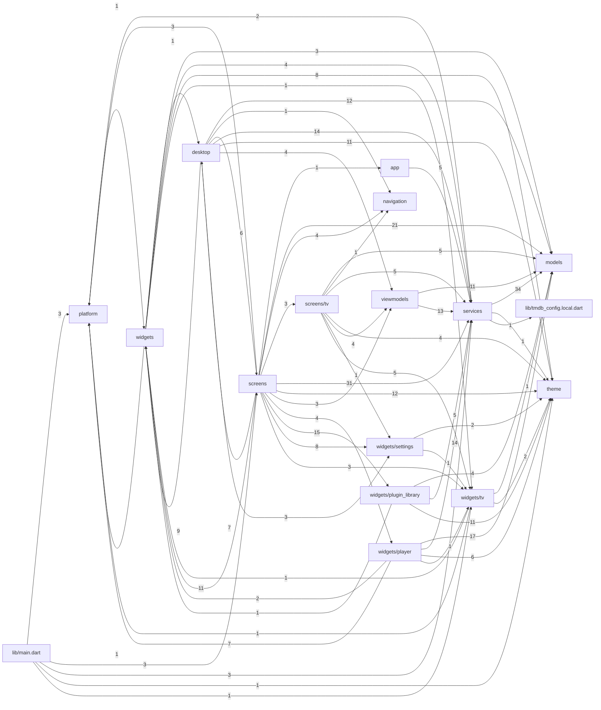

# Dependency map

<!-- Generated by tool/docs/docs_tool.dart from the source. Do not edit by hand: run `dart run tool/docs/docs_tool.dart generate`. -->

How the folders of `lib/` import each other, which files the most code depends on, and where each third-party package is used. Counts are import statements between files, from the source.

## Folder dependencies

An arrow `A --> B` means files in A import files in B; the label is how many imports. Read it to see which layers know about which: for example, nothing in `models` or `services` should import a UI folder.

| From folder | Imports from (count) |
|---|---|
| `lib/main.dart` | `platform` (3), `screens` (3), `services` (3), `theme` (1), `widgets/tv` (1) |
| `app` | `services` (5) |
| `desktop` | `models` (12), `navigation` (1), `screens` (6), `services` (14), `theme` (11), `viewmodels` (4), `widgets` (9), `widgets/settings` (3) |
| `models` | nothing outside itself |
| `navigation` | nothing outside itself |
| `platform` | `widgets` (1) |
| `screens` | `app` (1), `desktop` (7), `models` (21), `navigation` (4), `platform` (3), `screens/tv` (3), `services` (31), `theme` (12), `viewmodels` (3), `widgets` (11), `widgets/player` (4), `widgets/plugin_library` (15), `widgets/settings` (8), `widgets/tv` (3) |
| `screens/tv` | `models` (5), `navigation` (1), `services` (5), `theme` (4), `viewmodels` (4), `widgets/settings` (1), `widgets/tv` (5) |
| `services` | `models` (34), `platform` (2), `theme` (1), `lib/tmdb_config.local.dart` (1) |
| `theme` | nothing outside itself |
| `viewmodels` | `models` (11), `services` (13) |
| `widgets` | `desktop` (1), `models` (3), `platform` (1), `services` (4), `theme` (8), `widgets/tv` (1) |
| `widgets/player` | `models` (17), `platform` (7), `services` (14), `theme` (6), `widgets` (2), `widgets/tv` (1) |
| `widgets/plugin_library` | `models` (4), `services` (5), `theme` (11), `widgets` (1) |
| `widgets/settings` | `theme` (2), `widgets/tv` (1) |
| `widgets/tv` | `models` (1), `platform` (1), `theme` (2), `widgets` (1) |

## Most depended-on files

The files imported by the most other `lib/` files. A change to one of these reaches widely; run the full test suite and check each platform.

| File | Imported by (lib files) | Imported by (tests) |
|---|---|---|
| [`lib/src/theme/glass_theme.dart`](../../lib/src/theme/glass_theme.dart) | 58 | 14 |
| [`lib/src/models/media_item.dart`](../../lib/src/models/media_item.dart) | 29 | 30 |
| [`lib/src/models/stream_source.dart`](../../lib/src/models/stream_source.dart) | 18 | 13 |
| [`lib/src/services/storage_service.dart`](../../lib/src/services/storage_service.dart) | 16 | 16 |
| [`lib/src/platform/device_capabilities.dart`](../../lib/src/platform/device_capabilities.dart) | 14 | 4 |
| [`lib/src/widgets/tv/tv_focus.dart`](../../lib/src/widgets/tv/tv_focus.dart) | 12 | 4 |
| [`lib/src/services/tmdb_service.dart`](../../lib/src/services/tmdb_service.dart) | 11 | 14 |
| [`lib/src/models/media_details.dart`](../../lib/src/models/media_details.dart) | 9 | 5 |
| [`lib/src/models/plugin_catalog.dart`](../../lib/src/models/plugin_catalog.dart) | 9 | 1 |
| [`lib/src/services/network_target_policy.dart`](../../lib/src/services/network_target_policy.dart) | 9 | 13 |
| [`lib/src/services/paged_feed_controller.dart`](../../lib/src/services/paged_feed_controller.dart) | 9 | 5 |
| [`lib/src/desktop/desktop_widgets.dart`](../../lib/src/desktop/desktop_widgets.dart) | 8 | 5 |
| [`lib/src/models/episode_progress.dart`](../../lib/src/models/episode_progress.dart) | 8 | 7 |
| [`lib/src/services/provider_plugin_service.dart`](../../lib/src/services/provider_plugin_service.dart) | 8 | 3 |
| [`lib/src/widgets/settings/settings_components.dart`](../../lib/src/widgets/settings/settings_components.dart) | 8 | 1 |
| [`lib/src/services/media_catalog_rules.dart`](../../lib/src/services/media_catalog_rules.dart) | 7 | 7 |
| [`lib/src/services/plugin_library_query.dart`](../../lib/src/services/plugin_library_query.dart) | 7 | 1 |
| [`lib/src/widgets/poster_image.dart`](../../lib/src/widgets/poster_image.dart) | 7 | 1 |
| [`lib/src/models/app_update.dart`](../../lib/src/models/app_update.dart) | 6 | 7 |
| [`lib/src/services/playback_settings_controller.dart`](../../lib/src/services/playback_settings_controller.dart) | 6 | 6 |
| [`lib/src/models/episode_context.dart`](../../lib/src/models/episode_context.dart) | 5 | 3 |
| [`lib/src/models/resume_summary.dart`](../../lib/src/models/resume_summary.dart) | 5 | 2 |
| [`lib/src/models/stream_type.dart`](../../lib/src/models/stream_type.dart) | 5 | 4 |
| [`lib/src/services/plugin_library_repository.dart`](../../lib/src/services/plugin_library_repository.dart) | 5 | 2 |
| [`lib/src/widgets/settings/tmdb_attribution.dart`](../../lib/src/widgets/settings/tmdb_attribution.dart) | 5 | 1 |

## Package usage

Each third-party package imported by `lib/`, A–Z, with the files that import it. Why each exists is in [third-party dependencies](../reference/third-party-dependencies.md).

| Package | Imported by |
|---|---|
| `crypto` | `src/services/github_update_service.dart`, `src/services/provider_plugin_service.dart` |
| `flutter` | 101 files, including `main.dart`, `src/desktop/desktop_details_screen.dart`, `src/desktop/desktop_hero.dart`, `src/desktop/desktop_pages.dart`, `src/desktop/desktop_plugins_page.dart`, `src/desktop/desktop_provider_search.dart` |
| `flutter_go_torrent_streamer` | `src/services/torrent_source_preparer.dart`, `src/widgets/player/custom_video_player.dart` |
| `flutter_js` | `src/services/provider_fetch_bridge.dart`, `src/services/provider_runner.dart` |
| `http` | `src/services/github_update_service.dart`, `src/services/network_target_policy.dart`, `src/services/plugin_library_service.dart`, `src/services/provider_fetch_bridge.dart`, `src/services/provider_plugin_service.dart`, `src/services/subtitle_addon_service.dart`, `src/services/subtitle_loader.dart`, `src/services/tmdb_service.dart` |
| `material_symbols_icons` | 54 files, including `src/desktop/desktop_details_screen.dart`, `src/desktop/desktop_hero.dart`, `src/desktop/desktop_pages.dart`, `src/desktop/desktop_plugins_page.dart`, `src/desktop/desktop_provider_search.dart`, `src/desktop/desktop_settings_page.dart` |
| `package_info_plus` | `src/screens/app_information_screens.dart`, `src/screens/credits_screen.dart`, `src/services/app_metadata.dart`, `src/services/github_update_service.dart` |
| `path_provider` | `src/services/github_update_service.dart`, `src/services/plugin_library_service.dart`, `src/services/storage_service.dart`, `src/services/tmdb_response_cache.dart` |
| `shared_preferences` | `src/desktop/desktop_shell.dart`, `src/screens/first_run_consent_screen.dart`, `src/services/storage_service.dart` |
| `url_launcher` | `src/desktop/desktop_update_section.dart`, `src/screens/app_information_screens.dart`, `src/screens/credits_screen.dart`, `src/screens/legal_information_screen.dart`, `src/screens/plugin_details_screen.dart` |
| `video_player` | `src/services/playback_coordinator.dart`, `src/services/player_engine.dart`, `src/widgets/player/audio_track_sheet.dart`, `src/widgets/player/custom_video_player.dart`, `src/widgets/player/player_controls.dart`, `src/widgets/player/player_progress_bar.dart`, `src/widgets/player/player_settings_sheet.dart` |
| `video_player_android` | `src/services/player_engine.dart` |
| `video_player_media_kit` | `src/services/player_engine.dart`, `src/services/windows_update_controller.dart`, `src/widgets/player/custom_video_player.dart` |
| `video_player_platform_interface` | `src/services/player_engine.dart` |
