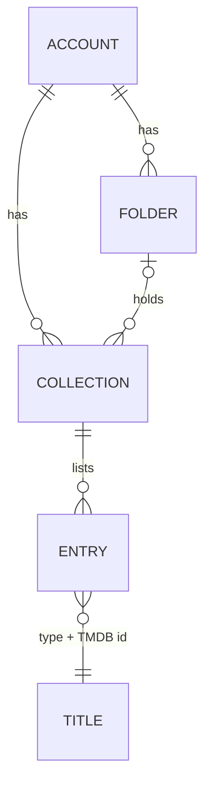

# Collection data model

## Storage

One SharedPreferences string per account:

| Key | Value |
|---|---|
| `onfeed.collections.v1.u.<userId>` | JSON document below |

Signed out there is no library (the app has no guest state; `AccountGate`
shows sign-in). Nothing is stored device-wide, so there is nothing to
migrate from older versions.

```json
{
  "v": 1,
  "folders": [
    {"id": "9f1c…", "name": "Movies", "order": 1, "createdAt": 1763000000000, "updatedAt": 1763000000000}
  ],
  "collections": [
    {"id": "a87c…", "name": "Sci-fi", "description": "Big ideas", "folderId": "9f1c…",
     "cover": "movie:438631", "order": 1, "createdAt": 1763000000000, "updatedAt": 1763000100000},
    {"id": "b2d0…", "name": "Old", "order": 2, "createdAt": 1762000000000, "updatedAt": 1763000200000, "deleted": true}
  ],
  "entries": [
    {"collectionId": "a87c…", "type": "movie", "id": "438631", "name": "Dune",
     "poster": "https://image.tmdb.org/t/p/w500/….jpg", "background": "https://image.tmdb.org/t/p/w1280/….jpg",
     "year": "2021", "addedAt": 1763000050000, "updatedAt": 1763000050000},
    {"collectionId": "a87c…", "type": "series", "id": "70523", "name": "Dark",
     "addedAt": 1763000060000, "updatedAt": 1763000300000, "removed": true}
  ]
}
```

Optional fields are left out when empty. Times are milliseconds since the
epoch on the device's clock (`StorageService.clock`).

## Records

### `CollectionFolder`

| Field | Meaning |
|---|---|
| `id` | 24 hex characters from `Random.secure()` |
| `name` | 1–80 characters, trimmed |
| `order` | Position among folders, smallest first; ties by `createdAt` |
| `createdAt`, `updatedAt` | Save times |
| `deleted` | Deletion mark |

### `MediaCollection`

| Field | Meaning |
|---|---|
| `id` | As folders |
| `name` | 1–80 characters, trimmed |
| `description` | Up to 300 characters, optional |
| `folderId` | Its folder, or absent at the top level |
| `cover` | `type:id` of the title whose poster leads the cover; absent for the newest titles |
| `order` | Position within its folder (or the top level) |
| `createdAt`, `updatedAt`, `deleted` | As folders |

### `CollectionEntry`

| Field | Meaning |
|---|---|
| `collectionId` | The collection |
| `type`, `id` | `movie` or `series`, and the TMDB id: the title's identity |
| `name`, `poster`, `background`, `year` | The card, copied when added |
| `addedAt` | When it was (last) added |
| `updatedAt` | Last change, including removal |
| `removed` | Taken out, kept as a mark |

The entry's key is `collectionId|type:id`. There is one record per key, so
a title cannot be in a collection twice, on one device or (with sync) on
several. A movie and a series that share a TMDB id are different titles.

### `SmartCollection`

Not stored. See the [specification](SMART_COLLECTIONS_SPECIFICATION.md).

### Sync state

Kept beside the library by `CollectionSync`, one entry per account
([sync strategy](COLLECTION_SYNC_STRATEGY.md)):

| Key | Value |
|---|---|
| `onfeed.collectionSync.v1` | `{userId: {device, seq, cursor, offset, seeded, outbox: {recordKey: at}}}` |

Record keys there are `folder:<id>`, `collection:<id>` and
`entry:<collectionId>|<type>:<id>`. Times from other devices are converted
to this device's clock with the measured offset before they are stored.

## Relationships and rules



- **One level of folders.** A folder has no parent, so a cycle cannot be
  made.
- **Moving into a folder** requires the folder to exist; the collection goes
  to the end of its new place.
- **Deleting a folder** moves its collections to the end of the top level,
  unless the viewer chooses *Delete folder and its collections* and confirms
  a second time.
- **A collection whose folder is missing** (for example, deleted on another
  device later) shows at the top level.
- **Deleting a collection** marks it deleted; its entries are dropped when
  the library is next saved. The titles stay in My list, other collections
  and the history.
- **Adding** a title already present does nothing. Adding one that was
  removed revives its record with a new `addedAt`.
- **Reordering** swaps `order` with the neighbour, so only two records
  change.
- **Validation** happens before anything changes: a change naming a missing
  collection or folder changes nothing.

## Deletion marks

Deleted folders and collections, and removed entries, are kept with their
`updatedAt`, so a sync can tell "deleted" from "never seen" and an older
copy cannot bring them back. Marks older than 400 days are dropped when the
library is saved, the same retention as synced playback progress.

## Reading old or damaged data

- Unknown fields are ignored; a record without a readable id, name or (for
  entries) a kind of `movie` or `series` is skipped, and the rest load.
- A document that is not JSON loads as an empty library and is left in place
  until the next change rewrites it.
- `MediaItem.savedAt` (below) is optional; My list entries without it load
  as before.

## Change to My list

`MediaItem` gains `savedAt`, the time a title was added to My list. It is
written only when non-zero, set by `StorageService.toggleFavorite`, and left
at 0 for titles the Trakt watchlist sync brings in (a first sync would
otherwise mark the whole watchlist as just added). Recently added uses it.

## Indexes

In memory, `CollectionLibrary` keeps: collections sorted by folder and
order, entries by collection (newest first), and collection ids by title.
Lookups are map reads; sorting a collection by title or year sorts that
collection only.
