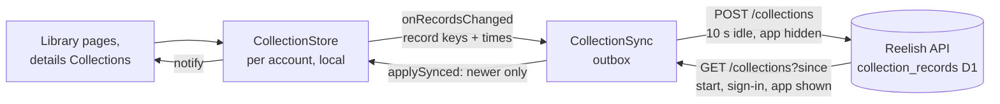

# Collection sync strategy

Collections are local first and synced through the Reelish API, the same
way as playback progress
([cross-device sync](../intelligent-continue-watching/CROSS_DEVICE_SYNC_STRATEGY.md)).



## Local first

- Collections, folders and entries are stored per account on the device
  ([data model](COLLECTION_DATA_MODEL.md)); every change is saved there at
  once and works with no connection.
- Sync never blocks editing, and a failed sync never touches the library.
- Account switching: `AccountHistory` points `CollectionStore` at the new
  account. A change still queued for the old account fails rather than
  being saved to the new one; a change reported just as the account changes
  waits in that account's own outbox for its next sign-in.
- Signing out empties the library in memory; the stored document and the
  outbox stay for that account's next sign-in.

## Server (`backend/src/collections.ts`, migration `0012`)

```sql
CREATE TABLE collection_records (
  user_id    TEXT NOT NULL REFERENCES users(id) ON DELETE CASCADE,
  kind       TEXT NOT NULL CHECK (kind IN ('folder', 'collection', 'entry')),
  record_key TEXT NOT NULL,          -- id, or collectionId|type:id
  body       TEXT NOT NULL,          -- checked fields, rebuilt by the server
  deleted    INTEGER NOT NULL DEFAULT 0,
  device_id  TEXT NOT NULL,
  seq        INTEGER NOT NULL,
  client_at  INTEGER NOT NULL,
  changed_at INTEGER NOT NULL,
  PRIMARY KEY (user_id, kind, record_key)
);
CREATE INDEX collection_records_changed ON collection_records (user_id, changed_at);
```

| Route | Does |
|---|---|
| `POST /api/v1/collections` | `{device, changes}`: up to 50 records, 64 KB. Each is checked field by field (kind, id or entry key pattern, name 1–80, description ≤ 300, folder id, cover `type:id`, finite order, TMDB artwork URLs only, four-digit year, whole-number times). A deletion keeps no content. Returns `{accepted, serverTime}` |
| `GET /api/v1/collections?since=` | Rows changed at or after the cursor, oldest first, 200 a page: `{items, cursor, more, serverTime}` |

Both run after the session check, behind `SYNC_LIMITER` (key
`collections:<user>`). Every query is filtered by the session's user id,
never by data the app sends. The daily cron deletes deletion marks older
than 400 days; live records are kept until the account is deleted, which
removes every row (`ON DELETE CASCADE`).

## Ordering and conflicts

Per record, so two devices' edits to different records both survive. A
stored row is replaced only by a newer change:

- same device: the higher change counter (`seq`) wins;
- different devices: the later `client_at` wins, the device clock corrected
  by its measured offset from the server and clamped by the server to its
  own time;
- equal: the larger device id, so every device settles on the same answer.

Devices apply a pulled record only when it is newer than the copy they
hold, and never over a newer change of their own still waiting to be sent.

| Case | Result |
|---|---|
| A collection made on Android, a title added on Windows, both offline | Different records: both kept |
| The same title added to the same collection on two devices | Same key: one record, never a duplicate |
| Renamed on two devices | The later rename wins |
| Deleted on one device, renamed offline on another (earlier) | The deletion is newer: it stays deleted everywhere |
| Deleted on one device, a title added to it on another | The collection stays deleted; its titles are hidden and dropped with it |
| Folder deleted on one device, a collection moved into it on another | The collection shows at the top level (a missing folder is treated as none) |
| A title arrives before its collection (another page) | Kept, and shown once the collection arrives |
| A record sent twice | Compares equal: nothing changes (idempotent) |

## App (`lib/src/account/collection_sync.dart`)

- `CollectionStore.onRecordsChanged` reports the records each local change
  touched (found by comparing records before and after the change).
- An outbox `{recordKey: at}` per account, stored under
  `onfeed.collectionSync.v1`, with the device id (random, per account),
  change counter, pull cursor and clock offset.
- Push 10 s after editing stops, and when the app is hidden. The record
  sent is read from the store at that moment, so several edits of one
  record send it once.
- Pull at start, at sign-in, and when the app is shown again more than two
  minutes after the last pull; up to 20 pages a pull.
- Retries from 30 s, doubling to 30 minutes, 8 times; a 401 refreshes the
  session once.
- First sync on a device: every record already held (Phase 1 collections)
  waits to be sent, after first pulling what other devices sent.
- Pulled rows are checked again on the device (they are remote data) and
  applied in one save; the library then notifies the pages.

## Free-tier budget

The Workers free plan allows 100,000 requests a day, shared with the TMDB
gateway and playback sync. Collections add one pull at each app start or
return (shared with no other request) and one push per editing session: a
handful a day for an active user. D1 rows are a few hundred bytes; a
library of 1,000 titles is under 1 MB. The pull reads only rows changed
since the cursor, so D1 row reads stay small after the first sync. No new
service is needed.

## Limitations

- A device's clock is corrected once it has reached the server; a change
  made offline before then counts as made at upload time.
- A device whose clock was fast, then corrected, keeps records dated in the
  future until they are changed again; its newer-looking copies win until
  then (as with playback progress).
- A device left open does not see another device's edits until it is
  reopened, returned to after two minutes, or restarted.
- When a collection is deleted, its titles' rows stay on the server (hidden
  by the deletion) until the account is deleted.
- There is no limit on the number of records per account beyond the rate
  limiter and per-request bounds.

## Trakt

Not used for collections (decision: not now):

- Trakt personal lists (`/users/me/lists`) hold movies and shows, with
  ordering, but have **no folders**, and free Trakt accounts have tight
  limits on lists and items (check Trakt's current limits before relying on
  them).
- Mapping Reelish folders and covers onto Trakt would lose structure, and
  two-way sync would need list ids, rate-limit handling and conflict rules
  of its own.
- My list keeps its existing, optional Trakt watchlist sync. Disconnecting
  Trakt does not affect collections.

If added later, the safest first step is a one-way **import** of chosen
Trakt lists into new Reelish collections, through new read-only routes on
the Reelish API (which holds the Trakt tokens).

## Security and privacy

- Records are stored under the authenticated account only; the app never
  names the account in a request.
- The server rebuilds what it stores from checked fields, so nothing a
  device sends is stored verbatim; artwork must be a TMDB image URL.
- Collection names and titles are not logged, by the app or the API.
- The privacy policy has a paragraph, *Your collections across your
  devices*, and account deletion lists collections.
