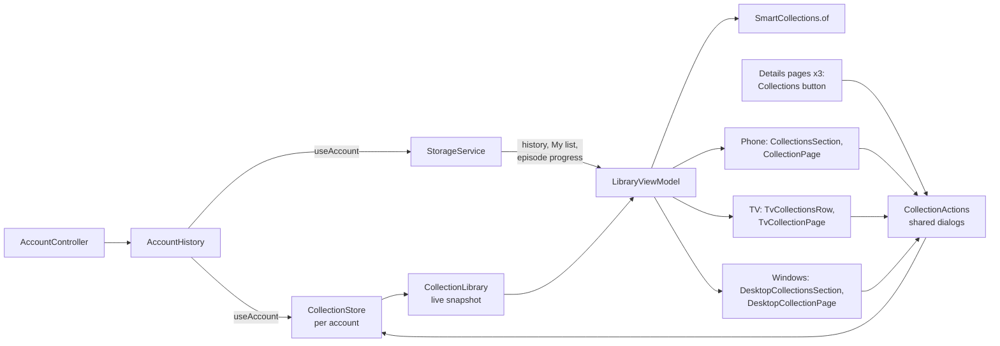
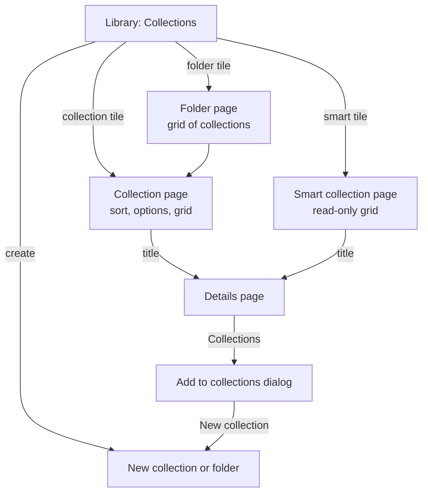

# Custom collections: architecture

Viewers can group movies and series into their own collections, put
collections into folders, and browse four smart collections that fill
themselves. The library is stored on the device, per account, and works
offline (Phase 1); `CollectionSync` keeps it the same across the account's
devices through the Reelish API (Phase 2,
[sync strategy](COLLECTION_SYNC_STRATEGY.md)).

## What existed before

| Concern | Where | Notes |
|---|---|---|
| My list | `StorageService.favorites()` / `toggleFavorite`, key `onfeed.favorites` | Reelish's favourites *and* watchlist: one list, full `MediaItem` cards, per device |
| Trakt watchlist | `WatchlistSync` (app), `backend/src/trakt-sync.ts` | Optional two-way sync of My list with the Trakt watchlist |
| Watch history | `StorageService.history()`, per account (Continue watching Phase A) | 50 titles, positions, episode progress |
| Library pages | `LibraryScreen` (phone), `TvLibraryPage`, `DesktopLibraryPage` | All read `LibraryViewModel` |
| Accounts | `AccountHistory` | Points storage at the signed-in account |

There is no Firestore: Firebase runs only analytics and crash reports. The
existing free storage for account data is the Reelish API with D1.

## Decisions

| Area | Decision |
|---|---|
| Storage | SharedPreferences, one JSON document per account (`onfeed.collections.v1.u.<userId>`) |
| Folders | One level: folders hold collections, not folders (user decision) |
| Title data | TMDB id and kind plus a small card (name, poster, backdrop, year), so a collection opens with no TMDB requests (user decision) |
| Favourites | The My list smart collection *is* My list; nothing is copied |
| Trakt | Not used for collections (user decision); My list keeps its watchlist sync |
| Sync | Through the Reelish API + D1 (user decision), per record, newest change wins |

## Components

- **`CollectionStore`** (`lib/src/collections/collection_store.dart`) owns the
  records. Every change goes through one queue, is applied in memory,
  published as a new `CollectionLibrary`, and saved for the account it was
  made for. A change queued for one account fails if the account changes
  before it runs, so nothing is saved to the wrong account.
- **`CollectionLibrary`** (`collection_models.dart`) is an immutable snapshot
  of the live records with indexes: collections by folder, titles by
  collection, collections by title. Built once per change, not per frame.
- **`SmartCollections`** (`smart_collections.dart`) is a pure function from
  My list, the history, episode progress and the collections to a list of
  titles ([specification](SMART_COLLECTIONS_SPECIFICATION.md)).
- **`LibraryViewModel`** gains `collections`, `collectionStore` and
  `smart(kind)`, cached until the history, My list or collections change.
- **`CollectionActions`** (`lib/src/widgets/collections/`) holds the dialogs
  every interface uses: create, edit, move to folder, choose cover, reorder,
  delete (with confirmation, Cancel focused), and Add to collections.

## Interfaces

| | Phone | Android TV / Google TV | Windows |
|---|---|---|---|
| Library | Collections section after Recently watched, and a Collections filter chip | Collections row after Watch history | Collections section after Watch history |
| Open | Tap a tile | Select a tile | Click a tile |
| Collection actions | Long press a tile, or ⋮ on its page | Options button on its page | ⋮ on hover, right-click, or Options on its page |
| Title actions | Long press a poster on the page: Collections, Use as cover, Remove | The title's details page → Collections | The title's details page → Collections |
| Create | + in the section header | Create tile at the row's end | New in the section header |
| Back | System back | Back | Esc, Backspace or the back button |

Every details page has a **Collections** button next to My list. It opens a
dialog of the account's collections with a tick for each one the title is
in; each tick saves at once, and *New collection* creates one with the
title already in it.

Pages are pushed routes (`AppPageRoute`), as details pages are, so they
cover the TV rail and the Windows sidebar. Titles open through Home's own
`_showDetails`, so playback, My list and Watch together work as anywhere
else.

## UI flow

## Data flow of one change

1. The viewer ticks *Sci-fi* in the Add to collections dialog.
2. `CollectionStore.setMembership` queues the change for the current
   account, waits for earlier changes and the initial read, then applies it.
3. A new `CollectionLibrary` is published; the dialog, the library section
   and any open collection page rebuild from it. `LibraryViewModel` drops
   its cached smart lists.
4. The account's JSON document is written. A failure is reported in a snack
   bar; the in-memory library keeps the change for the session.

## Performance

- Opening a collection reads nothing from the network: cards come from the
  stored snapshot. Posters go through the existing artwork cache, decoded at
  the size drawn (`cacheWidth`).
- Each change rebuilds the snapshot once (linear in the number of titles)
  and rewrites one SharedPreferences string. For a library of a few thousand
  titles this is well under a frame's budget; it is not measured on device.
- Library rows and grids are lazy (`ListView.builder`, `SliverGrid`).
- Smart lists are computed once per change, from at most 50 history entries,
  My list and the collections.

## Not built (see the changelog)

Trakt lists, nested folders, drag-and-drop ordering, manual
ordering of titles inside a collection, custom images, and a per-card
"Add to collection" outside details pages.
