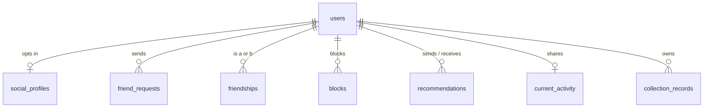

# Friends & Activity: database schema

D1 (SQLite), one migration, `0013_social.sql`. Every table references
`users(id) ON DELETE CASCADE`, so deleting an account removes its social
data. Times are server milliseconds.

```sql
-- A user's social profile. No row: Friends is off, and nothing about the
-- account can be found or seen.
CREATE TABLE social_profiles (
  user_id TEXT PRIMARY KEY REFERENCES users(id) ON DELETE CASCADE,
  handle TEXT NOT NULL,                 -- as typed, for display
  handle_key TEXT NOT NULL UNIQUE,      -- lower-case, the lookup key
  handle_changed_at INTEGER NOT NULL,
  friend_code TEXT NOT NULL UNIQUE,     -- 8 chars, no look-alikes
  display_name TEXT,                    -- ≤ 40, optional
  avatar_preset TEXT,                   -- one of the built-in presets
  find_by_code INTEGER NOT NULL DEFAULT 1,
  find_by_handle INTEGER NOT NULL DEFAULT 0,
  allow_recommendations INTEGER NOT NULL DEFAULT 1,
  share_activity INTEGER NOT NULL DEFAULT 0,   -- 0 off, 1 friends
  created_at INTEGER NOT NULL,
  updated_at INTEGER NOT NULL
);

-- Pending requests only; accepted ones become friendships, declined and
-- cancelled ones are deleted.
CREATE TABLE friend_requests (
  sender_id TEXT NOT NULL REFERENCES users(id) ON DELETE CASCADE,
  receiver_id TEXT NOT NULL REFERENCES users(id) ON DELETE CASCADE,
  created_at INTEGER NOT NULL,
  PRIMARY KEY (sender_id, receiver_id),
  CHECK (sender_id <> receiver_id)
);
CREATE INDEX friend_requests_receiver ON friend_requests (receiver_id, created_at);

-- One row per friendship, user_a < user_b.
CREATE TABLE friendships (
  user_a TEXT NOT NULL REFERENCES users(id) ON DELETE CASCADE,
  user_b TEXT NOT NULL REFERENCES users(id) ON DELETE CASCADE,
  created_at INTEGER NOT NULL,
  PRIMARY KEY (user_a, user_b),
  CHECK (user_a < user_b)
);
CREATE INDEX friendships_b ON friendships (user_b);

CREATE TABLE blocks (
  blocker_id TEXT NOT NULL REFERENCES users(id) ON DELETE CASCADE,
  blocked_id TEXT NOT NULL REFERENCES users(id) ON DELETE CASCADE,
  created_at INTEGER NOT NULL,
  PRIMARY KEY (blocker_id, blocked_id),
  CHECK (blocker_id <> blocked_id)
);
CREATE INDEX blocks_blocked ON blocks (blocked_id);

-- Private, sender to recipient. The card is a snapshot (title, year, TMDB
-- artwork URL), so the inbox needs no TMDB requests.
CREATE TABLE recommendations (
  id TEXT PRIMARY KEY,                   -- random
  sender_id TEXT NOT NULL REFERENCES users(id) ON DELETE CASCADE,
  recipient_id TEXT NOT NULL REFERENCES users(id) ON DELETE CASCADE,
  media_key TEXT NOT NULL,               -- movie:<tmdb> | series:<tmdb>
  title TEXT NOT NULL,
  year TEXT,
  poster TEXT,                           -- image.tmdb.org only
  message TEXT,                          -- ≤ 200
  client_id TEXT NOT NULL,               -- idempotency key from the app
  created_at INTEGER NOT NULL,
  read_at INTEGER,
  UNIQUE (sender_id, client_id, recipient_id),
  UNIQUE (sender_id, recipient_id, media_key)  -- re-sending refreshes it
);
CREATE INDEX recommendations_inbox ON recommendations (recipient_id, created_at);
CREATE INDEX recommendations_sent ON recommendations (sender_id, created_at);

-- At most one current activity per user; never a history.
CREATE TABLE current_activity (
  user_id TEXT PRIMARY KEY REFERENCES users(id) ON DELETE CASCADE,
  media_key TEXT NOT NULL,               -- movie:<tmdb> | series:<tmdb>
  season INTEGER,
  episode INTEGER,
  title TEXT NOT NULL,
  poster TEXT,
  started_at INTEGER NOT NULL,
  updated_at INTEGER NOT NULL,
  expires_at INTEGER NOT NULL            -- set by the server
);
CREATE INDEX current_activity_expiry ON current_activity (expires_at);

-- Daily send counters (requests, recommendations), one row per user and day.
CREATE TABLE social_counters (
  user_id TEXT NOT NULL REFERENCES users(id) ON DELETE CASCADE,
  day INTEGER NOT NULL,                  -- days since the epoch, UTC
  requests INTEGER NOT NULL DEFAULT 0,
  recommendations INTEGER NOT NULL DEFAULT 0,
  PRIMARY KEY (user_id, day)
);

-- Collections: visibility as a real column, so friends' reads are indexed.
ALTER TABLE collection_records ADD COLUMN visibility TEXT NOT NULL DEFAULT 'private';
CREATE INDEX collection_records_shared
  ON collection_records (user_id, kind, visibility) WHERE deleted = 0;
```

## Relationships



## Query patterns and indexes

| Query | Index used |
|---|---|
| Find by code / handle | `friend_code` / `handle_key` unique indexes |
| Is X a friend of Y | `friendships` primary key (ordered pair) |
| Is there a block either way | `blocks` primary key, twice |
| My friends | `friendships` PK prefix (`user_a = me`) ∪ `friendships_b` |
| Incoming requests | `friend_requests_receiver` |
| Inbox | `recommendations_inbox` |
| Friends watching now | friends (above) joined to `current_activity` PK, `expires_at > now` |
| Friend's shared collections | `collection_records_shared` |
| Titles of a shared collection | `collection_records` PK range on `record_key` prefix |

## Data rules

- **Handles** are normalised to lower case; `handle_key` is unique. Reserved
  names (`admin`, `support`, …, and anything containing `reelish`) are
  refused. A handle given up (changed, Friends turned off, account deleted)
  goes into `released_handles` (handle, last owner or null, time) and is
  refused to everyone else for 30 days; its last owner may take it back.
  The daily cron deletes rows past the hold. Decided in Phase 1.
- **Handle changes**: once a week, except the first change after turning
  Friends on (a new profile starts with `handle_changed_at = 0`), so a typo
  can be fixed at once. A change of letter case only is always allowed.
- **Friend codes** use 8 characters from an alphabet without 0/O/1/I,
  random, and change on request.
- **Request state transitions**: none → pending (sender); pending → friends
  (receiver accepts, or the other side sends); pending → none (decline,
  cancel, block, either account turning Friends off). Friends → none
  (remove, block, either account turning Friends off).
- **Recommendations**: the unique `(sender, recipient, media)` makes a
  re-send update `created_at`, message and `read_at = NULL` instead of
  adding a row. Old ones are pruned after 180 days.
- **Activity**: one row, upserted. A row past `expires_at` is never returned
  and is deleted by the daily cron.
- **Counters**: rows older than 2 days are pruned daily.

## Retention and deletion

| Data | Kept |
|---|---|
| Profile, friendships, blocks | Until removed, Friends turned off, or account deleted |
| Pending requests | 30 days, then pruned |
| Recommendations | 180 days, or until removed by the recipient |
| Current activity | Until cleared or expired (≤ 4 hours) |
| Counters | 2 days |

## Migration

Additive only: new tables, one new column with a default. Existing
collections read as private. The app treats a missing `visibility` as
private, so older app versions keep working and never make anything
shared.
