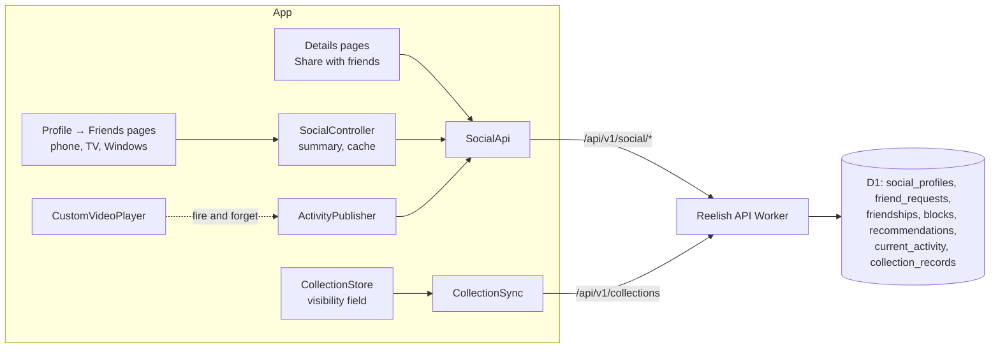
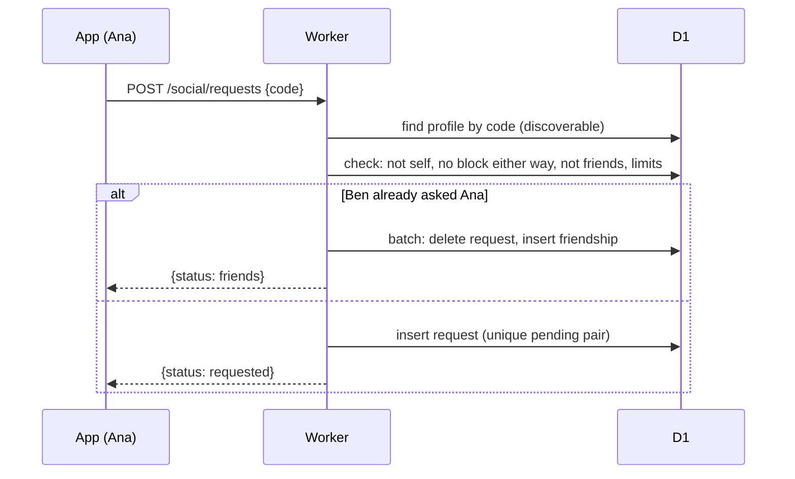

# Friends & Activity: technical architecture

## Backend choice

| Option | Fit |
|---|---|
| **Reelish API + D1 (recommended)** | Already authenticates every user, already holds accounts, collections and progress, and already enforces per-user rate limits. Social rules (friendship checks, blocks, visibility) become SQL `WHERE` clauses in one Worker, tested in the Workers runtime with real D1. No new SDK or vendor, and one place to delete an account. |
| Firestore | Would need Firebase Auth or custom tokens minted by the Worker (Reelish sessions are not Firebase identities), FlutterFire (which CLAUDE.md rules out because it builds the C++ SDK into Windows), and a second copy of account data. Security Rules cannot easily express "friends of" without denormalised friend lists, which cost reads on every check. |
| Durable Objects | Good for live rooms (Watch Party). Social data is relational and read on demand, so D1 is simpler. |

## Components

### Server (`backend/src/social/`)

- `profiles.ts`: create, update and delete a profile, handle rules, friend
  codes, privacy settings.
- `friends.ts`: lookup by code or handle, requests, accept, decline,
  cancel, remove, block, unblock, list.
- `recommendations.ts`: send, inbox, sent, mark read, remove.
- `activity.ts`: publish, clear, friends' current activity.
- `shared-collections.ts`: a friend's shared collections and their titles,
  read from `collection_records`.
- One helper, `relationship(viewer, owner)`, returns *self*, *friend*,
  *blocked* or *none*, and every read goes through it.

All routes sit behind `authenticate` and `requireLiveSession`, and a new
`SOCIAL_LIMITER` binding (per user, e.g. 60 requests a minute), plus daily
counters in D1 for requests and recommendations.

### App (lib/src/social/ (planned))

- `SocialApi`: the HTTP client, on `AccountApi`'s `_send` conventions.
- `SocialController` (a `ChangeNotifier`): profile and settings, summary
  counts, friends list cache (memory, plus SharedPreferences per account
  for offline display), invalidated on actions.
- `ActivityPublisher`: receives "started", "episode changed" and "closed"
  from the player through one nullable hook (like `PartyPlayerSync`), sends
  asynchronously, never awaited by playback, at most one write a minute.
- UI per interface: phone lib/src/screens/social/ (planned), TV
  lib/src/screens/tv/tv_social.dart (planned), Windows
  lib/src/desktop/desktop_social.dart (planned); shared dialogs in
  lib/src/widgets/social/ (planned).

## Request flows

### Friend request

Concurrent requests from both sides: the unique pair index plus the
"reverse request exists" check inside one D1 batch means one wins and the
other becomes an accept. Friendships are stored once, ordered
(`user_a < user_b`), so duplicates are impossible.

### Reads

| Screen | Request | Bounded by |
|---|---|---|
| Friends entry dot | `GET /social/summary` | 2 counts |
| Friends page | `GET /social/friends?cursor=` | 50 a page, plus pending requests (≤ 30 each way) |
| A friend | `GET /social/friends/{handle}` | Profile + shared collections (names, counts, cover posters) |
| A shared collection | `GET /social/friends/{handle}/collections/{id}?cursor=` | 200 titles a page |
| Inbox | `GET /social/recommendations?cursor=` | 30 a page |
| Watching now | `GET /social/activity` | Friends with a live record, ≤ 100 |

Nothing polls. Reads happen when a page opens, on pull-to-refresh, or on
return to the app after a pause.

## Playback integration

- One nullable `ActivityPublisher` call in `CustomVideoPlayer`, when
  playback first reports a position (the stream is playing), on episode
  change and in `dispose`. Each call returns immediately; the publisher
  queues the latest state and sends it later.
- No call when sharing is off, signed out, inside a Watch Party (decision
  D8), or for content without a TMDB id.
- No engine, source, header, subtitle or audio code changes.

## Collections integration

- `MediaCollection` gains `visibility` (`private` by default; old records
  without it read as private).
- `CollectionSync` sends it; the server stores it in a real column
  (`collection_records.visibility`), not only in the JSON body, so the
  friends' read is an indexed `WHERE`.
- A friend reads `kind = 'collection' AND visibility = 'friends' AND
  deleted = 0` for that owner, and titles by `record_key` prefix
  (`<collectionId>|`), which is a range scan on the primary key.
- Entries carry no visibility of their own: they follow their collection
  at read time, so switching a collection back to *Private* hides every
  title at once.

## Offline and failure

- Social pages show the last friends list and inbox from the cache, marked
  offline. Actions need a connection and say so; nothing is queued silently.
- Recommendations being sent are kept in a small outbox with an idempotency
  key (`client_id`), so a retry never sends twice.
- Activity is best effort: missed updates simply expire.
- Social errors never reach playback, browsing or the Library.

## Account lifecycle

- Sign out: the activity record is cleared (best effort; it expires anyway).
- Turn Friends off: the profile and every social row are deleted in one
  batch, and shared collections become private.
- Delete account: `ON DELETE CASCADE` removes everything.
