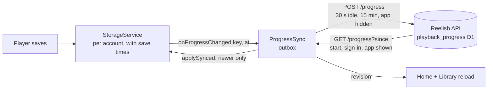
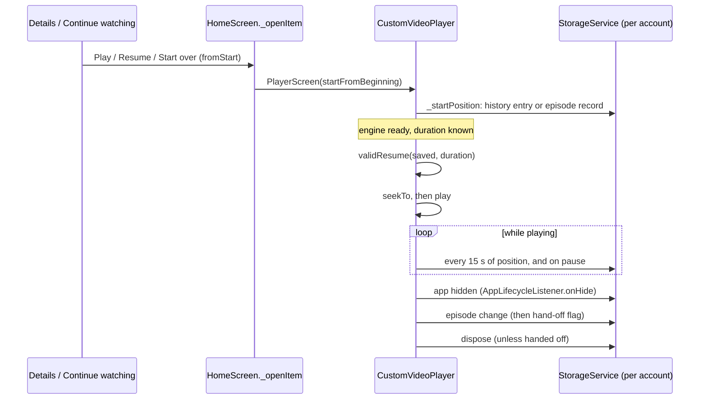
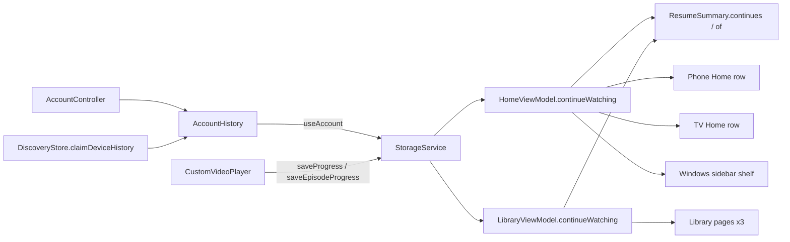

# Continue watching: architecture

How Reelish records where a viewer stopped, resumes it, and decides what
Continue watching shows. Phase A is the local engine; Phase B syncs it
across an account's devices through the Reelish API
([sync strategy](CROSS_DEVICE_SYNC_STRATEGY.md)).

## What existed before this work

Most of the local engine was already in place and is kept:

| Concern | Where | Behaviour |
|---|---|---|
| Checkpoints | `_CustomVideoPlayerState._tick` | Saves every 15 s of playback position, and 300 ms after every pause |
| Exit | `_CustomVideoPlayerState.dispose` | Saves unless the position was handed to the next episode's player |
| Episode change | `_playEpisode` | Saves, then sets `_progressHandedOff` so the old player cannot overwrite the new episode |
| Movie progress | `StorageService.saveProgress` | `resumeMs`/`durationMs` on the title's history entry (50 entries, newest first) |
| Episode progress | `StorageService.saveEpisodeProgress` | Per-episode `[positionMs, durationMs]` plus the episode watched last (100 series) |
| Resume | `_startPosition` | Episode from its own record, movie from its history entry; watched (90 %) restarts at 0 |
| Cards | `ResumeSummary.of` | Real progress only: share and time left |
| Removal | `removeHistory` / `restoreHistory` | Phone (with Undo), TV details (with confirmation), Windows cards (Delete key, button) |

Writes to SharedPreferences go through one static queue
(`StorageService._serialized`), so two saves never write back a list
missing the other's change.

## What Phase A changed

| Gap | Change |
|---|---|
| History was shared by every account on a device | History and episode progress are stored per account (`StorageService.useAccount`, `AccountHistory`); the older device-wide history moves once into the account that owns it |
| Finished titles stayed in Continue watching as "Watched" | `ResumeSummary.continues` removes them from the row; they stay in the history (Library, recommendations) |
| A finished episode gave no way forward | The player records the next aired episode with a watched one; the card reads `Up next · S1 E4`, and the Windows sidebar and the episode list open on it (`SeriesProgress.continueAt`) |
| A movie opened from search or a catalog row started at 0 | The player reads the movie's saved entry wherever it was opened from |
| A saved position was trusted against any stream | `CustomVideoPlayer.validResume` restarts from 0 when the position falls in the watched end of *this* stream (a shorter source) |
| No way to start over | Details pages show **Resume** and **Start over** for a movie in progress (phone, TV, Windows) |
| Backgrounding saved only if playback paused | An `AppLifecycleListener` saves when the app is hidden (Android background, screen off, Windows minimise) |

## Phase B: across devices

Local saves never wait on the network; sync reads the latest saved value
when it sends, and applies a pulled value only where it is newer. The
ordering rule and budget are in the
[sync strategy](CROSS_DEVICE_SYNC_STRATEGY.md).

## Playback lifecycle

The seek runs after the controller is initialised and before `play()`, as
before; the history read for movies starts in `initState` alongside the
stream opening, so it adds no start-up wait.

## Components

Progress logic lives below the UI: the player only reports positions; the
model (`EpisodeProgress`, `SeriesProgress`, `ResumeSummary`) decides what is
watched, what continues, and what a card says; `StorageService` owns
persistence and account scoping. All three interfaces read the same view
models, so the rules are identical on phone, TV and Windows.

## Completion

A title is complete at 90 % of its length (`EpisodeProgress.watchedFraction`).
Reaching the end is covered by the same rule (the position is then the
length). Nothing is marked complete without a recorded position at or past
that share, so an error or an early exit cannot complete a title. The
next-episode offer has its own user setting
(`PlaybackSettings.nextEpisodeThresholdPercent`) and is unchanged.

## Platform notes

- **Android / Google TV / Android TV:** `onHide` fires when the activity
  stops (Home button, another app, screen off). A process killed while
  playing keeps the last 15-second checkpoint.
- **Windows:** `onHide` fires on minimise. Closing the window is not
  reported to Dart (the runner handles `WM_CLOSE` for window placement
  only), so a close while playing keeps the last checkpoint. Changing that
  needs runner work and is left as a follow-up.
- Picture-in-picture does not hide the app; saves continue on the normal
  schedule.
