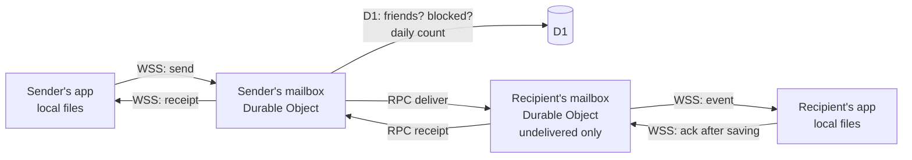

# Private messages

One-to-one text messages between friends, on phone, Android TV / Google TV
and Windows. Messages live on the devices. The Reelish API holds a message
only until every device of the recipient has saved it, and for at most
14 days.

**Not end-to-end encrypted.** Messages travel over TLS (HTTPS/WSS) and the
server deletes them once delivered. While a message waits, it is stored
in plain text in a Cloudflare Durable Object, so the operator (and
Cloudflare) could read it. The app says so on the Messages page. See
[End-to-end encryption](#end-to-end-encryption-not-yet) for the path to it.

## Architecture



| Part | Where | Role |
|---|---|---|
| `Mailbox` Durable Object | `backend/src/messaging/mailbox.ts` | One per account (`mailbox:<userId>`). SQLite tables `events` (undelivered messages and receipts) and `devices` (a cursor per session). WebSocket Hibernation API. |
| Socket route | `backend/src/messaging/messages.ts`, `GET /api/v1/messages/socket` | Authenticates the session, requires Friends on, forwards the socket to the caller's own mailbox with the account and session ids as headers it builds itself. |
| Hooks in existing routes | `social/friends.ts`, `social/profiles.ts`, `auth.ts`, `episode-alerts.ts` | Block purges waiting messages both ways. Friends off and account deletion wipe the mailbox. The summary counts waiting messages. The background check can report them. |
| Daily count | D1 `social_counters.messages` (migration `0015_messages.sql`) | Next to the other social limits. Pruned by the existing daily cron. |
| `MessagesController` | `lib/src/messaging/messages_controller.dart` | The conversations, the outbox, the socket and its lifecycle, acknowledgements and receipts; deleting, unsending and the per-account settings. |
| `MessageStore` | `lib/src/messaging/message_store.dart` | Files on this device, per account. |
| Screens | `lib/src/screens/social/messages_screen.dart`, `conversation_options_screen.dart` | Conversation list, chat, composer, message actions; a conversation's options (nickname, mute, delete). Opened from Friends (`friends_screen.dart`) and a friend's page. |
| Alerts | `lib/src/notifications/episode_check.dart`, `episode_alerts.dart` | "Messages from friends" in Settings › Notifications, folded into the episode check (Android background, Windows while open). |

Nothing new was added for identity, profiles or friendships. Sessions,
Trakt sign-in, Friends profiles, friendships, blocks and reports are the
existing ones (`docs/friends-activity/`). Firebase and Supabase hold no app
data, so they were not used. Firestore would need a second identity
system and its own security rules, and Cloud Functions need the paid Blaze
plan.

## Delivery lifecycle

1. The sender's app gives the message a random UUID, saves it to its own
   conversation file with status **sending**, and adds it to the outbox
   (`index.json`).
2. Connected: the app sends `{t:'send', to:<handle>, id, text}` over its
   socket. Offline: it waits in the outbox and goes when a socket opens.
3. The sender's mailbox checks the text, then reads D1 once. It looks up
   who the handle is, whether the two are friends with no block either
   way, and how many messages the sender has sent today.
4. It calls `deliver` on the recipient's mailbox. A message with the same
   sender and id that is already waiting is not stored again, which makes
   retries idempotent. The message is stored and pushed to the recipient's
   connected devices that are caught up.
5. The sender's socket gets `{t:'sent', id, at}`, and the message becomes
   **sent**. If the sender has other devices, a copy marked `out` goes to
   their own mailbox for them.
6. The recipient's app saves the message to disk (append and flush), then
   acknowledges `{t:'ack', seq}`. One acknowledgement covers everything up
   to `seq`, and the app groups them about 250 ms apart. The conversation
   list is written before the acknowledgement goes out.
7. The mailbox moves the device's cursor and deletes every event that all
   live devices have saved.
8. The first acknowledgement from any of the recipient's devices sends a
   receipt to the sender's mailbox. If all of the sender's devices are
   connected, it goes out live and nothing is stored. Otherwise it is
   stored as an event until they have it. The message becomes
   **delivered**.

A message is never deleted from the cloud just because it was sent to a
device: only after the device has acknowledged saving it, or when it
expires.

### Interruptions and duplicates

| Case | What happens |
|---|---|
| App closes after receiving, before acknowledging | Nothing was acknowledged: the next connection sends it again, and the app recognises its id (key `i:<id>` / `o:<id>`) and skips it. |
| App closes before the conversation list is written | The message is in its conversation file. On redelivery the app sees the list does not have it and writes it then. |
| Crash mid-write | Only the last line of a conversation file can be cut short, and it is skipped on reading. The index is written through a temporary file and a rename. |
| Connection lost before `sent` | The outbox resends with the same id after reconnecting; the mailbox answers with the first copy's time. |
| Recipient's mailbox unreachable, D1 error, rate limit | `send_error` `unavailable` / `rate_limited`: kept in the outbox and retried (15 s, or on the next connection). |
| Refused (`not_friends`, `too_long`, `empty`, `daily_limit`) | Marked **failed** with the reason, and the user can retry it (same id). |
| A friend reuses one of your ids | Messages are keyed by direction and id, so it cannot overwrite yours. The server only deduplicates within the same sender. |

### Several devices

Each session is a device with its own cursor. A message stays until every
device seen in the last 14 days has saved it. A device that signs out is
dropped by the mailbox's alarm (at most daily while something waits, after
checking the session in D1), so it does not hold messages back. A newly
signed-in device receives whatever is still waiting. **History is not
copied between devices**: each device keeps what it received or sent while
signed in.

## Deleting, unsending, nicknames and mute

All of these belong to one account. Nothing deletes the other person's
copy, except an unsend of your own message, which they see as "Message
unsent". Every action needs the connection (the app says when it is
offline) so that all of the account's devices end up the same.

| Action | Where it is kept | Who is affected |
|---|---|---|
| **Delete for you** (any message) | On each device: the message stays as a marker without its text (`x:'d'` in its line), so a redelivered copy does not bring it back. The file is rewritten at once (`MessageStore.replace`), so the text leaves the disk. Other devices hear of it through a `hide` event in the account's own mailbox. | This account only |
| **Unsend** (your own sent or delivered message) | The friend's mailbox drops the message if it still waits (it is never delivered) and stores an `unsend` event for their devices. A copy (`out:true`) goes to your other devices. Devices keep a marker without text (`x:'u'`), shown as unsent. | Both people |
| **Delete conversation** | `conversation_prefs.cleared_at` (Reelish time) in the account's mailbox, given to every device. Each device drops messages up to that time, deletes or rewrites the file, and ignores older redeliveries. A newer message starts the conversation again. | This account only |
| **Nickname** | `conversation_prefs.nickname`. Shown instead of the friend's name in the list, the chat and its options. Their `@handle` always stays visible, and their own name is shown on the options page. | This account only |
| **Mute** | `conversation_prefs.muted`. Messages arrive as usual and the conversation keeps its own unread count. It is left out of `Mailbox.pending()`, which feeds the background alert and the Friends summary badge, and out of the app's total unread. | This account only |

**Persistent settings.** `conversation_prefs` (`conv`, `muted`, `nickname`,
`cleared_at`, `updated_at`) is a table in the account's own mailbox Durable
Object. Unlike `events`, it is not pruned. A row with nothing set is deleted,
and an account may keep at most 1,000 rows. The mailbox sends all of them in
`ready` and pushes each change to every connected device. A device that was
offline or is newly signed in gets them when it connects, and keeps a copy in
`index.json` (`prefs`) for offline starts. They are written only when they
change. Turning Friends off or deleting the account wipes them, along with
the rest of the mailbox. Deleting a conversation keeps its nickname and mute.

**Why the unsend is safe.** The server sets an unsend's conversation from the
sender's verified account, and the sender's id is the socket's account. The
recipient's devices apply an unsend from the friend (`out:false`) only to
*incoming* messages in that conversation (`i:<id>`). So whatever id a client
names, it can only reach its own messages. An `out:true` unsend or a `hide`
can only come from the account's own mailbox. Unsend works after a
friendship ends, but never across a block. The server cannot check how old
the message is (it keeps no delivered messages), so there is no time limit.

**Alerts and timing.** Mute and deletion are checked by the server each time
a device asks for waiting messages, so they apply on the next background
check of every device. They do not withdraw an alert that is already
showing. Alerts only say how many messages wait and from whom, never which
conversation.

**Groups.** Conversations are one to one. The settings are keyed by
conversation. A group would need nicknames keyed by conversation and
member.

## Local storage

```
<app support>/messages/<account id>/index.json            conversations, unread counts, outbox
<app support>/messages/<account id>/<conversation>.jsonl   one message per line
```

- **No new dependency:** `dart:io` files through the existing
  `path_provider`. Per account, so another account on the same device sees
  nothing.
- **Conversation files** are only appended to. A status change is a new
  line for the same message, and the last one wins. A file is rewritten
  (temporary file and rename) once it holds more than twice as many lines
  as messages, plus 50.
- **Conversation ids** are made by the server (`SHA-256("conversation:" +
  ordered pair)`, 22 characters, base64url). They are the same for both
  people and reveal neither account id. The app accepts only
  `[A-Za-z0-9_-]{16,64}`, so an id can never name a path outside the
  folder.
- **History** loads in full when a conversation opens, and the chat shows
  the latest 50, then 50 more per "Earlier messages". This suits
  chat-sized histories. Very long ones (tens of thousands of messages)
  would want an indexed store such as SQLite, which needs a new dependency.
- **Shapes** are versioned (`index.json` has `v: 1`), and the JSON keys in
  `ChatMessage.toJson` and `Conversation.toJson` are stored user data:
  keep them readable.
- **Sign-out** keeps the files, like the app's other per-account caches,
  and signing in again shows them. **Turning Friends off** deletes them,
  and the confirmation says so. They are not encrypted at rest. Android
  keeps them in app-private storage, Windows in the user's AppData.

## Security

| Requirement | How |
|---|---|
| Server-enforced authentication | The socket route needs a valid access token, `requireLiveSession` and Friends on. An open socket re-checks its session and profile in D1 every 10 minutes and closes (4401) when revoked. |
| Only friends | Checked in D1 at every send (friendship and no block either way), never cached. Unknown, not-a-friend, blocked and yourself all answer `not_friends`. |
| Only participants read messages | A device connects only to its own mailbox. The account and session come from the verified token as headers the Worker sets. A client header such as `X-Mailbox-User` is overwritten (tested). There is no route that reads another mailbox. |
| No impersonation | The sender is the socket's account. The sender's handle, name and avatar in a message come from D1, never from the client. |
| Conversation id manipulation | The server computes conversation ids. A client cannot choose one or address a mailbox by it. The app ignores frames with unsafe ids. |
| Deletion | A device can only acknowledge its own cursor, never above what it was sent. No message route deletes another person's data. Block, Friends off and account deletion are the only purges. Delete for you, delete conversation, nickname and mute write only to the caller's own mailbox. An unsend reaches the friend's devices for the sender's own messages only (see [Deleting, unsending, nicknames and mute](#deleting-unsending-nicknames-and-mute)). |
| Per-account settings | Validated on the server: conversation id pattern, nickname 1–32 characters on one line with the same unsafe characters removed as in messages, booleans only, at most 1,000 rows, `hide` at most 100 well-formed keys. A request without a valid `ref` counts as an invalid frame. |
| Blocks | A block deletes waiting messages both ways and refuses all later sends. |
| Input | At most 2,000 UTF-16 units. Control, bidirectional-override and zero-width characters removed. Newlines kept, runs of more than three blank lines collapsed. Frames over 12 KB refused. The app shows text as plain text: no links are made clickable and nothing is rendered as HTML. |
| Rate and spam | A token bucket per socket (a burst of 20 frames, then one a second). Five invalid frames close it (4029). 1,000 messages per account per UTC day. `SOCIAL_LIMITER` on connecting. |
| Reports | Report on a friend's page (opened from the chat's info button): the existing `/social/reports`. Reports are not attached to message content: the server keeps none to attach. |
| Logs and analytics | No message text, handle or id is logged. Crash notes are fixed text (`messages connect failed`). |
| Secrets | None in the app. The Worker uses its existing secrets only. |

## Free-tier limits and consumption

Workers Free plan, checked 2026-11-14:
[Durable Objects pricing](https://developers.cloudflare.com/durable-objects/platform/pricing/),
[Workers pricing](https://developers.cloudflare.com/workers/platform/pricing/),
[D1 pricing](https://developers.cloudflare.com/d1/platform/pricing/).

| Resource | Free allowance (per account, per day unless noted) | Shared with |
|---|---|---|
| Worker requests | 100,000 | Every API route (TMDB gateway is the largest) |
| Durable Object requests | 100,000 (incoming WebSocket messages count 20:1; outgoing are free) | Watch Party |
| Durable Object duration | 13,000 GB-s | Watch Party |
| DO SQLite rows written | 100,000 (deletes and `setAlarm` count) | Watch Party (small) |
| DO SQLite rows read | 5,000,000 | Watch Party |
| DO SQLite storage | 5 GB total | Watch Party |
| D1 rows read / written | 5,000,000 / 100,000 | All D1 routes |

When an allowance runs out, Cloudflare refuses requests until 00:00 UTC.
Nothing upgrades on its own: the Free plan has no billing to upgrade to.
The app then shows "Offline…" or "Messages are unavailable", keeps what it
has, and retries with backoff up to a minute. Pending messages stay in the
outbox.

### Per operation

| Operation | Worker req. | DO requests (billed) | DO rows written | D1 |
|---|---|---|---|---|
| Open a socket (Messages screen) | 1 | 1 | 1 (device row) | 3 reads (session, profile) |
| Send one message, recipient online | 0 | ≈ 1.05 (deliver RPC + 1/20 frame) | ≈ 2 (row + sequence) | ≈ 10 reads, 1 write (counter) |
| Recipient saves and acknowledges | 0 | 1/20 + 1 (receipt RPC) | 1 cursor + 1 delete (grouped per batch) | — |
| Receipt to a sender whose devices are all connected | 0 | 0 | 0 | — |
| Receipt to a sender with a device offline | 0 | 0 | ≈ 2 + later 1 delete | — |
| Copy to the sender's other devices | 0 | 0 | ≈ 2 + later 1 delete | — |
| First message into an empty mailbox | 0 | 0 | +1 (`setAlarm`) | — |
| Summary (`GET /social/profile`) | (existing) | +1 | 0 | (existing) |
| Background check, messages on | (existing) | +1 | 0 | +1 read |
| Daily alarm while something waits | 0 | 1 | ≈ 1–3 | 1 read |
| Mute, nickname or delete a conversation | 0 | 1/20 | 1 (row reads: 1–2) | — |
| Delete for you | 0 | 1/20 | 0, or ≈ 2 + later 1 delete with other devices | — |
| Unsend | 0 | ≈ 1.05 (retract RPC + 1/20 frame) | ≈ 3 (+ ≈ 2 with other devices) | 1 read |
| Settings sent on connecting | 0 | 0 | 0 | — (DO rows read: one per stored setting, at most 1,000) |

So one message costs roughly **4–5 rows written** when both people are
online with one device each, and **up to ~10** with offline senders and
several devices. Storage is only what waits: about 0.5 KB per message,
deleted on delivery or after 14 days.

**Duration** is the least certain cost. A mailbox is billed (at 128 MB)
while it is in memory and not hibernated, which includes a short idle
window after each message. A lively chat keeps both mailboxes awake; a
sparse one wakes them per message. Watch the Durable Objects *Duration*
metric in the Cloudflare dashboard after launch.

### Scenarios

Assumptions: 30 % of registered users active daily, each sending 20 and
receiving 20 messages a day, two Messages sessions a day, one device each.

| Registered | Messages/day | Worker req. | DO requests | DO rows written | Of the 100k writes |
|---|---|---|---|---|---|
| 100 | 600 | ~60 | ~1.4k | ~3k | 3 % |
| 500 | 3,000 | ~300 | ~7k | ~15k | 15 % |
| 1,000 | 6,000 | ~600 | ~14k | ~30k | 30 % |
| 5,000 | 30,000 | ~3k | ~70k | ~150k | **150 %: over** |

**The binding limit is Durable Object rows written** (then possibly
duration), not Worker requests. Messaging stays comfortably free up to
roughly **10,000–15,000 messages a day** across all users, fewer if
Watch Party is busy. Beyond that the choices are the Workers Paid plan
(owner's decision, about $5 a month base) or fewer writes (for example
storing receipts less often). No paid service is used or implied now.

### Guards against waste

- The socket is open only while a Messages screen is visible (plus 20 s,
  or longer while the outbox is non-empty) and the app is in the
  foreground. Nothing polls.
- Hibernating sockets, and protocol pings Cloudflare answers without
  waking the object.
- Acknowledgements grouped (one cursor write per batch, not per message).
  Backlogs are sent 100 at a time.
- Receipts not stored when everyone who needs them is connected. No copy
  for other devices when there are none.
- Reconnects back off 1 → 60 s with jitter. A refused socket (Friends off)
  stops retrying.
- Daily per-account cap; mailboxes woken by the background check only for
  accounts with Friends on.

## Configuration

- **Worker:** `wrangler.toml` binds `MAILBOXES` (class `Mailbox`) in
  development, staging and production, and adds DO migration `v3`
  (`new_sqlite_classes = ["Mailbox"]`). No new secrets or variables.
- **D1:** apply `0015_messages.sql` (staging first):
  `npx wrangler d1 migrations apply reelish-staging --remote --env staging`.
- **Deploy** the Worker after the migration (`npm run deploy:staging`).
  Production only when the owner says so, and before an app release that
  uses messages.
- **App:** nothing to configure. The socket address comes from
  `REELISH_API_URL`.

## Protocol

Socket frames are JSON text.

| From | Frame | Meaning |
|---|---|---|
| Server | `{t:'ready', serverTime, limits:{maxChars, maxNickname}, prefs:[{conv, muted, nickname, clearedAt}]}` | Connected, with every setting of this account. |
| Server | `{t:'prefs', prefs:[…]}` | A setting changed (from any device of the account). |
| Server | `{t:'event', seq, kind:'hide', conv, keys, at}` | This account deleted these messages for itself on another device. |
| Server | `{t:'event', seq, kind:'unsend', conv, id, out, at}` | A message was unsent: the friend's (`out` false) or this account's, from another device. |
| Server | `{t:'done', ref, conv}` / `{t:'failed', ref, code}` | Answer to `pref`, `hide` or `unsend` (`invalid`, `invalid_nickname`, `too_many`, `not_friends`, `unavailable`). |
| Server | `{t:'event', seq, kind:'message', conv, id, out, peer:{handle,displayName,avatar}, text, at}` | A message to save (`out`: one this account sent from another device). |
| Server | `{t:'event', seq, kind:'receipt', conv, ids, at}` | These of my messages reached the friend. |
| Server | `{t:'synced', seq}` | Caught up; later events are pushed live. |
| Server | `{t:'receipt', conv, ids, at}` | A receipt not stored (every device connected). |
| Server | `{t:'sent', id, conv, at}` / `{t:'send_error', id, code}` | Answer to a send. |
| Server | `{t:'error', code}` | `invalid_message`, `unknown_message`, `rate_limited`. |
| Client | `{t:'send', to, id, text}` | Send to a friend by handle. |
| Client | `{t:'ack', seq}` | Everything up to `seq` is saved. |
| Client | `{t:'pref', ref, conv, muted?, nickname?, clear?}` | Set this account's mute or nickname (`null` resets it), or delete the conversation for it. |
| Client | `{t:'hide', ref, conv, keys}` | Delete messages for this account (keys `i:<id>` / `o:<id>`). |
| Client | `{t:'unsend', ref, to, id}` | Unsend this account's message `id` to the friend `to`. |

Older app versions ignore the new frames and event kinds and still
acknowledge them, so nothing waits on their account.

Close codes: 4001 connected again elsewhere (same session), 4003 Friends
off (stop), 4029 too many invalid frames, 4401 session ended.

## End-to-end encryption (not yet)

Deferred, by decision. Real E2EE with several devices per account needs a
reviewed library (for example libsodium through `sodium_libs`, a native
dependency on Android and Windows), a public-key directory per device, a
key for each recipient device, and a way to verify keys. Without forward
secrecy (static sealed boxes) it is not Signal-grade either. The frame and
store shapes leave room for it: a `v` field on messages and an encrypted
`text` can be added without migrating what is stored.

## Known limitations

- Not end-to-end encrypted (above).
- No history sync: a new device starts empty, apart from messages still
  waiting.
- Alerts with the app closed only on Android, every few hours (WorkManager
  minimum and the episode-check cadence). Windows checks only while the
  app runs. No alerts on TV, and no instant push.
- Text only: no images, reactions, read receipts, typing indicators or
  editing.
- An unsend cannot take back what the friend already read, copied or saw
  in an alert. A device of theirs that stays offline for more than 14 days
  misses it, as it would a message. A device of yours that does the same
  misses a "delete for you" (deleted conversations, nicknames and mute are
  kept until changed, so it still gets those).
- Deleting, unsending and changing a setting need a connection; they are
  not queued offline.
- Messages older than 14 days that never reached a device are lost (the
  sender's copy stays, marked sent).
- Local files are not encrypted at rest.
- A message waiting for a friend who later deletes their account expires
  with their mailbox; one from a deleted account still reaches its
  recipient.

## Tests

| Suite | Covers |
|---|---|
| `backend/test/messages.test.ts` (30) | Real-time delivery, ack, deletion and receipts. Offline queueing, summary count, sync on connect. Idempotent retries. Redelivery after an interrupted ack. Friends-only, block and unfriend. Text rules and size. Daily limit. Flood closing. Unauthenticated, no upgrade, Friends off. Forged headers. Several devices and copies to them. Batched backlog. Ack beyond what was sent. TTL expiry and signed-out devices. Revoked session closing an open socket. Friends off wipes, then works again. Conversation ids. Background check without text. Nickname and mute private to the account, on all of its devices and on a new one, and reset. Setting validation. Mute out of alerts and the summary while delivery goes on. Delete conversation for one account only, with newer messages still arriving. Delete for you only to the account's other devices. Unsend before delivery (text never delivered) and after, after unfriending, refused across a block. An unsend cannot reach the friend's own messages. Settings wiped with Friends off. |
| `backend/test/social-friends.test.ts` | Updated for the new `conversation` and `messages` fields. |
| `test/messaging_test.dart` (22) | Store: last line wins, direction-keyed ids, cut-off lines, index and outbox, account separation, wipe, compaction, unsafe ids. Controller: save-then-ack, redelivery once, grouped acks, offline send then sent/delivered, restart keeping history and outbox, resend after reconnect, failed and retry, passing refusals, length, copies from other devices, unsafe frames, backoff and stopping, closing when no screen is open, conversations kept apart, Friends off, another account. Settings from the account on a new device, kept across a restart, a reset elsewhere, muted conversations out of the total. Nickname and mute requests, local validation, refusals, a dropped connection. Delete for you with the text off the disk and no return on redelivery. Delete for you from another device. Unsend own and the friend's, and the friend unable to unsend yours. Delete conversation, older redelivery ignored, a newer message starting it again, and an offline device catching up. |
| `test/messages_screen_test.dart` (15) | Empty state, sending → sent, Enter sends on Windows, failure and retry, list with unread count and privacy note, offline banner and outbox, TV composer through the text dialog, time labels. Delete for you from the long-press menu, with confirmation. Unsend with confirmation. Windows right-click menu. TV Select on a message. List with nickname, handle, muted icon and long press. Options page: nickname, mute, delete. Options offline. |
| `test/episode_alerts_test.dart` | A message alert once per arrival, never with text, and the switch. |
| `test/friends_test.dart` | Windows two-column layout with Messages leading the left column. |
