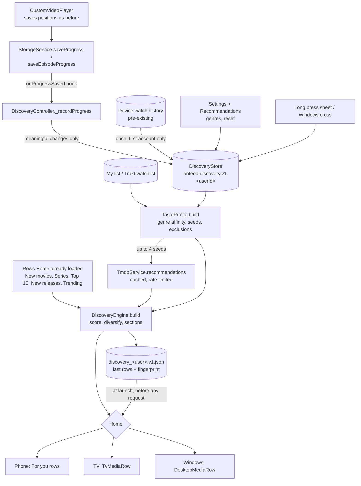

# Personalised discovery: architecture

Reelish builds up to four personalised rows on Home from what each signed-in
account watches, saves and says about recommendations. Everything is worked
out on the device. No new backend, service or dependency was added.

Related pages: [scoring model](RECOMMENDATION_SCORING_MODEL.md),
[data model](PERSONALIZATION_DATA_MODEL.md),
[TMDB usage](TMDB_API_OPTIMIZATION.md),
[test report](PERSONALIZED_DISCOVERY_TEST_REPORT.md),
[changelog](IMPLEMENTATION_CHANGELOG.md).

## What existed before (audit)

| Area | Found | Used for discovery |
|---|---|---|
| TMDB | `TmdbService` through the Reelish API's allowlisted gateway (`backend/src/tmdb/allowlist.ts`). Request limiter (4), retries, de-duplication of requests in flight, disk cache with stale-while-revalidate (`TmdbResponseCache`). | `TmdbService.recommendations(item)` as it is: cached 20 min, deferred priority. |
| Gateway limits | Allows `/movie|tv/{id}/recommendations`, `/discover/*` with fixed date/vote/type filters, details with `credits,external_ids`, trending, popular, search. **No `/similar`, no `with_genres`, `with_cast`, `with_people`, no `/person/*`.** | Candidates come from seed recommendations and rows Home already loaded. |
| Watch history | `StorageService` (SharedPreferences): 50 titles with resume point and length; per-episode progress for 100 series. **Device-wide, not per account. No dates, no completions.** | Read once into the first account's activity; afterwards activity is recorded from saved positions. |
| My list | `StorageService.favorites()`, synced with the Trakt watchlist by `WatchlistSync` when turned on. | A positive signal and a seed. |
| Trakt | Device-code sign-in; backend keeps Trakt tokens; the app has watchlist sync and episode alerts. **No history or ratings route.** | Only through My list (watchlist). See "Trakt" below. |
| Home | `HomeViewModel` + one `PagedFeedController` per row; Top 10 already uses `/recommendations` of the best catalog titles; phone, TV and Windows draw the rows their own way. | Personalised rows are added; nothing is removed. |
| Firebase | Analytics and Crashlytics through the Android SDK, opt-in. No Firestore. | Not used. |
| State | `ChangeNotifier` ViewModels, Home owns `AppServices`. | `DiscoveryController` is one more `ChangeNotifier` owned by Home. |

## Components

| Piece | File | Role |
|---|---|---|
| `TitleActivity`, `ViewingRules` | `lib/src/discovery/viewing_activity.dart` | Turns saved positions into started / in progress / mostly watched / completed / rewatched / abandoned. |
| `DiscoveryData`, `TitleFeedback` | `lib/src/discovery/discovery_data.dart` | One account's activity, feedback and picked genres; JSON shapes. |
| `DiscoveryStore` | `lib/src/discovery/discovery_store.dart` | Per-account SharedPreferences key; cached rows in a private file; which account owns the old device history. |
| `TasteProfile`, `DiscoveryWeights` | `lib/src/discovery/taste_profile.dart` | Genre affinity, movie/series balance, seeds, exclusions. All weights in one class. |
| `DiscoveryEngine` | `lib/src/discovery/discovery_engine.dart` | Scores candidates and builds the rows. Pure: no I/O. |
| `TmdbGenres` | `lib/src/discovery/tmdb_genres.dart` | Genre names, picker list, TV↔movie genre equivalents. |
| `DiscoveryController` | `lib/src/discovery/discovery_controller.dart` | Binds the account, records viewing, single-flight refresh, cache, feedback, reset. |
| Phone rows + sheet | `home_screen.dart`, `widgets/recommendation_feedback_sheet.dart`, `MediaCard.onLongPress` | Rows in For you; long press for feedback. |
| TV rows | `screens/tv/tv_pages.dart` | `TvMediaRow`s after New movies and Series. |
| Windows rows | `desktop/desktop_pages.dart`, `DesktopMediaRow.removeLabel` | Rows under Top 10; hover cross / Delete = Not interested; reasons as captions. |
| Settings | `screens/recommendation_settings_screen.dart` | Genres you like, show hidden titles, reset. Phone/TV Settings > General, Windows Settings rail. |

## Data flow

## When things run

- **Launch:** Home binds the signed-in account. The account's data and last
  rows are read from disk and shown at once, before any request.
- **Refresh:** once page 1 of New movies and Series has loaded
  (`catalogSettled`), after returning to Home from the player (history
  reload), and on app resume. The controller rebuilds only when the rows are
  older than 6 hours or the profile's fingerprint changed; otherwise the call
  costs one My list read. Calls at the same time share one refresh.
- **Recording:** while Home is alive (the player is pushed over it), every
  saved position reaches the recorder; it writes only when the title's status,
  share band (tenths), episodes or finishes change.
- **Account change:** Home is torn down on sign-out (`AccountGate`), and the
  controller also follows `AccountController` so another account's rows and
  data are dropped from memory before anything of the new one is read.

## Cold start

No activity, no My list, no picked genres → no personalised rows at all. Home
shows exactly what it showed before (New movies, Series worth the queue,
Top 10, New releases, Trending), which is the cold-start experience. With
picked genres (the first-run genre step, the Home card or Settings), TMDB is
asked for popular, well-rated movies and series of up to two of them, so a
genre-only account gets "Picked for your genres" and one "Because you like
<genre>" row per queried genre ([genre onboarding](../discovery/DISCOVERY_IMPLEMENTATION_REPORT.md)). Rows appear as soon as there is one
signal and fill out as more arrive. A row needs six titles to be shown.

## Trakt

Investigated: the Reelish API exposes Trakt only for sign-in, profile,
watchlist sync and episode checks (`backend/src/trakt-sync.ts`). There is no
route for Trakt history or ratings, so the app cannot read them without a
backend change (new route, Trakt egress, tests, staging then production
deploy). The watchlist already reaches discovery through My list. Reading
Trakt history is listed as a follow-up in the changelog; discovery works the
same with or without Trakt watchlist sync turned on.

## Limits and follow-ups

- **Actors and directors** are not scored. Candidate lists from TMDB carry no
  cast, scoring cast would need a details request per candidate, and the
  gateway allows no person or `with_cast` discover route. Adding
  `with_cast`/`with_crew` to the discover allowlist would enable "More from
  actors you watch"; that is a backend change for a later step.
  (`with_genres` was added for the genre rows.)
- **Cross-device sync** covers the preferences only (picked genres, the genre
  step, personalisation on/off; `/api/v1/discovery/preferences`). Viewing
  activity and feedback stay per device; the Trakt watchlist and synced
  progress are the shared viewing signals.
- **TV feedback**: TV shows the rows but has no per-card feedback action
  (cards have no secondary action on a remote). Settings > Recommendations
  works on TV.
