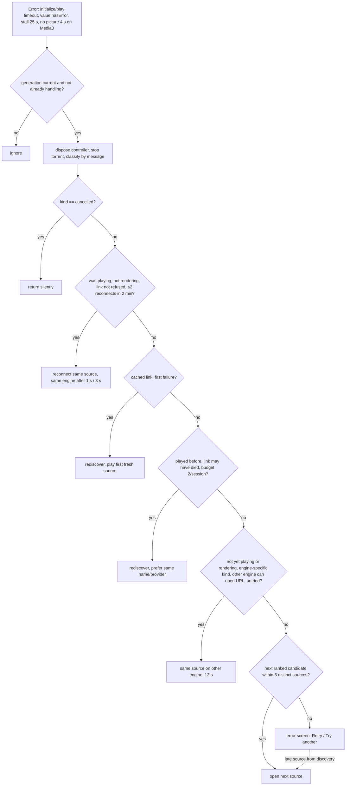

# Playback architecture overview (audit baseline, 2026-11-13)

This page records the playback architecture as the audit found it in the
code at `6d3c7ae` (v1.33.1). It is the reference for the other audit
documents in this folder:

- [Audit report](PLAYBACK_AUDIT_REPORT.md): findings, with severity and evidence
- [Performance report](PLAYBACK_PERFORMANCE_REPORT.md): latency budget, bottlenecks, metrics
- [Test strategy](PLAYBACK_TEST_STRATEGY.md): coverage, gaps, procedures
- [Remediation roadmap](PLAYBACK_REMEDIATION_ROADMAP.md): phased fixes

The maintained descriptions are [Playback architecture](../playback/playback-architecture.md),
[Playback lifecycle](../playback/playback-lifecycle.md),
[Provider integration](../playback/provider-integration.md) and
[Player engines](../playback/platform-player-engines.md). This page
summarises what the audit verified and does not replace them.

## Components and responsibilities

| Stage | Component | File | Responsibility |
|---|---|---|---|
| Entry | `_HomeScreenState._openItem` / `_resolveAndOpenPlayer` | [home_screen.dart](../../lib/src/screens/home_screen.dart) | One play request at a time (`_playbackStart` token). Picks the episode, resolves the TMDB id (3 s cap), reads a cached link, starts discovery, shows the search dialog or source sheet, then pushes `PlayerScreen`. Cancels the discovery when the player route ends. |
| Discovery | `ProviderPluginService.discoverStreams` / `streams` | [provider_plugin_service.dart](../../lib/src/services/provider_plugin_service.dart) | One `StreamDiscovery` per (title, episode, filter) key, shared while in flight. Workers (≤4) take providers in priority order, fetch the script (`ProviderScriptCache`), check approval, take one of 2 runtime slots, run the provider, normalise and validate each result. Whole search capped at 60 s. |
| Progressive results | `StreamDiscovery` | [stream_discovery.dart](../../lib/src/services/stream_discovery.dart) | `firstSource`, a replaying `updates` stream, `startingSource()` (a torrent first result waits ≤2 s for a direct stream), `cancel()` (a flag only). |
| Provider sandbox | `ProviderRunner` | [provider_runner.dart](../../lib/src/services/provider_runner.dart) | `Isolate.run` per provider run. A new QuickJS runtime (64 MiB) loads the 702 KB Cheerio/CryptoJS bundle when the script mentions `cheerio` or `crypto`. `getStreams` is capped at 30 s, the interrupt deadline at 40 s (Android only) and the whole run at 45 s. |
| Provider network | `ProviderFetchBridge`, `NetworkDestinationValidator` | [provider_fetch_bridge.dart](../../lib/src/services/provider_fetch_bridge.dart), [network_target_policy.dart](../../lib/src/services/network_target_policy.dart) | `fetch`/XHR for scripts. One DNS-pinned `HttpClient` per origin per run (pooled, 4 connections per host). 5 s DNS and 20 s request timeouts. Every redirect is re-validated. |
| Concurrency | `ProviderExecutionScheduler` | [provider_execution_scheduler.dart](../../lib/src/services/provider_execution_scheduler.dart) | App-wide: 4 workers per lookup, and 2 live QuickJS runtimes across all lookups. |
| Source shaping | `StreamNormalizer`, `StreamValidator`, `StreamSource.isPlayable` | [stream_normalizer.dart](../../lib/src/services/stream_normalizer.dart), [stream_validator.dart](../../lib/src/services/stream_validator.dart), [stream_source.dart](../../lib/src/models/stream_source.dart) | JSON to `StreamSource`. Rejects expired, malformed or bad-header sources. |
| Session | `_CustomVideoPlayerState` | [custom_video_player.dart](../../lib/src/widgets/player/custom_video_player.dart) | Owns the controller, generation counter, cancellation completer, failure policy (`_handleFailure`), stall watchdog, reconnect and link-refresh budgets, rediscovery, episode hand-off, progress saving, subtitles and tracks. About 3,800 lines. |
| Attempt policy | `PlaybackCoordinator`, `PlaybackFailure`, `EnginePreference`, `LinkRefreshBudget` | [playback_coordinator.dart](../../lib/src/services/playback_coordinator.dart) | Candidate list, attempt budget (5 distinct sources), ranking after a failure, error classification by message text, `prepareAndOpen` (prepare, engine gate, `initialize()` with timeout and cancellation). |
| Preparation | `SourcePreparer`, `TorrentSourcePreparer` | [source_preparer.dart](../../lib/src/services/source_preparer.dart), [torrent_source_preparer.dart](../../lib/src/services/torrent_source_preparer.dart) | Validates, strips hop-by-hop headers, resolves DNS and rejects non-public destinations (loopback only for the torrent streamer). Torrent metadata wait ≤30 s. |
| Engines | `PlayerEngineFactory`, `Media3PlayerEngine`, `MpvPlayerEngine`, `PlayerEngineGate`, `_EngineVideoController` | [player_engine.dart](../../lib/src/services/player_engine.dart) | Android: Media3 for `https`, libmpv for everything else and as the fallback. Windows: libmpv only. The gate stops the app-wide `VideoPlayerPlatform.instance` switching under a live player (waits ≤5 s). Dispose is capped at 5 s. |
| libmpv bridge | `MediaKitVideoPlayer` | [media_kit_video_player.dart](../../packages/video_player_media_kit/lib/src/media_kit_video_player.dart) | `video_player` platform implementation over media_kit. FFmpeg protocol allowlist, `endedEarly` (a lost connection becomes an error, not the end), decoder-error grace, MediaCodec output on emulators, Windows frame request. Default `PlayerConfiguration` (no explicit buffer, cache or network-timeout tuning). |
| Stall detection | `StallWatchdog` | [stall_watchdog.dart](../../lib/src/widgets/player/stall_watchdog.dart) | Playing and buffering with no movement for 25 s (60 s for torrents) counts as a failure. |
| Diagnostics | `PlaybackMetrics`, `PlaybackDiagnostics`, `PlaybackLog`, `PerfTimeline` | [playback_metrics.dart](../../lib/src/services/playback_metrics.dart), [playback_diagnostics.dart](../../lib/src/diagnostics/playback_diagnostics.dart) | Per-session summary (debug/profile) plus one opt-in analytics event. App-side failure kinds become non-fatal crash reports. Stage timings are logged in debug builds only. |

## Lifecycle: from Play to first frame

```mermaid
sequenceDiagram
    autonumber
    actor V as Viewer
    participant H as HomeScreen._resolveAndOpenPlayer
    participant P as ProviderPluginService
    participant R as ProviderRunner (isolate, QuickJS)
    participant S as CustomVideoPlayer state
    participant C as PlaybackCoordinator
    participant E as Engine (Media3 / libmpv)

    V->>H: Play (token _playbackStart)
    H->>H: series without episode: allEpisodes + EpisodePanel
    H->>H: resolveTmdbId (≤3 s); resolveIds in parallel
    alt reuseLastLink and cached link
        H->>H: storage.lastStream
    else
        H->>P: discoverStreams (shared per key)
        loop ≤4 workers, priority order
            P->>P: script cache / download (20 s), approval
            P->>P: acquireRuntime (2 app-wide)
            P->>R: run (getStreams ≤30 s, hard 45 s)
            R-->>P: raw entries
            P-->>H: discovery.add(source) (progressive)
        end
        H->>H: startingSource() (torrent first: ≤2 s grace)
        opt auto selection off
            H->>H: wait finished or N s, StreamSelectorSheet
        end
    end
    H->>S: push PlayerScreen(source, sources, discovery)
    S->>S: initState: details, episodes, start position (parallel)
    S->>C: prepareAndOpen
    C->>C: SourcePreparer: validate, headers, DNS (≤5 s)
    C->>E: PlayerEngineGate.activate (≤5 s), createController
    C->>E: initialize() (20 s, 7 s for a cached link, 12 s on engine fallback)
    S->>E: getVideoTracks + getAudioTracks (≤2 s)
    S->>E: preferred audio (≤2 s), speed (≤2 s), volume (≤2 s)
    S->>E: seekTo(resume) (≤2 s)
    S->>E: play() (≤10 s, else EngineStartTimeout)
    E-->>S: position advances: first frame (metrics)
    S->>S: subtitles search, save last link, artwork after 4 s
```

## Failure and recovery flow



## Concurrency and ownership invariants (verified)

- **Generation token.** `_initializationGeneration` is bumped by every open,
  by `_releaseEngine` and by `dispose`. Every await in `_initialize` and
  `_handleFailure` re-checks it. The one exception is in
  `_rediscoverAndPlay` (see PB-04 in the report).
- **Open cancellation.** Each open has a `Completer`. A newer open, a dispose
  or an episode release completes it. `prepareAndOpen` races it against
  `initialize()` and disposes the half-open controller.
- **One controller owner.** Only the session state assigns `_controller`.
  Old controllers are disposed before the next open, except the overlap
  during an episode hand-off, which `EpisodeHandOff.release` closes before
  the new route is pushed.
- **Engine switch safety.** `PlayerEngineGate` tracks live controllers per
  engine and delays an engine switch until the other engine's controllers
  are released (≤5 s). `Media3PlayerEngine.activate()` never replaces a live
  `AndroidVideoPlayer`.
- **One play request.** Home ignores Play while `_playbackStart` is set. The
  player ignores episode choices while `_switchingEpisode` is set.
- **Discovery lifetime.** Home cancels the discovery when the player route
  completes. The player cancels its own rediscovery on dispose. Cancelling
  stops new providers from starting; providers already running continue
  (see PB-01).

## Platform differences

| Concern | Android phone/tablet | Android TV / Google TV | Windows |
|---|---|---|---|
| First engine | Media3 (`video_player_android`) for `https`; libmpv for other schemes and torrent loopback | Same | libmpv (`media_kit_libs_windows_video`) |
| Fallback engine | libmpv (Media3 when libmpv was first) | Same | None (`alternateFor` returns null) |
| Media3 buffering | `video_player_android` defaults; the app has no `LoadControl` hook | Same | n/a |
| libmpv config | media_kit defaults; protocol allowlist; MediaCodec output only on emulators | Same | media_kit defaults; `ensureVisualUpdate` so `open` is not stuck on a still screen |
| No-picture watchdog | Media3 only (4 s) | Same | Not applied (libmpv reports size differently) |
| QuickJS interrupt for runaway sync code | Supported | Supported | Not supported: the timeout frees the slot, but the isolate keeps running (`ProviderRunner` docs) |
| Torrents | 64-bit processes only (`TorrentSupport`) | Same; many TVs are 32-bit | Supported when the Go streamer DLL loads (`TorrentSupport.available`). The architecture skill's "not supported" is out of date. |
| Background | `video_player` lifecycle observer pauses (no `VideoPlayerOptions`, so `allowBackgroundPlayback` is false); PiP keeps playing | Same, no PiP | Window minimise does not pause (package behaviour; not verified) |
| Keep screen on | `onfeed/player` `keepScreenOn` | Same | `DesktopWindow.keepDisplayOn` |
