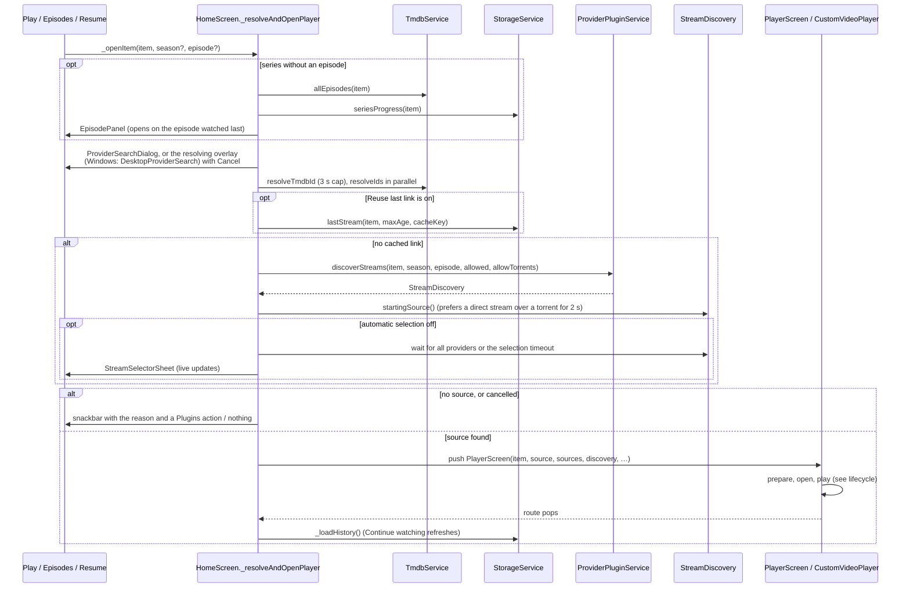

# Playback architecture

From a Play press to a picture on screen. Related pages:
[playback lifecycle](playback-lifecycle.md) (the player session),
[provider integration](provider-integration.md) (where sources come from),
[player engines](platform-player-engines.md) (Media3 and libmpv),
[troubleshooting](troubleshooting.md).

## The pipeline

| Stage | Code | What it does |
|---|---|---|
| 1. Request | `HomeScreen._openItem` → `_resolveAndOpenPlayer` ([`home_screen.dart`](../../lib/src/screens/home_screen.dart)) | One play at a time (`_playbackStart` guard); picks the episode; shows search progress; finds a source; pushes the player |
| 2. Discovery | `ProviderPluginService.discoverStreams` → `StreamDiscovery` ([`provider_plugin_service.dart`](../../lib/src/services/provider_plugin_service.dart), [`stream_discovery.dart`](../../lib/src/services/stream_discovery.dart)) | Runs enabled providers progressively; sources arrive one by one |
| 3. Normalise and check | `StreamNormalizer`, `StreamValidator`, `isPlaybackSourceAllowed` ([`stream_normalizer.dart`](../../lib/src/services/stream_normalizer.dart), [`stream_validator.dart`](../../lib/src/services/stream_validator.dart), [`playback_source_policy.dart`](../../lib/src/services/playback_source_policy.dart)) | Provider JSON → `StreamSource`; cheap URL checks; the viewer's provider and P2P preferences |
| 4. Session | `PlayerScreen` → `CustomVideoPlayer` ([`player_screen.dart`](../../lib/src/screens/player_screen.dart), [`custom_video_player.dart`](../../lib/src/widgets/player/custom_video_player.dart)) | Owns the controller, failure policy, controls, subtitles, tracks, progress |
| 5. Prepare | `PlaybackCoordinator.prepareAndOpen` → `SourcePreparer` ([`playback_coordinator.dart`](../../lib/src/services/playback_coordinator.dart), [`source_preparer.dart`](../../lib/src/services/source_preparer.dart)); torrents first through `TorrentSourcePreparer` | Validates the URL, headers and destination (DNS) before any engine sees it |
| 6. Open | `PlayerEngineGate.activate` → `PlayerEngine.createController` → `initialize()` ([`player_engine.dart`](../../lib/src/services/player_engine.dart)) | Media3 or libmpv builds a `VideoPlayerController`; startup timeout 20 s (7 s for a reused cached link) |
| 7. Play | `CustomVideoPlayer._initialize` | Tracks, preferred audio/video/subtitles, speed, resume seek, `play()` (10 s timeout), first-frame and no-picture watchdogs |
| 8. Recover | `CustomVideoPlayer._handleFailure` + `PlaybackCoordinator` | Reconnect, refresh a stale cached link, other engine, next source; at most 5 distinct sources |

## Play request flow

Notes:

- **Who calls `_openItem`.** The phone, TV and Windows details screens;
  the Windows hero and Spotlight play button for a movie (for a series they
  open its details, where episodes are chosen); and the Windows sidebar's
  Continue watching (`_resumeFromSidebar`, which picks the episode watched
  last). The player also calls it for every episode change
  (`onPlayEpisode`), handing over its engine through `EpisodeHandOff`.
- **Cancel.** The search can be cancelled from the dialog or overlay. A
  cancelled search never opens the player, even when it was cancelled during
  a step that does not watch for it (the check after the source is chosen).
- **Torrents** are requested only when P2P streaming is on and
  `TorrentSupport.available` (64-bit Android). See
  [player engines](platform-player-engines.md#torrents).

## Recovery policy

`CustomVideoPlayer._handleFailure` is the single failure path for start-up
and mid-playback errors. `PlaybackFailure.classify` turns the engine's error
into a `PlaybackFailureKind` (preparation, http, network, timeout, manifest,
format, decoder, rendering, engine, source, cancelled, unknown). Then, in
order:

1. **Cancelled**: stop.
2. **Reconnect** the same source on the same engine, if it was already
   playing and the failure is not "no picture": at most two reconnects per
   source in two minutes (`_allowReconnect`), after 1 s then 3 s.
3. **Refresh a cached link**: a reused last link that fails is usually an
   expired signed URL, so providers are asked again
   (`_refreshAfterCachedFailure`).
4. **Other engine** for the same source, when the failure kind can depend
   on the engine (`canTryAnotherEngine`: manifest, format, decoder,
   rendering, engine, source, unknown), the engine can open the URL
   (Media3 needs HTTPS), and that pair was not tried yet. Android only.
5. **Next source** from `PlaybackCoordinator.nextAfterFailure`: a different
   provider first, providers that already failed lower, direct streams
   before torrents, known stream types before unknown. Sources still
   arriving from the running discovery join the candidates
   (`_listenForSources`). Budget: 5 distinct sources (`maxAutomaticAttempts`).
6. **Error screen** with `PlaybackFailure.userMessage` ("Could not play 3
   sources. …").

Network, HTTP, DNS and timeout failures skip step 4: they do not depend on
the engine, so retrying them only doubles the wait.

## Security on this path

Stream URLs and headers come from untrusted provider code. Before an engine
receives them, `SourcePreparer` drops hop-by-hop headers, validates the
rest, and resolves the host through `NetworkDestinationValidator`, which
rejects private, loopback and special-use addresses. The only loopback URL
allowed is the one Reelish's own torrent streamer creates. Native engines
then do their own networking; that accepted risk (SEC-01) is described in
[`docs/streaming_security.md`](../streaming_security.md).

Diagnostics go through `PlaybackLog`, which only logs in debug builds and
never includes URLs, query strings, header values or cookies.
