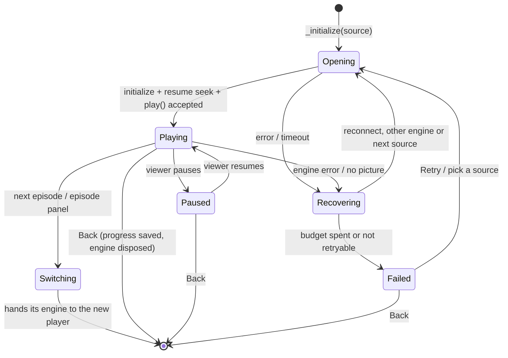

# Playback lifecycle

What a player session does from the moment `PlayerScreen` opens until it
closes. All of it is in `_CustomVideoPlayerState`
([`custom_video_player.dart`](../../lib/src/widgets/player/custom_video_player.dart)),
shared by every platform. The generated
[function reference](../codebase/function-reference.md) links each method
named here to its line.

## States

## Opening (`_initialize`)

1. **Cancel the previous attempt.** Completes the previous open's
   cancellation, bumps `_initializationGeneration`, disposes the old
   controller and torrent session. Every later step checks the generation,
   so a superseded open never applies its result.
2. **Reset the view.** Loading status, controls shown, pause screen hidden.
   An OpenSubtitles choice survives a source change; embedded tracks do not.
3. **Torrent first, if needed.** `_prepareTorrent` starts a streaming
   session and replaces the source with its loopback URL.
4. **Prepare and open.** `PlaybackCoordinator.prepareAndOpen`: validate
   (`SourcePreparer`), wait for the engine gate, create the controller,
   `initialize()` within the startup timeout (20 s; 7 s for a reused cached
   link), cancellable.
5. **Tracks.** Video and audio tracks are queried together, waited for at
   most 2 s; the preferred video height (`selectPreferredVideoHeight` in
   [`video_quality_selector.dart`](../../lib/src/services/video_quality_selector.dart)),
   audio language and subtitle are applied.
6. **Speed and resume.** A non-default speed is set; then the player seeks
   to the resume point: the last position in this session, else
   `_startPosition`: a movie's history entry, or a series episode's own
   saved position (never another episode's). A resume at or past the end is
   pulled back one second.
7. **Play.** `play()` must be accepted within 10 s or it counts as a
   failure. Then `_awaitFirstFrame` logs the first frame and
   `_watchForPicture` treats 4 s of Media3 audio with no picture as a
   rendering failure (so the other engine can try).
8. **After start.** Pause artwork is precached after 4 s, orientation is
   decided once (wide video → landscape on phones), subtitle addons are
   searched, and the working source is saved as the last stream for reuse.

## While playing (`_tick`)

`_tick` listens to the controller and:

- **Saves progress** every 15 s of playback position, and immediately on
  pause (the app may be backgrounded and killed): `_saveProgress` writes the
  history entry and, for an episode, its per-episode progress.
- **Offers the next episode** once the position passes the
  `nextEpisodeThresholdPercent` setting; with auto-play on, an 8 s
  countdown starts (`_offerNextEpisode`).
- Keeps the controls visible while paused and schedules hiding while
  playing.
- **Recovers stalls:** playing but buffering in place for 25 s (60 s for a
  torrent) is handled like a dropped stream (`StallWatchdog`,
  `_onStall`): reconnect, then another source. `_recoverStalls` turns it
  off.
- **Keeps the display on** while playing (Android window flag; Windows
  `SetThreadExecutionState` through `DesktopWindow.keepDisplayOn`; on
  Windows a failure releases it, so the error screen lets the display
  sleep), and
  tells Android whether leaving the app should continue the video in
  picture in picture (`PlayerPip`).
- **Measures** the session in debug and profile builds (`PlaybackMetrics`):
  time to first frame, rebuffers, stalls and failures, printed as one
  `[Playback][Summary]` line when the player closes.

Input paths stay separate: touch gestures and double-tap seek on phones
(`GestureTouchLayer`), remote keys on TV (`_onRemoteKey`, focus kept inside
the player), pointer and keyboard on Windows (`_onPointerMove`,
`_withPointer`, and `DesktopPointerLayer`: a click plays or pauses, a double
click toggles fullscreen).

## Subtitles

- **Sources:** provider subtitle tracks on the `StreamSource`, Stremio
  subtitle addons (`SubtitleAddonService`, OpenSubtitles v3 preinstalled),
  and embedded tracks (libmpv only; Media3 does not expose text tracks
  through package:video_player).
- **Rendering:** downloaded subtitles (SRT, WebVTT, ASS/SSA) are parsed by
  `SubtitleLoader` and drawn by Reelish itself, timed by
  `ExternalCueClock`, so they look the same on every engine.
- **Choice memory:** an explicit choice is remembered per title
  (`rememberSubtitle`), and a preferred language is applied automatically.

## Switching episodes

`_playEpisode` is the only way to move to another episode (next-episode
card, countdown, the panel, Previous/Next). It saves progress, releases the
engine and torrent session (`_releaseEngine`), and calls `onPlayEpisode`,
which runs `HomeScreen._openItem` again with an `EpisodeHandOff`: the new
player replaces the old route, and the old one does not save again on
dispose (`_progressHandedOff`), so the new episode stays "watched last".

## Closing (`dispose`)

Removes listeners, cancels the discovery subscription and any rediscovery,
completes the open cancellation, saves progress (unless handed off),
cancels timers, and disposes the controller. `_EngineVideoController.dispose`
waits at most 5 s for the native engine, so a stuck libmpv dispose cannot
freeze the next screen; `PlayerEngineGate` is released either way.

After the route pops, `HomeScreen` reloads the history, so Continue watching
shows the new position.

## Tests

`playback_pipeline_test`, `playback_reliability_test`, `player_ui_test`,
`paused_overlay_test`, `episode_selection_test`, `external_cue_clock_test`,
`subtitles_test` under [`test/`](../../test), and on devices
[`player_long_session_test.dart`](../../integration_test/player_long_session_test.dart)
and [`windows_soak_test.dart`](../../integration_test/windows_soak_test.dart)
for memory over many sessions. See the [testing guide](../development/testing-guide.md).
