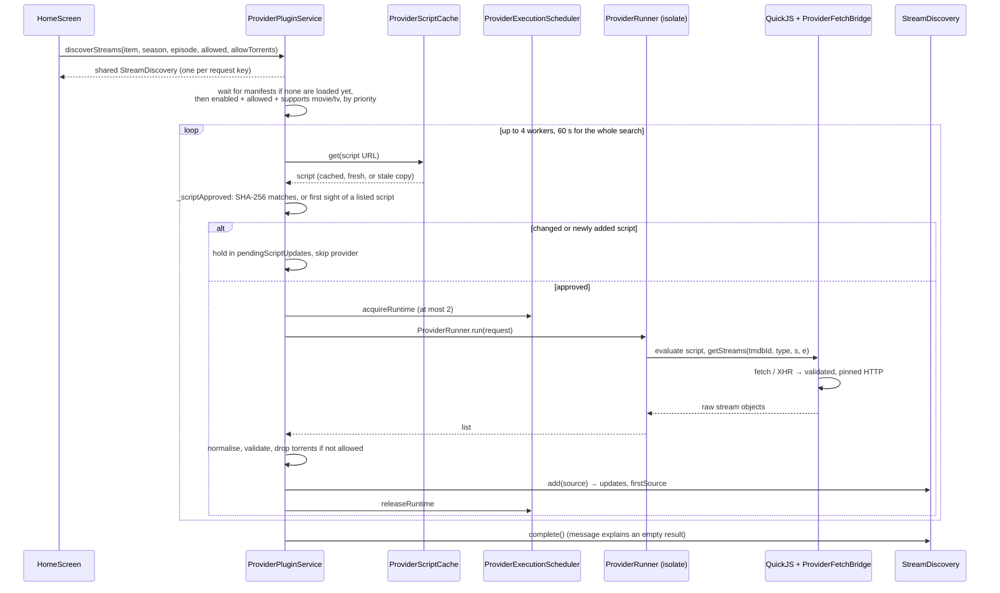

# Provider integration

Providers are third-party JavaScript scripts that find streams for a title.
Reelish installs them from repository manifests, runs each in its own
sandboxed QuickJS runtime on a background isolate, and validates everything
they return. They never populate the catalog; TMDB does.

Trust model and accepted risks: [`docs/streaming_security.md`](../streaming_security.md).
Debugging a provider: the `provider-debugging` skill in
[`.claude/skills/provider-debugging/`](../../.claude/skills/provider-debugging) and the
[troubleshooting guide](troubleshooting.md).

## Pieces

| Component | File | Responsibility |
|---|---|---|
| `ProviderPluginService` | [`provider_plugin_service.dart`](../../lib/src/services/provider_plugin_service.dart) | Repositories (install, update, remove, retry), enabled overrides, script hashes and approval, `discoverStreams` |
| `ProviderRepository`, `ProviderPlugin` | [`provider_plugin.dart`](../../lib/src/models/provider_plugin.dart) | A manifest and its providers (id, name, filename, supported types, priority, enabled) |
| `StreamDiscovery` | [`stream_discovery.dart`](../../lib/src/services/stream_discovery.dart) | One lookup's sources, delivered progressively; `firstSource`, `startingSource`, `updates`, `finished`, `cancel` |
| `ProviderScriptCache` | [`provider_script_cache.dart`](../../lib/src/services/provider_script_cache.dart) | Session cache of scripts: 30 min lifetime, a copy up to 24 h old if a refresh fails, one download per URL at a time |
| `ProviderExecutionScheduler` | [`provider_execution_scheduler.dart`](../../lib/src/services/provider_execution_scheduler.dart) | 4 workers per lookup, at most 2 live QuickJS runtimes |
| `ProviderRunner` | [`provider_runner.dart`](../../lib/src/services/provider_runner.dart) | One isolate and one QuickJS runtime per run; 64 MiB heap, interrupt after 40 s, `getStreams` 30 s, hard timeout 45 s |
| `ProviderFetchBridge` | [`provider_fetch_bridge.dart`](../../lib/src/services/provider_fetch_bridge.dart) | `fetch` and `XMLHttpRequest` for scripts on Dart HTTP: cookie jar, redirects (at most 5), 2 MiB request and response limits, 4 requests at once |
| `NetworkDestinationValidator` | [`network_target_policy.dart`](../../lib/src/services/network_target_policy.dart) | Public addresses only, every redirect re-validated, connections pinned to the validated address (no DNS rebinding), header checks |
| `StreamNormalizer`, `StreamValidator` | [`stream_normalizer.dart`](../../lib/src/services/stream_normalizer.dart), [`stream_validator.dart`](../../lib/src/services/stream_validator.dart) | Provider JSON → `StreamSource`; cheap rejection of unusable sources |
| QuickJS (vendored `flutter_js`) | [`third_party/flutter_js/`](../../third_party/flutter_js) | The JS engine; Reelish's patch adds the memory limit and interrupt (see its `REELISH_PATCH.md`) |
| Cheerio / CryptoJS bundle | [`assets/js/cheerio_bundle.js`](../../assets/js/cheerio_bundle.js) | Loaded into a run only when the script mentions `cheerio` or `crypto` |

## Resolution flow

## Repositories and script approval

- **Install.** From a manifest URL (or a supported GitHub link) in
  `ProviderInstallerModal`, or from the Plugin Library
  (`PluginInstallButton` hands the catalog's manifest to the same
  installer). The repository URL list and enabled overrides are stored by
  `StorageService`; the last manifest body is cached on disk with its HTTP
  validators.
- **Loading.** `ProviderPluginService.load` reads every repository. A
  lookup started before manifests have loaded waits for them; repositories
  that failed (often offline at launch) are retried at most every 30 s.
- **Approval.** Each script's SHA-256 is recorded the first time it runs.
  Later, changed code, and script URLs a manifest update added, wait in
  `pendingScriptUpdates` until the viewer approves them in Plugins
  (`approveScriptUpdates`). The hashes and the scripts listed at install
  are stored under `onfeed.plugin.scriptHashes.v1` and
  `onfeed.plugin.knownScripts.v1`.

## The sandbox

Each provider run gets a fresh isolate holding its own QuickJS runtime,
fetch bridge and timers:

- **Memory:** 64 MiB heap (`ProviderRunRequest.memoryLimit`).
- **Time:** the script is interrupted 40 s after the run starts, synchronous
  loops included; `getStreams` itself has 30 s; the caller stops waiting at
  45 s (`ProviderRunner.hardTimeout`) even if a native build ignores the
  interrupt, freeing the runtime slot.
- **Network:** only `fetch`/XHR through `ProviderFetchBridge`. Every request
  and redirect goes through `NetworkDestinationValidator`; `Cookie` and
  `Authorization` are not sent to another origin; responses over 2 MiB are
  refused.
- **Nothing else:** no file system, no Dart `eval` of script output, no
  secrets in the environment.

Where the native library supports them, the limits are enforced inside
QuickJS: the Android runtime and the Windows `quickjs_c_bridge.dll` (CI
checks that the DLL exports `JS_SetMemoryLimit` and
`JS_SetInterruptHandler`; `test/quickjs_windows_limits_test.dart` tests
them). Do not raise these limits or remove the interrupt to make a
provider work.

## Results to the player

Every returned entry is normalised into a `StreamSource` (provider id is
`repositoryUrl|pluginId`, matching the Playback settings keys), validated,
and filtered by the viewer's P2P setting. `StreamDiscovery` de-duplicates by
URL and headers. The player keeps listening to the same discovery while it
runs, so later sources become fallback candidates
(`CustomVideoPlayer._listenForSources`).

## Tests

`provider_runner_test`, `provider_fetch_bridge_test`,
`provider_repository_state_test`, `network_destination_validator_test`,
`stream_discovery_test`, `plugin_library_test`,
`quickjs_windows_limits_test`; on a device or Windows,
[`provider_runtime_test.dart`](../../integration_test/provider_runtime_test.dart).
