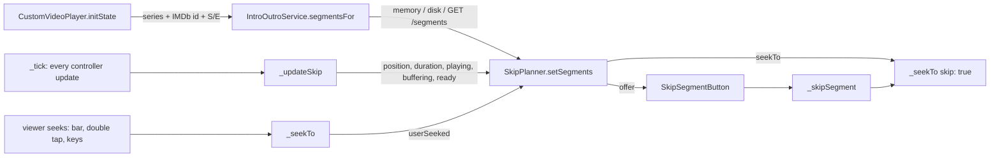

# Intro and outro skipping

Reelish skips or offers to skip TV episode intros and outros using
timestamps from [IntroDB](https://introdb.app). If Reelish is not sure a
segment belongs to the episode playing, it does nothing. The audit this
builds on is [INTRO_OUTRO_AUDIT.md](INTRO_OUTRO_AUDIT.md).

## 1. IntroDB integration

| | |
|---|---|
| Request | `GET https://api.introdb.app/segments?imdb_id=tt…&season=N&episode=N` |
| Authentication | None: IntroDB reads are anonymous. No key exists in the app |
| Transport | Direct from the app (`IntroOutroService`, `lib/src/intro_skip/intro_outro_service.dart`). Fixed HTTPS host; redirects not followed; 6 s timeout; body capped at 64 KB; generic `User-Agent: Reelish` |
| Fields used | `imdb_id`, `media_type`, `is_movie`, `season`, `episode`, `intro`, `outro` (`start_ms`, `end_ms`, `confidence`, `submission_count`), `no_intro`, `no_outro` |
| Not used | `recap`, `post_credits` (movies only), the legacy `/intro`, `/outro` (movies), `/submit` |
| Terms | Media-player skip integration is a permitted use; reads are kept to one per episode and day at most (section 9). Attribution: Settings > Playback names IntroDB, and the credits list it |

## 2. Episode identification

The player already receives the **series IMDb id** (TMDB
`/tv/{id}` `external_ids`, through `TmdbService.resolveIds`) and the TMDB
season and episode numbers. `EpisodeKey.of` accepts only an id matching
`^tt[0-9]{7,8}$` and season/episode ≥ 1. Without one (no IMDb id at TMDB, a
movie, or a missing episode number) **nothing is requested and nothing is
skipped**.

IntroDB's answer must name the same `imdb_id`, `season` and `episode` and
must not be a movie (`EpisodeSegments.fromIntroDb`). An answer about anything
else is discarded and remembered as "no data".

## 3. Metadata model

`EpisodeSegments` (`lib/src/intro_skip/skip_segments.dart`) holds an
optional `intro` and `outro` `SkipSegment`: `start`/`end` as `Duration`
from IntroDB's milliseconds, `confidence`, `submissions`. Both engines
report positions as `Duration`, so no conversion happens past parsing.

## 4. Timestamp validation

Field by field (a segment that fails is dropped; the other is kept):

- Integer milliseconds, `0 ≤ start < end ≤ 6 h`, confidence in [0, 1],
  integer submission count.
- Length 5 s–5 min for an intro, 5 s–15 min for an outro.
- `no_intro` / `no_outro` true → that segment is ignored even if present.

Against the stream that is playing (`EpisodeSegments.forStream`). IntroDB
has no duration or release field, so this is the version check:

- The stream must be at least 3 minutes long.
- The intro must end in the first half of the stream.
- The outro must start in the second half and end no more than 5 s past
  the end.
- If the intro and outro overlap, neither is used.

**Trust levels:**

| Data | Behaviour |
|---|---|
| confidence ≥ 0.7 and ≥ 2 submissions | May be skipped automatically |
| confidence ≥ 0.5 and ≥ 1 submission | Skip button only |
| weaker | Nothing |

## 5. Playback integration

- **One integration point**, `CustomVideoPlayer`, for Media3 and libmpv
  on phone, TV and Windows. No engine code changed.
- **Seeks go through `_seekTo`**, the viewer's own path, so subtitles,
  audio, progress saves and Watch Party reporting behave as for any seek.
  The planner never touches the controller.
- The request starts with the stream (`initState`) and is never awaited by
  playback. Changing the setting mid-episode requests it then.
- `SkipPlanner` (`lib/src/intro_skip/skip_planner.dart`) is pure Dart.
  `ready` is false while the stream opens, switches, fails, is scrubbed or
  hands over to another episode. A new episode gets a new player, so a new
  planner.

## 6. Automatic skip rules

A segment is skipped automatically only when all of these hold:

- Its mode is Skip automatically.
- The data is strong enough (section 4).
- The player is not in a Watch Party.
- Playback is playing and not buffering, and the player is ready.
- The position is inside the segment (from 0.5 s before its start to
  1.5 s before its end).
- The segment is still armed.
- The target is ahead of the position, so a skip is never backwards.

After a skip, the planner decides nothing until the position reaches the
target or 4 s pass. A skip that never lands is not retried.

Segment state per session:

| Event | Effect |
|---|---|
| Automatic skip or button | Done: never automatic again |
| Viewer seeks into the segment | Disarmed: watched on purpose, button only |
| Viewer seeks past it | Done |
| Viewer seeks back before it, or replays from the end | Armed again |
| Continue watching resumes inside it | Still armed: skipped (the resume seek is the player's, not the viewer's) |
| Data arrives after the segment | Nothing; data arriving while inside it skips forward |

Skipping the outro lands on IntroDB's credits end, which IntroDB's
guidelines place before any post-credits scene. When the credits run to the
end, the skip lands at the end, and the usual next-episode offer follows.

## 7. Manual skip

`SkipSegmentButton` (`lib/src/widgets/player/skip_segment_button.dart`)
shows "Skip intro" or "Skip outro" bottom-right while the segment plays. That
spot is clear of the centred subtitles, and the button moves above the bottom
bar while the controls show. Input:

- **Touch:** tap.
- **Mouse:** click.
- **Remote and keyboard:** a focused button takes Select or Enter. While the
  controls are hidden on TV or Windows, Select or Enter presses it
  (`_onRemoteKey`) instead of showing the controls.
- **Focus:** the button fills with the accent when focused.

It gives way to the next-episode card. The button also shows in Skip
automatically mode when the automatic skip doesn't apply: weak data, paused,
a party, or a viewer seek into the segment.

## 8. Preferences

Settings > Playback > **Intro & outro** (phone, TV and Windows share the
page):

| Setting | Choices | Default |
|---|---|---|
| Intros | Skip automatically / Show Skip button / Off | Skip automatically |
| Outros | Skip automatically / Show Skip button / Off | Show Skip button |

These are stored in `PlaybackSettings` as `introSkip` / `outroSkip`. Saves
made before these fields existed read the defaults. Like the other playback
settings they are device-local; syncing them would need a backend route for
two fields. When both are Off, IntroDB is never contacted.

## 9. Cache

| Layer | Behaviour |
|---|---|
| Memory | Per session; simultaneous requests for an episode share one |
| Disk | `introdb_segments.v1.json` in the app support directory (outside backup), at most 400 episodes, written through a temporary file. Entries are read back through the same validation as IntroDB's answers |
| Found | Reused for 7 days |
| Nothing known (or another episode answered) | Reused for 24 hours |
| Failure (offline, 4xx/5xx, 429, bad JSON, oversize, timeout) | Not cached; the episode is not asked again for 10 minutes |

So an episode is asked about at most once a day, and replaying, reopening
or switching source asks nothing.

## 10. Security

- No credentials exist or are needed. Nothing is logged.
- The response is untrusted: identity-checked, range-checked and
  plausibility-checked against the stream. It can only cause one forward
  seek within the stream, through the normal seek path, once per segment.
- The host is fixed and redirects are refused, so a response cannot move
  requests elsewhere. The body size and the request time are capped.
- Privacy: IntroDB receives the device's IP address and which series and
  episode is played. The privacy policy (Settings > Legal) says so, and
  turning both settings Off stops it.

## 11. Platforms

| Platform | Engine | Notes |
|---|---|---|
| Android phone | Media3, libmpv fallback | Tap the button |
| Android TV / Google TV | Media3, libmpv fallback | Larger button; Select skips while controls are hidden; focusable with controls up |
| Windows | libmpv | Click, or Enter while the player has focus |

## 12. Tests

| File | Covers | Result |
|---|---|---|
| `test/intro_skip_test.dart` (36) | Key validation; the documented response; identity mismatch; malformed and impossible segments; `no_*` flags; stream checks (other cut, short stream, past the end, overlap, unknown duration); planner cases 1–18 from the brief (intro+outro, intro only, none, invalid, resume inside, seek into, seek past, pause, seek during skip, buffering, engine switch, late data, seek before data, disposed, unusual duration, other cut); weak data; button; a skip that never lands; outro automatic and clamped; Watch Party; Off; service: the exact request URL, memory and disk reuse across launches, shared simultaneous requests, miss TTL, every failure kind not cached plus cooldown, redirect refused, other-episode answer, corrupt cache; settings migration and round trip | Pass |
| `test/intro_skip_player_test.dart` (5) | Through the real `PlayerScreen` with the scripted engine: automatic intro skip lands at the intro end, once; outro offered, not skipped; cached answer used; phone tap; TV remote Select; no IMDb id → nothing asked or skipped; both Off → IntroDB not asked | Pass |

The service tests caught a deadlock before it shipped: the in-flight
cleanup returned the future it was attached to, so the first lookup of
every episode would never have completed.

**Live API check** (2026-11-13, the docs' own example): `GET
/segments?imdb_id=tt0903747&season=1&episode=1` answered 200 with exactly
the documented fields: `no_intro: true`, and an outro 3431–3500 s with
`confidence: 1` from **one** submission. That is why automatic skipping
also needs two submissions: confidence alone would have allowed it. With
the defaults this outro gets a Skip outro button. An unknown episode
(`season=9&episode=99`) answered 200 with every segment `null`, as
documented.

**Not verified:** Media3 and libmpv on devices (the fake engine
stands in, and both engines expose the same controller); TV and Windows
focus on real hardware; request latency, memory and startup timing (not
measured; the request is asynchronous and cached, but no numbers are
claimed).

## 13. Known limitations

- IntroDB has no release, cut or duration information. The stream checks
  catch gross mismatches, but not a different cut whose intro moved a few
  seconds. The trust thresholds and the button reduce, but do not remove,
  that risk.
- TMDB and IMDb episode numbering can differ (specials, some anime). A
  numbering difference can match the wrong episode; the identity and stream
  checks catch some of these cases, not all.
- Recaps and movie end credits are available from IntroDB but are not used
  yet.
- No automatic skip in a Watch Party.
- The preferences are device-local.
